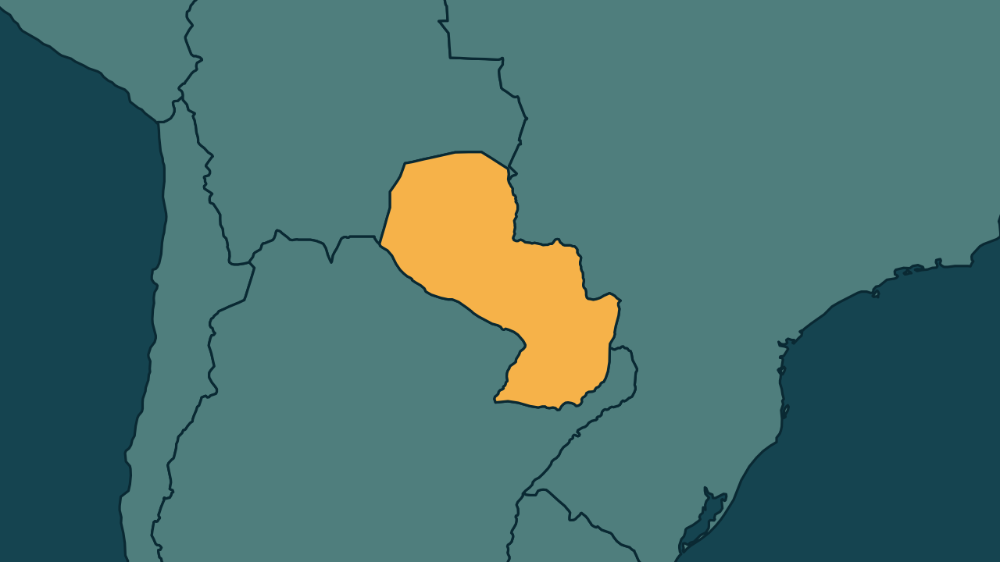

# Peña pede 72 horas para se defender de impeachment no Paraguai

*Heimdall News, edição internacional. 6 de novembro de 2026*

## A notícia

O presidente do Paraguai, Santiago Peña, pediu ao Congresso nesta sexta-feira mais 72 horas para preparar a defesa no processo de impeachment. [1]

O processo nasceu do escândalo do Ueno Bank. O colapso do banco congelou os depósitos de milhões de clientes e levou a protestos. [2]

Na quinta-feira, a Câmara aprovou a abertura do processo por unanimidade. Para destituir Peña, são necessários 30 votos dos 45 senadores. [3][4]

Peña apresentou a renúncia, mas segue no cargo, porque o Congresso não analisou o pedido por falta de quórum. [5][6]

## Quem se manifestou

- **Santiago Peña, paraguaio, presidente:** afirmou que um prazo inferior a doze horas é insuficiente para cumprir os padrões de um Estado de Direito. [7]
- **Basilio Núñez, paraguaio, presidente do Senado:** sinalizou que pretende manter o cronograma do julgamento. [8]
- **Rúben Velázquez, paraguaio, senador:** defendeu que o processo siga sem adiamentos. [9]
- **Celeste Amarilla, paraguaia, senadora:** afirmou que aceitaria a prorrogação, com um prazo de ao menos 48 horas. [10]

## Reação no Brasil

- **Celso Amorim, brasileiro, assessor especial da Presidência:** expressou esperança de que o episódio permita uma maior aproximação do Paraguai ao Mercosul e ao Brasil. [11]

## Fontes

1. Folha de S.Paulo, [Presidente do Paraguai pede mais tempo para apresentar defesa no processo de impeachment no Senado](https://www1.folha.uol.com.br/mundo/2026/11/presidente-do-paraguai-pede-mais-tempo-para-apresentar-defesa-no-processo-de-impeachment-no-senado.shtml): "pediu ao Congresso nesta sexta-feira (6) uma prorrogação de 72 horas para preparar sua defesa no processo de impeachment"
2. Folha de S.Paulo, [Presidente do Paraguai pede mais tempo para apresentar defesa no processo de impeachment no Senado](https://www1.folha.uol.com.br/mundo/2026/11/presidente-do-paraguai-pede-mais-tempo-para-apresentar-defesa-no-processo-de-impeachment-no-senado.shtml): "O colapso da instituição financeira congelou os depósitos de milhões de clientes e provocou uma onda de protestos no país."
3. Estadão, [Santiago Peña pede prazo de 72 horas para preparar defesa em processo de impeachment no Paraguai](https://www.estadao.com.br/internacional/santiago-pena-pede-prazo-de-72-horas-para-preparar-defesa-em-processo-de-impeachment-no-paraguai-npr/): "a Câmara dos Deputados aprovou por unanimidade a abertura do processo de impeachment, com 78 votos favoráveis"
4. Estadão, [Santiago Peña pede prazo de 72 horas para preparar defesa em processo de impeachment no Paraguai](https://www.estadao.com.br/internacional/santiago-pena-pede-prazo-de-72-horas-para-preparar-defesa-em-processo-de-impeachment-no-paraguai-npr/): "Para destituí-lo, são necessários 30 votos dos 45 senadores."
5. Revista Oeste, [Paraguai: Peña pede prazo de 72h para se defender de impeachment](https://revistaoeste.com/mundo/paraguai-pena-pede-prazo-de-72h-para-se-defender-de-iimpeachment-i/): "Embora tenha apresentado sua renúncia ao cargo, o presidente continua no exercício da função."
6. Revista Oeste, [Paraguai: Peña pede prazo de 72h para se defender de impeachment](https://revistaoeste.com/mundo/paraguai-pena-pede-prazo-de-72h-para-se-defender-de-iimpeachment-i/): "O Congresso ainda não conseguiu analisar o pedido por falta de quórum."
7. Brasil de Fato, [Senado do Paraguai retoma julgamento de impeachment de Peña](https://www.brasildefato.com.br/2026/11/06/senado-do-paraguai-retoma-julgamento-de-impeachment-de-pena-presidente-pede-prorrogacao-de-prazo-para-se-defender/): "um prazo inferior a 12 horas é insuficiente para que um processo cumpra os padrões de um Estado de Direito"
8. Estadão, [Santiago Peña pede prazo de 72 horas para preparar defesa em processo de impeachment no Paraguai](https://www.estadao.com.br/internacional/santiago-pena-pede-prazo-de-72-horas-para-preparar-defesa-em-processo-de-impeachment-no-paraguai-npr/): "Basilio Núñez sinalizou que pretende manter o cronograma do julgamento."
9. Folha de S.Paulo, [Presidente do Paraguai pede mais tempo para apresentar defesa no processo de impeachment no Senado](https://www1.folha.uol.com.br/mundo/2026/11/presidente-do-paraguai-pede-mais-tempo-para-apresentar-defesa-no-processo-de-impeachment-no-senado.shtml): "defendeu o seguimento do processo, sem adiamentos"
10. Folha de S.Paulo, [Presidente do Paraguai pede mais tempo para apresentar defesa no processo de impeachment no Senado](https://www1.folha.uol.com.br/mundo/2026/11/presidente-do-paraguai-pede-mais-tempo-para-apresentar-defesa-no-processo-de-impeachment-no-senado.shtml): "afirmou que aceitaria a prorrogação e que é preciso dar um prazo de, ao menos, 48 horas"
11. CNN Brasil, [O Grande Debate: Mudança no Paraguai afeta interesses do Brasil?](https://www.cnnbrasil.com.br/internacional/o-grande-debate-mudanca-no-paraguai-afeta-interesses-do-brasil/): "expressando esperança de que o episódio permita uma maior aproximação do Paraguai ao Mercosul e ao Brasil"
