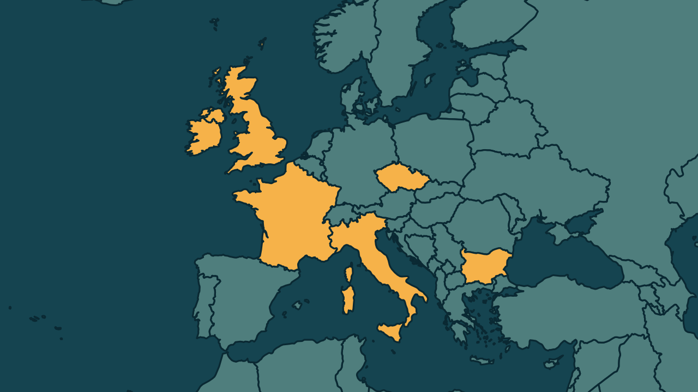

# Ameaças falsas de bomba chegam a TVs após afetar voos na Europa

*Heimdall News, edição internacional. 6 de novembro de 2026*

## A notícia

A onda de ameaças falsas de bomba na Europa chegou às emissoras de televisão nesta sexta-feira. Redações foram esvaziadas na Irlanda, no Reino Unido e na Bulgária, e a polícia não encontrou explosivos. [1][2]

A onda começou na segunda-feira. Só na quinta, pelo menos 27 voos foram afetados, com desvios e escolta de caças. Nesta sexta, até o meio da tarde na Europa, foram ao menos 14 aviões. [3][4][5]

Algumas mensagens foram assinadas pelo Estado Masculino, movimento russo proibido em 2021, mas não há confirmação de que ele tenha participado. O Kremlin nega ligação com atos desse tipo na Europa. [6][7][8]

## Quem se manifestou

- **Governo da Irlanda, Irlanda:** afirmou em nota que não se sabe quem é responsável, mas que parece provável uma campanha coordenada. [9][10]
- **Giorgia Meloni, italiana, primeira-ministra:** afirmou que os incidentes sugerem um ataque à infraestrutura civil europeia e pediu unidade no continente. [11][12]
- **União Europeia:** afirmou que ainda é cedo para tirar conclusões sobre uma ligação entre os incidentes. [13]
- **Vladislav Pozdniakov, russo, fundador do Estado Masculino:** negou ligação com as ameaças e afirmou que o grupo não existe desde 2021. [14][15]

## Reação no Brasil

Nenhum posicionamento encontrado.

## Fontes

1. Folha de S.Paulo, [Onda de ameaças falsas de bomba chega a TVs na Europa](https://www1.folha.uol.com.br/mundo/2026/11/onda-de-ameacas-falsas-de-bomba-chega-a-tvs-na-europa.shtml): "Emails ameaçadores foram enviados para diversas emissoras, como a irlandesa RTE, a britânica Sky News, a búlgara Nova TV e outras."
2. Folha de S.Paulo, [Onda de ameaças falsas de bomba chega a TVs na Europa](https://www1.folha.uol.com.br/mundo/2026/11/onda-de-ameacas-falsas-de-bomba-chega-a-tvs-na-europa.shtml): "Os funcionários deixaram os prédios, mas em nenhum caso a polícia localizou explosivos."
3. Revista Oeste, [Voo para Tel Aviv passa por inspeção em Bucareste por ameaça de bomba](https://revistaoeste.com/mundo/voo-para-tel-aviv-passa-por-inspecao-em-bucareste-por-ameaca-de-bomba/): "A onda começou na segunda-feira 2"
4. Folha de S.Paulo, [Alertas de bomba afetam 27 voos na Europa, e aviões desviam e pousam às pressas; nenhum explosivo foi achado](https://www1.folha.uol.com.br/mundo/2026/11/alertas-de-bomba-afetam-14-voos-na-europa-e-avioes-desviam-e-pousam-as-pressas.shtml): "Pelo menos 27 voos foram afetados nesta quinta-feira (5)"
5. Folha de S.Paulo, [Onda de ameaças falsas de bomba chega a TVs na Europa](https://www1.folha.uol.com.br/mundo/2026/11/onda-de-ameacas-falsas-de-bomba-chega-a-tvs-na-europa.shtml): "Nesta sexta, só até o meio da tarde (final da manhã no Brasil), ao menos 14 aviões foram afetados."
6. G1, [Ameaças de bomba na Europa: aeroportos receberam carta assinada por membros do grupo russo 'Estado Masculino'; fundador nega](https://g1.globo.com/mundo/noticia/2026/11/06/ameacas-de-bomba-na-europa-aeroportos-receberam-carta-assinada-por-membros-do-grupo-russo-estado-masculino-fundador-nega.ghtml): "receberam mensagens assinadas por supostos "combatentes do Estado Masculino""
7. Metrópoles, [Grupo extremista russo é citado em ameaças de bombas em voos na Europa](https://www.metropoles.com/mundo/grupo-extremista-russo-e-citado-em-ameacas-de-bombas-em-voos-na-europa): "não há confirmação de que a organização tenha participado dos episódios"
8. Folha de S.Paulo, [Onda de ameaças falsas de bomba chega a TVs na Europa](https://www1.folha.uol.com.br/mundo/2026/11/onda-de-ameacas-falsas-de-bomba-chega-a-tvs-na-europa.shtml): "O Kremlin nega qualquer ligação com atos do tipo na Europa."
9. Folha de S.Paulo, [Onda de ameaças falsas de bomba chega a TVs na Europa](https://www1.folha.uol.com.br/mundo/2026/11/onda-de-ameacas-falsas-de-bomba-chega-a-tvs-na-europa.shtml): "Ainda não se sabe quem é responsável, se é um esforço individual ou coordenado"
10. Folha de S.Paulo, [Onda de ameaças falsas de bomba chega a TVs na Europa](https://www1.folha.uol.com.br/mundo/2026/11/onda-de-ameacas-falsas-de-bomba-chega-a-tvs-na-europa.shtml): "parece provável que essa é uma campanha coordenada"
11. Folha de S.Paulo, [Onda de ameaças falsas de bomba chega a TVs na Europa](https://www1.folha.uol.com.br/mundo/2026/11/onda-de-ameacas-falsas-de-bomba-chega-a-tvs-na-europa.shtml): "o que está sendo atacado é a infraestrutura civil"
12. Folha de S.Paulo, [Onda de ameaças falsas de bomba chega a TVs na Europa](https://www1.folha.uol.com.br/mundo/2026/11/onda-de-ameacas-falsas-de-bomba-chega-a-tvs-na-europa.shtml): "pediu unidade no continente para enfrentar as ameaças"
13. Folha de S.Paulo, [Alertas de bomba afetam 27 voos na Europa, e aviões desviam e pousam às pressas; nenhum explosivo foi achado](https://www1.folha.uol.com.br/mundo/2026/11/alertas-de-bomba-afetam-14-voos-na-europa-e-avioes-desviam-e-pousam-as-pressas.shtml): "A União Europeia afirmou que ainda é cedo para tirar conclusões sobre uma possível ligação entre os incidentes"
14. G1, [Ameaças de bomba na Europa: aeroportos receberam carta assinada por membros do grupo russo 'Estado Masculino'; fundador nega](https://g1.globo.com/mundo/noticia/2026/11/06/ameacas-de-bomba-na-europa-aeroportos-receberam-carta-assinada-por-membros-do-grupo-russo-estado-masculino-fundador-nega.ghtml): "negou, nesta sexta-feira (6), qualquer ligação com as falsas ameaças de bomba"
15. G1, [Ameaças de bomba na Europa: aeroportos receberam carta assinada por membros do grupo russo 'Estado Masculino'; fundador nega](https://g1.globo.com/mundo/noticia/2026/11/06/ameacas-de-bomba-na-europa-aeroportos-receberam-carta-assinada-por-membros-do-grupo-russo-estado-masculino-fundador-nega.ghtml): "simplesmente não existe desde 2021"
