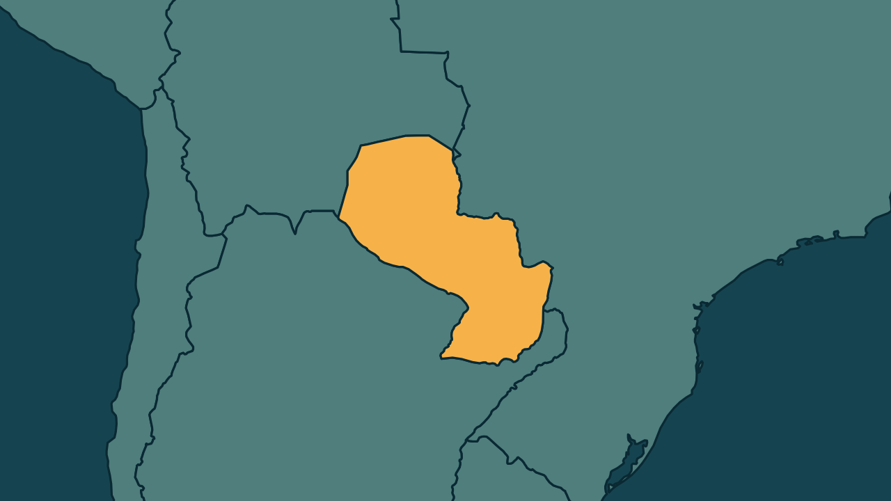

# Peña sofre impeachment e é preso; Alliana assume o Paraguai

*Heimdall News, edição internacional. 6 de novembro de 2026*

## A notícia

O Senado do Paraguai aprovou nesta sexta-feira o impeachment do presidente Santiago Peña, com 44 dos 45 senadores a favor. [1]

Logo depois, o Ministério Público ordenou a prisão de Peña e do ex-presidente do Banco Central, Carlos Carvallo. Peña ficou detido em casa e deve se apresentar aos promotores neste sábado. [2][3][4]

Os dois são investigados na crise do Ueno Bank, cuja intervenção deixou quase 3 milhões de clientes sem acesso aos serviços do banco. [5][6]

O vice, Pedro Alliana, tomou posse e deve completar o mandato, que vai até agosto de 2028. Manifestantes protestaram contra a posse do lado de fora do Congresso. [7][8][9]

## Quem se manifestou

- **Santiago Peña, paraguaio, ex-presidente:** negou ter participado de irregularidades e afirmou que apresentou a renúncia para evitar mais danos ao país. [10][11]
- **Pedro Alliana, paraguaio, presidente:** prometeu, no discurso de posse, que os afetados serão compensados plenamente, sem dar detalhes de como fará isso. [12][13]
- **Cristian Benítez, paraguaio, promotor:** disse que as classificações penais do mandado são preliminares. [14]
- **Efraín Alegre, paraguaio:** afirmou, na véspera do impeachment, que a responsabilidade não é só de Peña, mas também de Alliana e do Banco Central. [15]

## Reação no Brasil

- **Celso Amorim, brasileiro, assessor especial da Presidência:** manifestou, ao comentar a renúncia, o desejo de que o Paraguai se afaste do Escudo das Américas, grupo criado por Donald Trump. [16]
- **Leonardo Bortolleto, brasileiro, empresário:** afirmou, ao comentar a renúncia, que é precipitado dizer para qual direção política o país seguirá. [17]

## Fontes

1. Poder360, [Pedro Alliana toma posse como novo presidente do Paraguai](https://www.poder360.com.br/poder-internacional/pedro-alliana-assume-a-presidencia-do-paraguai/): "O Senado do Paraguai aprovou o impeachment por unanimidade, nesta 6ª feira (6.nov.2026). 44 dos 45 senadores estavam presentes e votaram a favor."
2. CNN Brasil, [MP do Paraguai ordena prisão de Santiago Peña e ex-presidente do BC](https://www.cnnbrasil.com.br/internacional/mp-do-paraguai-ordena-prisao-de-santiago-pena-e-ex-presidente-do-bc/): "O Ministério Público do Paraguai ordenou nesta sexta-feira (6) a prisão do ex-presidente Santiago Peña e do ex-presidente do Banco Central do país"
3. Gazeta do Povo, [Santiago Peña é preso em regime domiciliar após impeachment](https://www.gazetadopovo.com.br/mundo/pena-preso-paraguai-apos-impeachment/): "A Polícia Nacional confirmou que Peña já está detido em sua residência"
4. Gazeta do Povo, [Santiago Peña é preso em regime domiciliar após impeachment](https://www.gazetadopovo.com.br/mundo/pena-preso-paraguai-apos-impeachment/): "Ele deve se apresentar perante o MP paraguaio neste sábado (7)."
5. Revista Oeste, [Justiça do Paraguai manda prender Santiago Peña](https://revistaoeste.com/mundo/justica-do-paraguai-manda-prender-santiago-pena/): "Ambos são investigados por suspeitas de irregularidades relacionadas à crise do Ueno Bank"
6. Metrópoles, [Queda de presidente do Paraguai abala “nova direita” na América Latina](https://www.metropoles.com/mundo/queda-de-presidente-do-paraguai-abala-nova-direita-na-america-latina): "A medida suspendeu as operações do banco e deixou quase 3 milhões de clientes sem acesso aos serviços financeiros"
7. G1, [Pedro Alliana toma posse como presidente do Paraguai após impeachment de Santiago Peña](https://g1.globo.com/mundo/noticia/2026/11/06/pedro-alliana-toma-posse-como-presidente-do-paraguai-apos-impeachment-de-santiago-pena.ghtml): "O vice-presidente do Paraguai, Pedro Alliana, tomou posse como presidente do país nesta sexta-feira (6)"
8. Gazeta do Povo, [Pedro Alliana assume Presidência do Paraguai após impeachment de Peña](https://www.gazetadopovo.com.br/mundo/pedro-alliana-assume-presidencia-do-paraguai-apos-impeachment-de-pena/): "Alliana deve completar o mandato de Peña, que está previsto para terminar em 15 de agosto de 2028"
9. Folha de S.Paulo, [Após impeachment, Santiago Peña é preso em sua casa no Paraguai](https://www1.folha.uol.com.br/mundo/2026/11/apos-impeachment-ministerio-publico-do-paraguai-ordena-detencao-imediata-de-ex-presidente.shtml): "manifestantes nas ruas do lado de fora do Congresso protestam contra o juramento de Alliana"
10. Gazeta do Povo, [Santiago Peña é preso em regime domiciliar após impeachment](https://www.gazetadopovo.com.br/mundo/pena-preso-paraguai-apos-impeachment/): "Peña nega ter interferido na fiscalização bancária ou participado de irregularidades financeiras."
11. Metrópoles, [Peña publica "despedida" e diz que renunciou para evitar danos ao Paraguai](https://www.metropoles.com/mundo/pena-publica-despedida-e-diz-que-renunciou-para-evitar-danos-ao-paraguai): "Apresentei minha renúncia para evitar mais danos ao país e contribuir para devolver a tranquilidade ao Paraguai."
12. Folha de S.Paulo, [Após impeachment, Santiago Peña é preso em sua casa no Paraguai](https://www1.folha.uol.com.br/mundo/2026/11/apos-impeachment-ministerio-publico-do-paraguai-ordena-detencao-imediata-de-ex-presidente.shtml): "em consequência de um descalabro financeiro, serão compensados plenamente"
13. Folha de S.Paulo, [Após impeachment, Santiago Peña é preso em sua casa no Paraguai](https://www1.folha.uol.com.br/mundo/2026/11/apos-impeachment-ministerio-publico-do-paraguai-ordena-detencao-imediata-de-ex-presidente.shtml): "Ele, contudo, não deu detalhes de como fará isso."
14. G1, [Santiago Peña, ex-presidente do Paraguai, é preso em Assunção](https://g1.globo.com/mundo/noticia/2026/11/06/justica-do-paraguai-determina-prisao-de-santiago-pena.ghtml): "Ele disse, em entrevista à imprensa paraguaia, entretanto, que essas são classificações penais preliminares."
15. Folha de S.Paulo, [Peña renunciou para não ser preso e vice é parte da equipe que roubou Paraguai, diz opositor](https://www1.folha.uol.com.br/mundo/2026/11/pena-renunciou-para-nao-ser-preso-e-vice-e-parte-da-equipe-que-roubou-paraguai-diz-opositor.shtml): "Há responsabilidade não apenas de Peña, mas de Alliana, vice-presidente, e também do Banco Central do Paraguai"
16. CNN Brasil, [O Grande Debate: Mudança no Paraguai afeta interesses do Brasil?](https://www.cnnbrasil.com.br/internacional/o-grande-debate-mudanca-no-paraguai-afeta-interesses-do-brasil/): "Amorim também manifestou o desejo de que o Paraguai se afaste do chamado “Escudo das Américas”, grupo criado pelo presidente americano, Donald Trump"
17. CNN Brasil, [O Grande Debate: Mudança no Paraguai afeta interesses do Brasil?](https://www.cnnbrasil.com.br/internacional/o-grande-debate-mudanca-no-paraguai-afeta-interesses-do-brasil/): "é precipitado afirmar para qual direção política o país seguirá após a renúncia"
