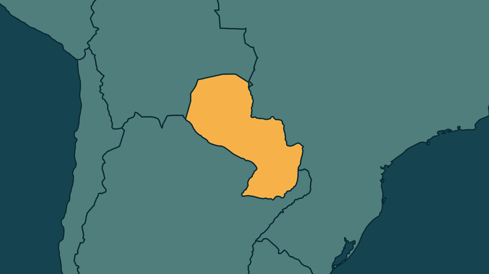

# Paraguai já pagou 1 milhão de clientes do Ueno Bank, diz Alliana

*Heimdall News, edição internacional. 7 de novembro de 2026*

## A notícia

O presidente do Paraguai, Pedro Alliana, disse neste sábado que mais de 1 milhão de clientes do Ueno Bank já receberam compensação do Estado. [1]

O banco digital tinha cerca de 3 milhões de clientes e sofreu intervenção do Banco Central, que viu o índice de solvência cair para menos da metade do mínimo legal. [2][3]

O fundo de garantia cobre até cerca de 200 mil reais por cliente. [4]

A crise chegou aos serviços públicos: os bombeiros voluntários operam com menos veículos, e 32 mil aposentados que recebiam pelo Ueno serão pagos por outros bancos no dia 17. [5][6]

## Quem se manifestou

- **Pedro Alliana, paraguaio, presidente:** prometeu que os afetados serão plenamente compensados, com prioridade aos menos favorecidos, e cobrou resultados de quem cuida da resposta. [7][8][9]
- **Corpo de Bombeiros Voluntários do Paraguai, Paraguai:** informou que cerca de 2 bilhões de guaranis arrecadados estão congelados no banco, o que compromete a continuidade dos serviços de emergência. [10][11]
- **Mirtha Arias, paraguaia, conselheira da previdência:** garantiu que os pensionistas receberão integralmente no dia 17 de novembro. [12][13]

## Reação no Brasil

- **Luciano Hang, brasileiro, empresário:** disse que o escândalo não mudou sua opinião sobre o Paraguai e que as instituições do país estão funcionando corretamente. [14][15]
- **Luiz Fernando Nóbrega, brasileiro, contador:** afirmou que empresários que pensavam em abrir negócios no Paraguai adiaram os planos, mas que o país logo voltará a ser uma opção forte. [16][17]

## Fontes

1. CNN Brasil, [Paraguai: 1 milhão de clientes já foram indenizados em crise do Ueno Bank](https://www.cnnbrasil.com.br/internacional/paraguai-1-milhao-de-clientes-ja-foram-indenizados-em-crise-do-ueno-bank/): "Alliana informou que mais de um milhão de correntistas da instituição financeira liquidada já receberam uma compensação estatal"
2. Metrópoles, [Novo presidente do Paraguai promete ressarcir vítimas de crise bancária](https://www.metropoles.com/mundo/novo-presidente-do-paraguai-promete-ressarcir-vitimas-de-crise-bancaria): "tinha aproximadamente 3 milhões de clientes em um país com cerca de 7 milhões de habitantes"
3. CartaCapital, [Banco Central do Paraguai começa a devolver dinheiro dos clientes do Ueno Bank](https://www.cartacapital.com.br/mundo/banco-central-do-paraguai-comeca-a-devolver-dinheiro-dos-clientes-do-ueno-bank/): "O índice de solvência caiu para 5,56%, menos da metade dos 12% exigidos pela legislação paraguaia."
4. Poder360, [Paraguai garante depósitos do Ueno Bank em até R$ 200 mil](https://www.poder360.com.br/poder-internacional/paraguai-garante-depositos-do-ueno-bank-em-ate-r-200-mil/): "O valor equivale a 228,3 milhões de guaranis, aproximadamente R$ 200 mil."
5. Metrópoles, [Crise bancária que derrubou presidente afeta serviços públicos no Paraguai](https://www.metropoles.com/mundo/como-crise-bancaria-afetou-servicos-publicos-paraguai): "O Corpo de Bombeiros Voluntários do Paraguai foi a primeira instituição afetada concretamente, tendo que operar com a capacidade de veículos reduzida."
6. CNN Brasil, [Paraguai: 1 milhão de clientes já foram indenizados em crise do Ueno Bank](https://www.cnnbrasil.com.br/internacional/paraguai-1-milhao-de-clientes-ja-foram-indenizados-em-crise-do-ueno-bank/): "cerca de 32 mil aposentados que recebiam seus benefícios através do Ueno Bank serão pagos por outros bancos no dia 17 deste mês"
7. CNN Brasil, [Paraguai: 1 milhão de clientes já foram indenizados em crise do Ueno Bank](https://www.cnnbrasil.com.br/internacional/paraguai-1-milhao-de-clientes-ja-foram-indenizados-em-crise-do-ueno-bank/): "serão plenamente compensados. Não os deixaremos sozinhos"
8. CNN Brasil, [Paraguai: 1 milhão de clientes já foram indenizados em crise do Ueno Bank](https://www.cnnbrasil.com.br/internacional/paraguai-1-milhao-de-clientes-ja-foram-indenizados-em-crise-do-ueno-bank/): "ressarcir os poupadores, dando prioridade aos menos favorecidos"
9. Gazeta do Povo, [Novo presidente do Paraguai promete ajudar clientes que foram afetados pela quebra do Ueno Bank](https://www.gazetadopovo.com.br/mundo/novo-presidente-do-paraguai-promete-ajudar-clientes-que-foram-afetados-pela-quebra-do-ueno-bank/): "Não quero ninguém indeciso encarregado desta missão. Quero resultados"
10. Metrópoles, [Crise bancária que derrubou presidente afeta serviços públicos no Paraguai](https://www.metropoles.com/mundo/como-crise-bancaria-afetou-servicos-publicos-paraguai): "cerca de 2 bilhões de guaranis (US$ 313 mil) arrecadados durante a última coleta da organização estão congelados no Banco Ueno"
11. Metrópoles, [Crise bancária que derrubou presidente afeta serviços públicos no Paraguai](https://www.metropoles.com/mundo/como-crise-bancaria-afetou-servicos-publicos-paraguai): "capacidade operacional dos quartéis e a continuidade dos serviços de emergência"
12. Metrópoles, [Crise bancária que derrubou presidente afeta serviços públicos no Paraguai](https://www.metropoles.com/mundo/como-crise-bancaria-afetou-servicos-publicos-paraguai): "dissipou temores de falta de verbas e garantiu que os pensionistas receberão"
13. Metrópoles, [Crise bancária que derrubou presidente afeta serviços públicos no Paraguai](https://www.metropoles.com/mundo/como-crise-bancaria-afetou-servicos-publicos-paraguai): "integralmente no dia 17 de novembro"
14. Folha de S.Paulo, [Crise do Ueno freia procura de brasileiros por negócios no Paraguai, diz Câmara de Comércio](https://c-level.folha.uol.com.br/negocios/2026/11/crise-do-ueno-freia-procura-de-brasileiros-por-negocios-no-paraguai-diz-camara-de-comercio.shtml): "avalia que o escândalo envolvendo o presidente Santiago Peña não alterou sua opinião sobre o Paraguai"
15. Folha de S.Paulo, [Crise do Ueno freia procura de brasileiros por negócios no Paraguai, diz Câmara de Comércio](https://c-level.folha.uol.com.br/negocios/2026/11/crise-do-ueno-freia-procura-de-brasileiros-por-negocios-no-paraguai-diz-camara-de-comercio.shtml): "Até agora, as instituições estão funcionando corretamente."
16. Folha de S.Paulo, [Crise do Ueno freia procura de brasileiros por negócios no Paraguai, diz Câmara de Comércio](https://c-level.folha.uol.com.br/negocios/2026/11/crise-do-ueno-freia-procura-de-brasileiros-por-negocios-no-paraguai-diz-camara-de-comercio.shtml): "empresários que já consideravam abrir operações no país decidiram adiar os planos após o episódio"
17. Folha de S.Paulo, [Crise do Ueno freia procura de brasileiros por negócios no Paraguai, diz Câmara de Comércio](https://c-level.folha.uol.com.br/negocios/2026/11/crise-do-ueno-freia-procura-de-brasileiros-por-negocios-no-paraguai-diz-camara-de-comercio.shtml): "Logo o Paraguai vai voltar a ser uma opção bem forte para ser considerada"
