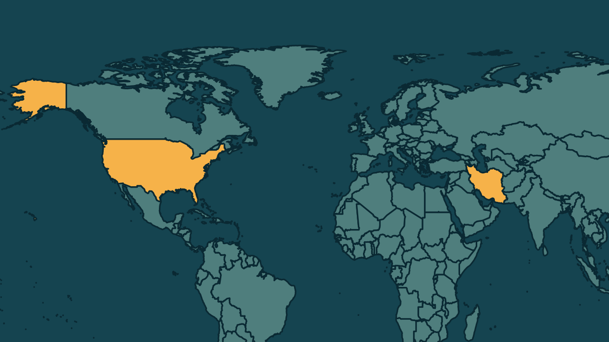

# Estados Unidos oferecem US$ 20 milhões por dados nucleares do Irã

*Heimdall News, edição internacional. 7 de novembro de 2026*

## A notícia

Os Estados Unidos ofereceram na sexta-feira uma recompensa de até 20 milhões de dólares por informações sobre o programa nuclear do Irã. [1]

A oferta, de um programa do Departamento de Estado, busca dados sobre instalações, equipamentos e cientistas, e prevê a transferência dos informantes para um local seguro. [2][3][4]

Em 2025, a Agência Internacional de Energia Atômica informou que o Irã enriquecia urânio a 60% de pureza, perto dos 90% usados em armas. [5][6]

A guerra de Estados Unidos e Israel contra o Irã começou em 28 de fevereiro, e o Catar media conversas que incluem o programa nuclear. [7][8]

## Quem se manifestou

- **Departamento de Estado, Estados Unidos:** afirmou que o Irã é o único Estado sem armas nucleares a enriquecer urânio a esse nível. [9]
- **Donald Trump, americano, presidente:** disse na quinta-feira que o Irã não faz nada sem a aprovação americana e que talvez tenha de destruir o resto do país. [10][11]
- **Governo do Irã, Irã:** advertiu que atacar suas instalações nucleares ampliaria o conflito e defendeu seu direito à energia nuclear pacífica. [12][13]

## Reação no Brasil

Nenhum posicionamento encontrado.

## Fontes

1. CNN Brasil, [EUA oferecem US$ 20 milhões por informações sobre programa nuclear do Irã](https://www.cnnbrasil.com.br/internacional/eua-oferecem-us-20-milhoes-por-informacoes-sobre-programa-nuclear-do-ira/): "oferecendo uma recompensa de até US$ 20 milhões (R$ 110 milhões) por informações sobre o programa nuclear do Irã, informou o Departamento de Estado na sexta-feira (6)"
2. Metrópoles, [EUA oferece US$ 20 milhões por informações sobre programa nuclear do Irã](https://www.metropoles.com/mundo/eua-oferece-us-20-milhoes-por-informacoes-sobre-programa-nuclear-do-ira): "Divulgada nesta sexta-feira (6/11) pela organização Rewards for Justice, que é vinculada ao Departamento de Estado"
3. Metrópoles, [EUA oferece US$ 20 milhões por informações sobre programa nuclear do Irã](https://www.metropoles.com/mundo/eua-oferece-us-20-milhoes-por-informacoes-sobre-programa-nuclear-do-ira): "busca dados sobre instalações, equipamentos, cientistas e outras pessoas associadas às atividades nucleares iranianas"
4. Metrópoles, [EUA oferece US$ 20 milhões por informações sobre programa nuclear do Irã](https://www.metropoles.com/mundo/eua-oferece-us-20-milhoes-por-informacoes-sobre-programa-nuclear-do-ira): "possibilidade de transferência dos informantes para um local seguro"
5. Metrópoles, [EUA oferece US$ 20 milhões por informações sobre programa nuclear do Irã](https://www.metropoles.com/mundo/eua-oferece-us-20-milhoes-por-informacoes-sobre-programa-nuclear-do-ira): "Em 2025, a Agência Internacional de Energia Atômica (AIEA) informou que o Irã enriquecia urânio a 60% de pureza."
6. Metrópoles, [EUA oferece US$ 20 milhões por informações sobre programa nuclear do Irã](https://www.metropoles.com/mundo/eua-oferece-us-20-milhoes-por-informacoes-sobre-programa-nuclear-do-ira): "próximo dos 90% geralmente necessários para a produção de urânio de grau militar"
7. Metrópoles, [EUA oferece US$ 20 milhões por informações sobre programa nuclear do Irã](https://www.metropoles.com/mundo/eua-oferece-us-20-milhoes-por-informacoes-sobre-programa-nuclear-do-ira): "Em 28 de fevereiro de 2026, Estados Unidos e Israel iniciaram uma ofensiva militar contra o Irã"
8. Metrópoles, [EUA oferece US$ 20 milhões por informações sobre programa nuclear do Irã](https://www.metropoles.com/mundo/eua-oferece-us-20-milhoes-por-informacoes-sobre-programa-nuclear-do-ira): "O Catar atua como intermediário nas conversas, que incluem o programa nuclear iraniano"
9. CNN Brasil, [EUA oferecem US$ 20 milhões por informações sobre programa nuclear do Irã](https://www.cnnbrasil.com.br/internacional/eua-oferecem-us-20-milhoes-por-informacoes-sobre-programa-nuclear-do-ira/): "O Irã é o único Estado que não possui armas nucleares a produzir urânio em um nível de enriquecimento tão elevado"
10. CNN Brasil, [EUA oferecem US$ 20 milhões por informações sobre programa nuclear do Irã](https://www.cnnbrasil.com.br/internacional/eua-oferecem-us-20-milhoes-por-informacoes-sobre-programa-nuclear-do-ira/): "Eles não estão fazendo nada sem a nossa aprovação"
11. G1, [Após culpar guerra no Irã por 'onda azul', Trump diz que talvez tenha que destruir 'o resto do país'](https://g1.globo.com/mundo/noticia/2026/11/05/apos-culpar-guerra-por-onda-azul-trump-diz-que-talvez-tenha-que-destruir-o-ira.ghtml): "Eu preferiria não destruir o resto do país, se possível, mas talvez eu tenha que fazê-lo"
12. CNN Brasil, [EUA oferecem US$ 20 milhões por informações sobre programa nuclear do Irã](https://www.cnnbrasil.com.br/internacional/eua-oferecem-us-20-milhoes-por-informacoes-sobre-programa-nuclear-do-ira/): "o Irã advertiu que qualquer ataque dos EUA contra suas instalações nucleares seria encarado como uma expansão do conflito na região"
13. CNN Brasil, [EUA oferecem US$ 20 milhões por informações sobre programa nuclear do Irã](https://www.cnnbrasil.com.br/internacional/eua-oferecem-us-20-milhoes-por-informacoes-sobre-programa-nuclear-do-ira/): "Teerã sustenta que tem o direito de desenvolver energia nuclear para fins pacíficos"
