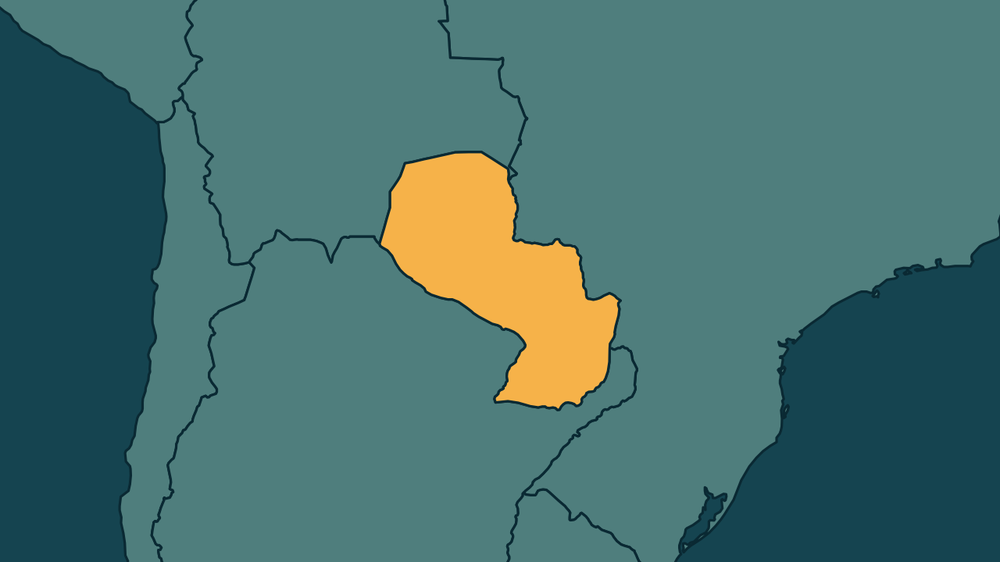

# Peña depõe após passar a noite em quartel por protestos no Paraguai

*Heimdall News, edição internacional. 7 de novembro de 2026*

## A notícia

O ex-presidente do Paraguai Santiago Peña prestou depoimento neste sábado ao Ministério Público, na investigação sobre a quebra do Ueno Bank. [1][2]

Ele passou a noite num quartel militar, para onde foi levado por segurança perto da meia-noite de sexta, depois de confrontos entre a polícia e manifestantes que cercavam a casa onde cumpria prisão domiciliar e pediam uma prisão comum. [3][4][5][6]

Peña é investigado por lesão de confiança, tráfico de influência e administração em proveito próprio. Foi acionista do grupo dono do banco até março de 2025. O banco tinha cerca de 850 milhões de dólares em depósitos públicos. [7][8][9]

Depois do depoimento, as autoridades devem decidir se ele volta ao quartel. [10]

## Quem se manifestou

- **Santiago Peña, paraguaio, ex-presidente:** nega ter cometido irregularidades. [11][12]
- **Christian Benítez, paraguaio, procurador:** disse que serão apresentados fatos e provas e que Peña pode ser acusado formalmente ainda neste sábado. [13]
- **Polícia Nacional, Paraguai:** afirmou que grupos infiltrados promoveram a violência no protesto. Segundo a imprensa local, a polícia não apresentou provas disso. [14][15]
- **Federação de Educadores do Paraguai, Paraguai:** convocou uma paralisação nacional por tempo indeterminado a partir de segunda-feira e exige garantias do Estado para as aposentadorias aplicadas no banco. [16][17]

## Reação no Brasil

Nenhum posicionamento encontrado.

## Fontes

1. Folha de S.Paulo, [Ex-presidente do Paraguai, Santiago Peña presta depoimento após ser colocado em prisão domiciliar](https://www1.folha.uol.com.br/mundo/2026/11/ex-presidente-do-paraguai-santiago-pena-presta-depoimento-apos-ser-colocado-em-prisao-domiciliar.shtml): "deixou o batalhão militar em Assunção onde passou a noite detido e foi prestar depoimento no Ministério Público"
2. Gazeta do Povo, [Santiago Peña presta depoimento por suspeitas de irregularidades no Ueno Bank](https://www.gazetadopovo.com.br/mundo/santiago-pena-presta-depoimento-por-suspeitas-de-irregularidades-no-ueno-bank/): "presta depoimento neste sábado (7), no âmbito da investigação criminal sobre o colapso do Ueno Bank"
3. Gazeta do Povo, [Após confrontos, ex-presidente do Paraguai é transferido para unidade militar](https://www.gazetadopovo.com.br/mundo/apos-confrontos-ex-presidente-do-paraguai-e-transferido-para-unidade-militar/): "a transferência ocorreu minutos antes da meia-noite de sexta-feira (6)"
4. Gazeta do Povo, [Após confrontos, ex-presidente do Paraguai é transferido para unidade militar](https://www.gazetadopovo.com.br/mundo/apos-confrontos-ex-presidente-do-paraguai-e-transferido-para-unidade-militar/): "A mudança foi realizada por razões de segurança"
5. Estadão, [Após protestos, ex-presidente do Paraguai deixa prisão domiciliar e é levado a quartel militar](https://www.estadao.com.br/internacional/ex-presidente-do-paraguai-levado-a-quartel-militar/): "Manifestantes exigiam que ele fosse levado a uma unidade prisional, e houve confronto com a polícia."
6. Estadão, [Após protestos, ex-presidente do Paraguai deixa prisão domiciliar e é levado a quartel militar](https://www.estadao.com.br/internacional/ex-presidente-do-paraguai-levado-a-quartel-militar/): "A transferência foi para o Regimiento Escolta Presidencial (REP), um quartel militar em Assunção"
7. Gazeta do Povo, [Após confrontos, ex-presidente do Paraguai é transferido para unidade militar](https://www.gazetadopovo.com.br/mundo/apos-confrontos-ex-presidente-do-paraguai-e-transferido-para-unidade-militar/): "investigado por suspeitas de lesão de confiança, tráfico de influência e administração em proveito próprio"
8. Gazeta do Povo, [Após confrontos, ex-presidente do Paraguai é transferido para unidade militar](https://www.gazetadopovo.com.br/mundo/apos-confrontos-ex-presidente-do-paraguai-e-transferido-para-unidade-militar/): "Peña foi acionista do grupo controlador do banco até março de 2025"
9. Gazeta do Povo, [Após confrontos, ex-presidente do Paraguai é transferido para unidade militar](https://www.gazetadopovo.com.br/mundo/apos-confrontos-ex-presidente-do-paraguai-e-transferido-para-unidade-militar/): "concentrava cerca de US$ 850 milhões em depósitos públicos"
10. Folha de S.Paulo, [Ex-presidente do Paraguai, Santiago Peña presta depoimento após ser colocado em prisão domiciliar](https://www1.folha.uol.com.br/mundo/2026/11/ex-presidente-do-paraguai-santiago-pena-presta-depoimento-apos-ser-colocado-em-prisao-domiciliar.shtml): "as autoridades do país devem definir se Peña voltará para a unidade militar"
11. Gazeta do Povo, [Santiago Peña presta depoimento por suspeitas de irregularidades no Ueno Bank](https://www.gazetadopovo.com.br/mundo/santiago-pena-presta-depoimento-por-suspeitas-de-irregularidades-no-ueno-bank/): "Peña nega irregularidades."
12. G1, [Em prisão domiciliar, Peña é transferido para instalação militar durante a madrugada, diz jornal](https://g1.globo.com/mundo/noticia/2026/11/07/pena-transferido-para-instalacao-militar-prisao-domiciliar.ghtml): "Peña negou ter cometido esses crimes."
13. G1, [Santiago Peña depõe à Justiça paraguaia após impeachment e prisão domiciliar](https://g1.globo.com/mundo/noticia/2026/11/07/santiago-pena-depoe-a-justica-paraguaia-apos-impeachment-e-prisao-domiciliar.ghtml): "disse à imprensa local que serão apresentados fatos e provas, e que "no decorrer da tarde" poderá ser formalmente acusado"
14. Brasil de Fato, [Após protestos, ex-presidente do Paraguai deixa prisão domiciliar e é transferido para base militar](https://www.brasildefato.com.br/2026/11/07/apos-protestos-ex-presidente-do-paraguai-deixa-prisao-domiciliar-e-e-transferido-para-base-militar/): "a polícia alegou que grupos “infiltrados” previamente identificados pela Diretoria de Inteligência teriam promovido a violência"
15. Brasil de Fato, [Após protestos, ex-presidente do Paraguai deixa prisão domiciliar e é transferido para base militar](https://www.brasildefato.com.br/2026/11/07/apos-protestos-ex-presidente-do-paraguai-deixa-prisao-domiciliar-e-e-transferido-para-base-militar/): "a corporação não apresentou provas sobre a identificação dos supostos infiltrados"
16. Brasil de Fato, [Após protestos, ex-presidente do Paraguai deixa prisão domiciliar e é transferido para base militar](https://www.brasildefato.com.br/2026/11/07/apos-protestos-ex-presidente-do-paraguai-deixa-prisao-domiciliar-e-e-transferido-para-base-militar/): "convocou uma paralisação nacional por tempo indeterminado e uma grande marcha a partir de segunda-feira (9)"
17. Brasil de Fato, [Após protestos, ex-presidente do Paraguai deixa prisão domiciliar e é transferido para base militar](https://www.brasildefato.com.br/2026/11/07/apos-protestos-ex-presidente-do-paraguai-deixa-prisao-domiciliar-e-e-transferido-para-base-militar/): "A entidade exige garantias estatais para proteger os recursos da Caja Fiscal e os aportes de aposentadorias"
