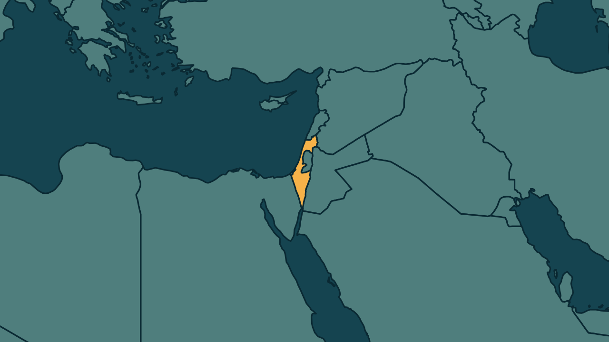

# Israel: Herzog escolhe rival de Netanyahu para tentar formar governo

*Heimdall News, edição internacional. 7 de novembro de 2026*

## A notícia

O presidente de Israel, Isaac Herzog, escolheu no sábado Gadi Eisenkot, principal adversário do primeiro-ministro Benjamin Netanyahu, para tentar formar o novo governo. [1]

Eisenkot foi indicado por 67 dos 120 deputados, contra 46 de Netanyahu. Entre eles estão os 19 de dois partidos árabes, que ele não pretende pôr no governo. [2][3]

Nas eleições de 27 de outubro, o bloco de Netanyahu ficou com 53 cadeiras, abaixo das 61 necessárias para a maioria. [4]

Eisenkot recebe o mandato no domingo e terá 28 dias para formar o governo, com possível prorrogação de 14. Netanyahu segue no cargo até a posse de um novo governo. [5][6]

## Quem se manifestou

- **Gadi Eisenkot, israelense, ex-chefe das Forças Armadas:** escreveu que é o momento de formar um governo de emergência nacional. [7]
- **Benjamin Netanyahu, israelense, primeiro-ministro:** afirmou que, com um governo minoritário apoiado pelos partidos árabes, Israel simplesmente não sobreviverá. [8][9]
- **Avigdor Liberman, israelense, ex-ministro da Defesa:** descartou um governo dependente dos partidos árabes e defendeu uma coalizão com os ultraortodoxos. [10][11]
- **Yousef Jabareen, israelense:** disse que a escolha não é entre o bom e o melhor, mas entre o ruim e o ainda pior. [12]

## Reação no Brasil

Nenhum posicionamento encontrado.

## Fontes

1. G1, [Presidente de Israel escolhe rival de Netanyahu para tentar formar novo governo](https://g1.globo.com/mundo/noticia/2026/11/07/presidente-de-israel-escolhe-rival-de-netanyahu-para-tentar-formar-novo-governo.ghtml): "O presidente de Israel, Isaac Herzog, escolheu neste sábado (7) Gadi Eisenkot, principal adversário do primeiro-ministro Benjamin Netanyahu, para tentar formar um novo governo."
2. CNN Brasil, [Presidente de Israel escolhe maior rival de Netanyahu para formar governo](https://www.cnnbrasil.com.br/internacional/presidente-de-israel-escolhe-maior-rival-de-netanyahu-para-formar-governo/): "Eisenkot garantiu o apoio de 67 membros do novo Knesset, incluindo 19 dos dois partidos árabes. Netanyahu recebeu apenas 46 recomendações."
3. G1, [Presidente de Israel escolhe rival de Netanyahu para tentar formar novo governo](https://g1.globo.com/mundo/noticia/2026/11/07/presidente-de-israel-escolhe-rival-de-netanyahu-para-tentar-formar-novo-governo.ghtml): "Eisenkot já afirmou que não pretende incluí-los no governo."
4. Folha de S.Paulo, [Presidente de Israel escolhe Gadi Eisenkot, rival de Netanyahu, para tentar formar governo](https://www1.folha.uol.com.br/mundo/2026/11/presidente-de-israel-escolhe-gadi-eisenkot-rival-de-netanyahu-para-tentar-formar-governo.shtml): "a coalizão nacionalista-religiosa mais ampla de Netanyahu obteve apenas 53 no total, abaixo das 61 necessárias para a maioria"
5. Brasil de Fato, [Rival de Netanyahu recebe apoio da maioria em Israel, mas rejeita governar com partidos árabes; decisão sobre futuro governo é neste domingo](https://www.brasildefato.com.br/2026/11/07/rival-de-netanyahu-recebe-apoio-da-maioria-em-israel-mas-rejeita-governar-com-partidos-arabes-decisao-sobre-futuro-governo-e-neste-domingo/): "Eisenkot receberá formalmente o mandato neste domingo (8) e terá 28 dias para formar governo, com possibilidade de prorrogação por mais 14."
6. Brasil de Fato, [Rival de Netanyahu recebe apoio da maioria em Israel, mas rejeita governar com partidos árabes; decisão sobre futuro governo é neste domingo](https://www.brasildefato.com.br/2026/11/07/rival-de-netanyahu-recebe-apoio-da-maioria-em-israel-mas-rejeita-governar-com-partidos-arabes-decisao-sobre-futuro-governo-e-neste-domingo/): "Netanyahu permanecerá no cargo até a posse de um novo governo."
7. G1, [Presidente de Israel escolhe rival de Netanyahu para tentar formar novo governo](https://g1.globo.com/mundo/noticia/2026/11/07/presidente-de-israel-escolhe-rival-de-netanyahu-para-tentar-formar-novo-governo.ghtml): "Este é o momento de formar um governo de emergência nacional"
8. CNN Brasil, [Presidente de Israel escolhe maior rival de Netanyahu para formar governo](https://www.cnnbrasil.com.br/internacional/presidente-de-israel-escolhe-maior-rival-de-netanyahu-para-formar-governo/): "Netanyahu alertou que, se um governo minoritário for formado com o apoio dos partidos árabes, Israel"
9. CNN Brasil, [Presidente de Israel escolhe maior rival de Netanyahu para formar governo](https://www.cnnbrasil.com.br/internacional/presidente-de-israel-escolhe-maior-rival-de-netanyahu-para-formar-governo/): "simplesmente não sobreviverá"
10. CNN Brasil, [Presidente de Israel escolhe maior rival de Netanyahu para formar governo](https://www.cnnbrasil.com.br/internacional/presidente-de-israel-escolhe-maior-rival-de-netanyahu-para-formar-governo/): "descartou qualquer governo dependente dos partidos árabes"
11. CNN Brasil, [Presidente de Israel escolhe maior rival de Netanyahu para formar governo](https://www.cnnbrasil.com.br/internacional/presidente-de-israel-escolhe-maior-rival-de-netanyahu-para-formar-governo/): "formar uma coligação de 61 parlamentares com os dois partidos ultraortodoxos"
12. Brasil de Fato, [Rival de Netanyahu recebe apoio da maioria em Israel, mas rejeita governar com partidos árabes; decisão sobre futuro governo é neste domingo](https://www.brasildefato.com.br/2026/11/07/rival-de-netanyahu-recebe-apoio-da-maioria-em-israel-mas-rejeita-governar-com-partidos-arabes-decisao-sobre-futuro-governo-e-neste-domingo/): "Não estamos escolhendo entre o bom e o melhor, mas entre o que consideramos ruim e ainda pior"
