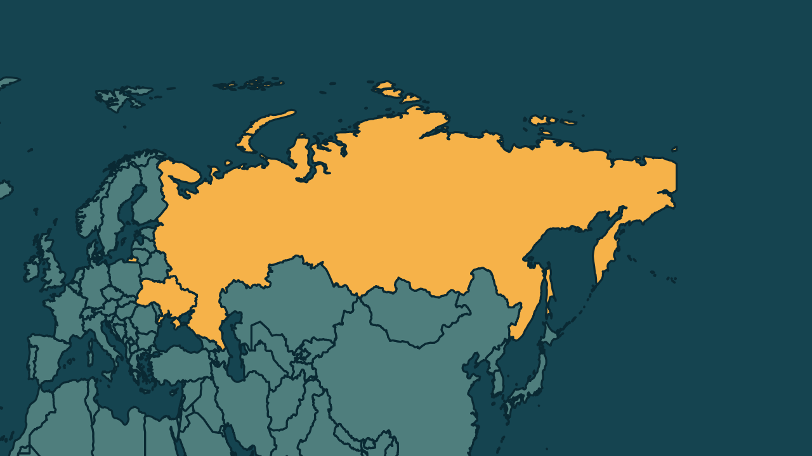

# Bombardeio russo corta luz na Ucrânia dias antes de reunião de paz

*Heimdall News, edição internacional. 7 de novembro de 2026*

## A notícia

A Rússia lançou mísseis e drones contra a rede de energia da Ucrânia na madrugada deste sábado: foram 36 mísseis balísticos e 172 drones, segundo o presidente ucraniano. [1][2]

Cinco regiões ficaram sem eletricidade, e pelo menos nove pessoas ficaram feridas, entre elas uma criança. [3][4]

Em Kiev, com temperaturas perto de zero grau, o ataque prejudicou o aquecimento e danificou a Ponte Norte, sobre o rio Dnieper. [5][6]

O ataque veio dias antes de uma reunião entre Ucrânia, Rússia e Estados Unidos, marcada para 10 e 11 de novembro, em Abu Dhabi. A última, em fevereiro, em Genebra, terminou sem avanços. [7][8]

## Quem se manifestou

- **Volodimir Zelensky, ucraniano, presidente:** afirmou que a Rússia tenta pressionar a Ucrânia antes da reunião e pediu mais atenção dos Estados Unidos. [9][10]
- **Ministério da Defesa, Rússia:** afirmou ter mirado alvos militares, de energia e de transporte, e que a Ponte Norte levava armas às forças ucranianas. [11][12]
- **Vitali Klitschko, ucraniano, prefeito de Kiev:** afirmou que a situação da energia na capital é extremamente complicada e afeta aquecimento e água. [13]

## Reação no Brasil

Nenhum posicionamento encontrado.

## Fontes

1. Estadão, [Ataques russos deixam nove feridos na Ucrânia às vésperas de nova rodada de negociações de paz](https://www.estadao.com.br/internacional/ataques-russos-ucrania-kiev/): "A Rússia lançou uma nova onda de ataques contra a Ucrânia neste sábado, 7"
2. Folha de S.Paulo, [Ucrânia relata cortes de energia em cinco regiões após ataque massivo da Rússia](https://www1.folha.uol.com.br/mundo/2026/11/ucrania-relata-cortes-de-energia-em-cinco-regioes-apos-ataque-massivo-da-russia.shtml): "a Rússia utilizou 36 mísseis balísticos e 172 drones para executar a ofensiva contra o setor energético"
3. CartaCapital, [Ucrânia denuncia cortes de energia em cinco regiões por ataque “massivo” da Rússia](https://www.cartacapital.com.br/mundo/ucrania-denuncia-cortes-de-energia-em-cinco-regioes-por-ataque-massivo-da-russia/): "o que provocou cortes de energia em cinco regiões"
4. Folha de S.Paulo, [Ucrânia relata cortes de energia em cinco regiões após ataque massivo da Rússia](https://www1.folha.uol.com.br/mundo/2026/11/ucrania-relata-cortes-de-energia-em-cinco-regioes-apos-ataque-massivo-da-russia.shtml): "pelo menos nove pessoas ficaram feridas, incluindo uma criança"
5. G1, [Ataques da Rússia deixam Ucrânia sem energia e aquecimento em meio a temperaturas perto de 0ºC](https://g1.globo.com/mundo/ucrania-russia/noticia/2026/11/07/ataques-russia-ucrania-sem-energia-e-aquecimento-temperaturas-0oc.ghtml): "sobrecarregando o fornecimento de energia e os sistemas de aquecimento de Kiev, enquanto as temperaturas se aproximavam dos 0ºC"
6. Folha de S.Paulo, [Ucrânia relata cortes de energia em cinco regiões após ataque massivo da Rússia](https://www1.folha.uol.com.br/mundo/2026/11/ucrania-relata-cortes-de-energia-em-cinco-regioes-apos-ataque-massivo-da-russia.shtml): "a ponte Norte, que cruza o rio Dnieper, sofreu danos"
7. Folha de S.Paulo, [Ucrânia relata cortes de energia em cinco regiões após ataque massivo da Rússia](https://www1.folha.uol.com.br/mundo/2026/11/ucrania-relata-cortes-de-energia-em-cinco-regioes-apos-ataque-massivo-da-russia.shtml): "encontro trilateral previsto para os dias 10 e 11 de novembro, em Abu Dhabi, entre emissários de Kiev, Washington e Moscou"
8. Folha de S.Paulo, [Ucrânia relata cortes de energia em cinco regiões após ataque massivo da Rússia](https://www1.folha.uol.com.br/mundo/2026/11/ucrania-relata-cortes-de-energia-em-cinco-regioes-apos-ataque-massivo-da-russia.shtml): "A última reunião trilateral ocorreu em meados de fevereiro, em Genebra, sem avanços para uma solução do conflito."
9. Folha de S.Paulo, [Ucrânia relata cortes de energia em cinco regiões após ataque massivo da Rússia](https://www1.folha.uol.com.br/mundo/2026/11/ucrania-relata-cortes-de-energia-em-cinco-regioes-apos-ataque-massivo-da-russia.shtml): "a Rússia tenta preparar o terreno para exercer pressão sobre a posição da Ucrânia e a de seus parceiros"
10. Folha de S.Paulo, [Ucrânia relata cortes de energia em cinco regiões após ataque massivo da Rússia](https://www1.folha.uol.com.br/mundo/2026/11/ucrania-relata-cortes-de-energia-em-cinco-regioes-apos-ataque-massivo-da-russia.shtml): "para que prestem mais atenção à Ucrânia"
11. G1, [Ataques da Rússia deixam Ucrânia sem energia e aquecimento em meio a temperaturas perto de 0ºC](https://g1.globo.com/mundo/ucrania-russia/noticia/2026/11/07/ataques-russia-ucrania-sem-energia-e-aquecimento-temperaturas-0oc.ghtml): "alvos que descreveu como pertencentes ao setor militar-industrial da Ucrânia , bem como à infraestrutura de energia e transporte"
12. Revista Oeste, [Ataques russos deixam nove feridos na Ucrânia](https://revistaoeste.com/mundo/ataques-russos-deixam-nove-feridos-na-ucrania/): "sob a justificativa de que a estrutura era utilizada para transportar armamentos e equipamentos militares destinados às forças ucranianas"
13. Folha de S.Paulo, [Ucrânia relata cortes de energia em cinco regiões após ataque massivo da Rússia](https://www1.folha.uol.com.br/mundo/2026/11/ucrania-relata-cortes-de-energia-em-cinco-regioes-apos-ataque-massivo-da-russia.shtml): "A situação do fornecimento de energia na capital é extremamente complicada. Isso afeta o funcionamento dos sistemas de aquecimento e de abastecimento de água da cidade"
