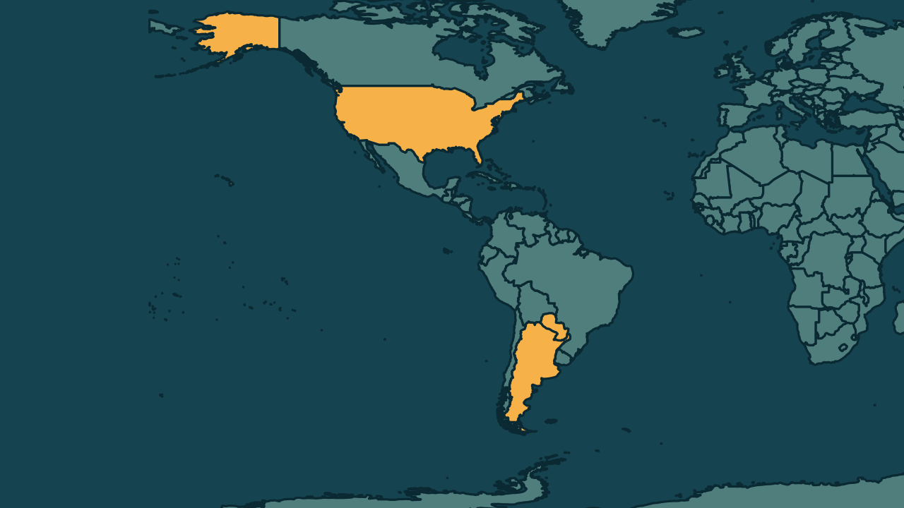

# Estados Unidos declaram apoio a Alliana, novo presidente do Paraguai

*Heimdall News, edição internacional. 8 de novembro de 2026*

## A notícia

O governo dos Estados Unidos manifestou apoio, no sábado, 7 de novembro, ao novo presidente do Paraguai, Pedro Alliana. [1][2]

Alliana tomou posse na sexta-feira, 6, depois que o Senado aprovou o impeachment de Santiago Peña com 44 votos, dos 45 senadores. O caso tem origem no fechamento do Ueno Bank. [3][4]

Alliana era vice-presidente e vai completar o mandato, que termina em 2028. Na política externa, ele defende a aproximação com os Estados Unidos e o apoio diplomático do Paraguai a Taiwan e a Israel. [5][6][7]

## Quem se manifestou

- **Juan Pablo Segura, americano, secretário de Estado adjunto:** escreveu que o Paraguai é um parceiro estratégico, amigo e aliado dos Estados Unidos. [8]
- **Governo da Argentina, Argentina:** avalia, segundo integrantes ouvidos pelo canal TN, que Alliana é ainda mais de direita do que Peña, e não espera mudanças na parceria entre os dois países. [9][10]
- **Pedro Alliana, paraguaio, presidente:** respondeu ao presidente brasileiro que as duas nações sempre estarão unidas por laços de fraternidade. [11]

## Reação no Brasil

- **Luiz Inácio Lula da Silva, brasileiro, presidente:** desejou a Alliana pleno êxito nas novas funções, disse esperar trabalhar com ele de maneira aberta, franca e cooperativa e afirmou que espera recebê-lo em breve em Brasília. [12][13]

## Fontes

1. Revista Oeste, [EUA declaram apoio a novo presidente do Paraguai](https://revistaoeste.com/mundo/eua-declaram-apoio-a-novo-presidente-do-paraguai/): "O governo dos Estados Unidos manifestou neste sábado, 7, apoio ao novo presidente do Paraguai, Pedro Alliana."
2. Poder360, [EUA declaram apoio a Pedro Alliana, novo presidente do Paraguai](https://www.poder360.com.br/poder-internacional/eua-declaram-apoio-a-pedro-alliana-novo-presidente-do-paraguai/): "O governo dos Estados Unidos manifestou apoio ao novo presidente do Paraguai, Pedro Alliana"
3. Poder360, [EUA declaram apoio a Pedro Alliana, novo presidente do Paraguai](https://www.poder360.com.br/poder-internacional/eua-declaram-apoio-a-pedro-alliana-novo-presidente-do-paraguai/): "O Senado do Paraguai aprovou por unanimidade, na 6ª feira (6.nov.2026), o impeachment contra Peña –44 dos 45 senadores estavam presentes e votaram a favor."
4. Revista Oeste, [EUA declaram apoio a novo presidente do Paraguai](https://revistaoeste.com/mundo/eua-declaram-apoio-a-novo-presidente-do-paraguai/): "O caso tem origem no fechamento do Ueno Bank."
5. Revista Oeste, [EUA declaram apoio a novo presidente do Paraguai](https://revistaoeste.com/mundo/eua-declaram-apoio-a-novo-presidente-do-paraguai/): "Alliana terá de recuperar a confiança dos correntistas e completar o mandato, que vai até 2028"
6. Revista Oeste, [EUA declaram apoio a novo presidente do Paraguai](https://revistaoeste.com/mundo/eua-declaram-apoio-a-novo-presidente-do-paraguai/): "Na política externa, Alliana defende a aproximação com os Estados Unidos"
7. Revista Oeste, [EUA declaram apoio a novo presidente do Paraguai](https://revistaoeste.com/mundo/eua-declaram-apoio-a-novo-presidente-do-paraguai/): "o apoio diplomático do Paraguai a Taiwan e Israel"
8. Revista Oeste, [EUA declaram apoio a novo presidente do Paraguai](https://revistaoeste.com/mundo/eua-declaram-apoio-a-novo-presidente-do-paraguai/): "“O Paraguai é um parceiro estratégico, amigo e aliado dos Estados Unidos”, escreveu Segura."
9. Gazeta do Povo, [Governo Milei vê sucessor de Peña no Paraguai como mais alinhado à direita](https://www.gazetadopovo.com.br/mundo/governo-milei-ve-sucessor-de-pena-como-mais-alinhado-a-direita/): "“Alliana é ainda mais de direita e próximo das ideias de Milei do que Santiago Peña”, afirmou ao TN um integrante do governo argentino"
10. Gazeta do Povo, [Governo Milei vê sucessor de Peña no Paraguai como mais alinhado à direita](https://www.gazetadopovo.com.br/mundo/governo-milei-ve-sucessor-de-pena-como-mais-alinhado-a-direita/): "não espera mudanças na parceria política e econômica entre os dois países"
11. CNN Brasil, [Lula diz que espera trabalhar com Pedro Alliana de “maneira cooperativa”](https://www.cnnbrasil.com.br/politica/lula-diz-que-espera-trabalhar-com-pedro-alliana-de-maneira-cooperativa/): "Nossas nações sempre estarão unidas por laços de fraternidade."
12. CNN Brasil, [Lula diz que espera trabalhar com Pedro Alliana de “maneira cooperativa”](https://www.cnnbrasil.com.br/politica/lula-diz-que-espera-trabalhar-com-pedro-alliana-de-maneira-cooperativa/): "meus desejos de pleno êxito nas novas funções e de poder trabalhar com ele de maneira aberta, franca e cooperativa"
13. CNN Brasil, [Lula diz que espera trabalhar com Pedro Alliana de “maneira cooperativa”](https://www.cnnbrasil.com.br/politica/lula-diz-que-espera-trabalhar-com-pedro-alliana-de-maneira-cooperativa/): "Espero poder recebê-lo proximamente em Brasília"
