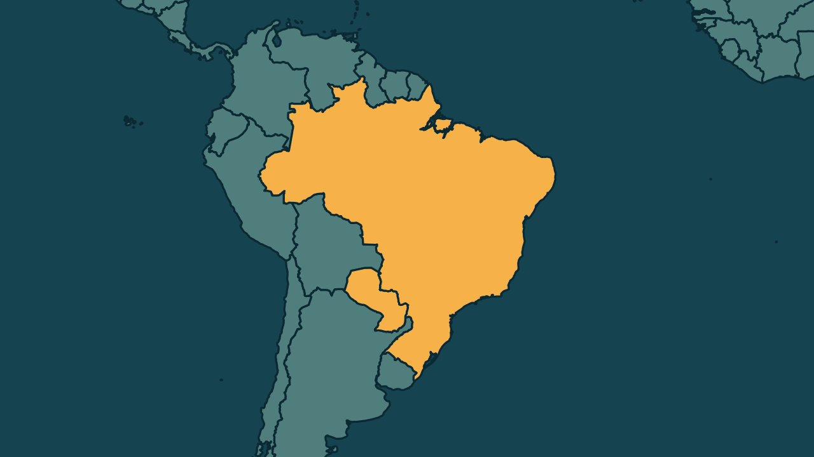

# Itaipu paraguaia tinha US$ 182 milhões no Ueno Bank e aciona a Justiça

*Heimdall News, edição internacional. 8 de novembro de 2026*

## A notícia

A administração paraguaia da Itaipu Binacional informou, no sábado, 7 de novembro, que tinha cerca de 182 milhões de dólares depositados no Ueno Bank, perto de 1 bilhão de reais. [1][2][3]

O banco teve as operações suspensas pelo Banco Central do Paraguai na terça-feira, 3. O valor equivale a 7,6% dos mais de 2,4 bilhões de dólares enviados do Brasil ao lado paraguaio da usina entre 2024 e 2026. [4][5]

A Itaipu apresentou uma denúncia penal contra oito ex-diretores do banco e não informou quanto espera recuperar nem em que prazo. [6][7][8]

## Quem se manifestou

- **Administração paraguaia da Itaipu, Paraguai:** afirmou que a situação não afeta o andamento normal das atividades da usina, que só aplica recursos em instituições habilitadas e com a classificação de risco exigida, e que vai esgotar todas as medidas legais e administrativas para recuperar o dinheiro. [9][10][11]
- **Banco Central do Paraguai, Paraguai:** informou que o fundo de garantia de depósitos pode cobrir 97% dos clientes do Ueno e que quem tem valores acima do limite aguarda o balanço final do banco. [12][13]

## Reação no Brasil

- **Administração brasileira da Itaipu, Brasil:** afirmou que não há recursos sob sua gestão no Ueno Bank e que a operação da usina segue normalmente, sem impacto na produção e no fornecimento de energia. [14][15]

## Fontes

1. Estadão, [Itaipu aciona Ministério Público do Paraguai para recuperar US$ 182 milhões depositados no Ueno Bank](https://www.estadao.com.br/economia/itaipu-ministerio-publico-paraguai-recuperar-milhoes-depositados-ueno-bank/): "A administração paraguaia da Itaipu Binacional informou neste sábado, 7,"
2. Estadão, [Itaipu aciona Ministério Público do Paraguai para recuperar US$ 182 milhões depositados no Ueno Bank](https://www.estadao.com.br/economia/itaipu-ministerio-publico-paraguai-recuperar-milhoes-depositados-ueno-bank/): "Itaipu mantinha cerca de US$ 182 milhões no Ueno Bank em 3 de novembro"
3. Folha de S.Paulo, [Lado paraguaio de Itaipu mantém quase R$ 1 bilhão no Ueno Bank](https://c-level.folha.uol.com.br/negocios/2026/11/lado-paraguaio-de-itaipu-mantem-quase-r-1-bilhao-no-ueno-bank.shtml): "Somados, os valores chegam a cerca de US$ 182 milhões (cerca de R$ 1 bilhão)."
4. G1, [Itaipu tinha cerca de R$ 1 bilhão no Ueno Bank, banco do Paraguai que teve operações suspensas, e tenta recuperar dinheiro na Justiça](https://g1.globo.com/pr/oeste-sudoeste/noticia/2026/11/08/itaipu-ueno-bank-banco-do-paraguai.ghtml): "teve as operações suspensas na terça-feira (3) após problemas identificados pelo Banco Central do país"
5. Estadão, [Itaipu aciona Ministério Público do Paraguai para recuperar US$ 182 milhões depositados no Ueno Bank](https://www.estadao.com.br/economia/itaipu-ministerio-publico-paraguai-recuperar-milhoes-depositados-ueno-bank/): "Os depósitos representavam 7,6% dos mais de US$ 2,4 bilhões recebidos pelo Paraguai em repasses do Brasil entre 2024 e 2026."
6. Gazeta do Povo, [Itaipu denuncia diretores do Ueno Bank para recuperar US$ 163,8 milhões](https://www.gazetadopovo.com.br/mundo/itaipu-denuncia-ueno-bank-recuperar-recursos/): "apresentou, neste sábado (7), uma denúncia penal contra os diretores do Ueno Bank"
7. Gazeta do Povo, [Itaipu denuncia diretores do Ueno Bank para recuperar US$ 163,8 milhões](https://www.gazetadopovo.com.br/mundo/itaipu-denuncia-ueno-bank-recuperar-recursos/): "O documento é dirigido aos oito ex-diretores da instituição"
8. Estadão, [Itaipu aciona Ministério Público do Paraguai para recuperar US$ 182 milhões depositados no Ueno Bank](https://www.estadao.com.br/economia/itaipu-ministerio-publico-paraguai-recuperar-milhoes-depositados-ueno-bank/): "A empresa não informou quanto espera recuperar nem estabeleceu prazo para a devolução."
9. Estadão, [Itaipu aciona Ministério Público do Paraguai para recuperar US$ 182 milhões depositados no Ueno Bank](https://www.estadao.com.br/economia/itaipu-ministerio-publico-paraguai-recuperar-milhoes-depositados-ueno-bank/): "A hidrelétrica afirmou que a situação “não afeta o desenvolvimento normal das atividades” da empresa."
10. Folha de S.Paulo, [Lado paraguaio de Itaipu mantém quase R$ 1 bilhão no Ueno Bank](https://c-level.folha.uol.com.br/negocios/2026/11/lado-paraguaio-de-itaipu-mantem-quase-r-1-bilhao-no-ueno-bank.shtml): "Itaipu afirma aplicar recursos apenas em instituições habilitadas com classificação de risco AAApy ou AApy"
11. CNN Brasil, [Itaipu tinha saldo equivalente a R$ 1 bilhão no banco Ueno, do Paraguai](https://www.cnnbrasil.com.br/infra/itaipu-detinha-us-18221-milhoes-alocados-no-ueno-do-paraguai/): "esgotar todas as medidas legais e administrativas cabíveis"
12. Folha de S.Paulo, [BC do Paraguai diz ter devolvido dinheiro a 1,2 milhão de clientes do Ueno Bank](https://c-level.folha.uol.com.br/financas/2026/11/bc-do-paraguai-diz-ter-devolvido-dinheiro-a-12-milhao-de-clientes-do-ueno-bank.shtml): "o mecanismo tem capacidade para cobrir os depósitos de 97% dos clientes do banco"
13. Folha de S.Paulo, [BC do Paraguai diz ter devolvido dinheiro a 1,2 milhão de clientes do Ueno Bank](https://c-level.folha.uol.com.br/financas/2026/11/bc-do-paraguai-diz-ter-devolvido-dinheiro-a-12-milhao-de-clientes-do-ueno-bank.shtml): "Quem tem depósitos acima desse limite terá de aguardar o balanço definitivo elaborado pela Superintendência de Bancos"
14. Estadão, [Itaipu aciona Ministério Público do Paraguai para recuperar US$ 182 milhões depositados no Ueno Bank](https://www.estadao.com.br/economia/itaipu-ministerio-publico-paraguai-recuperar-milhoes-depositados-ueno-bank/): "não há recursos financeiros sob gestão da margem brasileira depositados ou aplicados no Ueno Bank"
15. G1, [Itaipu tinha cerca de R$ 1 bilhão no Ueno Bank, banco do Paraguai que teve operações suspensas, e tenta recuperar dinheiro na Justiça](https://g1.globo.com/pr/oeste-sudoeste/noticia/2026/11/08/itaipu-ueno-bank-banco-do-paraguai.ghtml): "A operação da Itaipu segue normalmente, sem impacto na produção e no fornecimento de energia"
