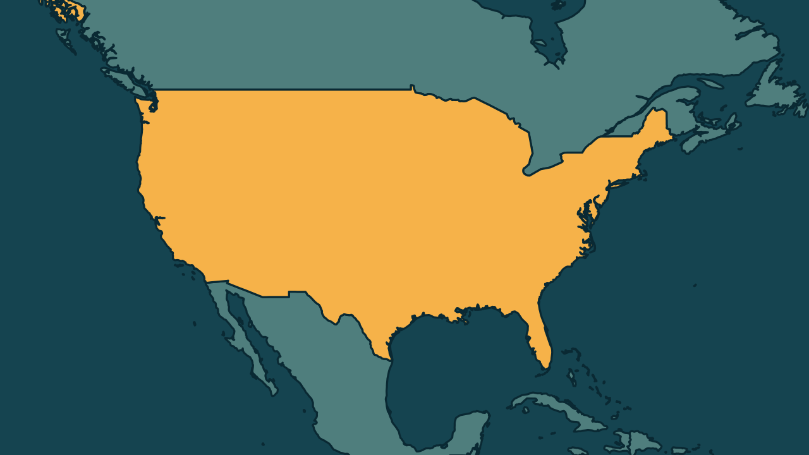

# Trump convida Dana White, do UFC, para porta-voz da Casa Branca

*Heimdall News, edição internacional. 8 de novembro de 2026*

## A notícia

O presidente dos Estados Unidos, Donald Trump, ofereceu no sábado ao presidente da liga de lutas UFC, Dana White, o cargo de secretário de imprensa da Casa Branca. [1][2][3]

Trump pediu que White leve seis lutadores como assistentes, entre eles a brasileira Amanda Nunes, que se tornou cidadã americana no ano passado. [4][5]

O cargo está vago desde 16 de outubro, quando Katie Zacharia saiu depois de cinco dias na função. Antes dela, Karoline Leavitt deixou o posto em agosto. [6][7]

Um assessor disse que Trump brincava, e uma fonte afirmou à CNN que White recusou. Em Londres, White disse que se reúne com Trump na Casa Branca na segunda-feira, 9 de novembro. [8][9][10]

## Quem se manifestou

- **Donald Trump, americano, presidente:** escreveu que precisa do grupo para se defender da esquerda lunática e que White será um secretário de imprensa como nenhum outro. [11][12]
- **Dana White, americano, presidente do UFC:** compartilhou a oferta com a legenda Rumo ao próximo capítulo e, perguntado sobre como conciliaria os cargos, disse que já tem muitos trabalhos. [13][14]
- **Steven Cheung, americano, diretor de comunicações:** republicou a mensagem do presidente e escreveu: com certeza, vai fundo. [15]

## Reação no Brasil

Nenhum posicionamento encontrado.

## Fontes

1. Poder360, [Trump oferece cargo de porta-voz da Casa Branca ao presidente do UFC](https://www.poder360.com.br/poder-internacional/trump-oferece-cargo-de-porta-voz-da-casa-branca-ao-presidente-do-ufc/): "ofereceu ao presidente do UFC, Dana White, o cargo de secretário de Imprensa da Casa Branca"
2. Folha de S.Paulo, [Trump diz querer o chefe do UFC, Dana White, como secretário de imprensa da Casa Branca](https://www1.folha.uol.com.br/mundo/2026/11/trump-diz-querer-o-chefe-do-ufc-dana-white-como-secretario-de-imprensa-da-casa-branca.shtml): "disse no sábado (7) que convidou o CEO do UFC, Dana White"
3. CartaCapital, [Trump oferece cargo de secretário de imprensa da Casa Branca a Dana White, do UFC](https://www.cartacapital.com.br/mundo/trump-oferece-cargo-de-secretario-de-imprensa-da-casa-branca-a-dana-white-do-ufc/): "ofereceu o cargo de secretário de imprensa a Dana White, diretor do UFC"
4. Folha de S.Paulo, [Trump diz querer o chefe do UFC, Dana White, como secretário de imprensa da Casa Branca](https://www1.folha.uol.com.br/mundo/2026/11/trump-diz-querer-o-chefe-do-ufc-dana-white-como-secretario-de-imprensa-da-casa-branca.shtml): "convidou seis atuais ou ex-campeões do UFC para se juntarem a White"
5. Folha de S.Paulo, [Trump diz querer o chefe do UFC, Dana White, como secretário de imprensa da Casa Branca](https://www1.folha.uol.com.br/mundo/2026/11/trump-diz-querer-o-chefe-do-ufc-dana-white-como-secretario-de-imprensa-da-casa-branca.shtml): "Amanda Nunes, brasileira que se tornou cidadã dos Estados Unidos no ano passado"
6. G1, [Trump oferece cargo de secretário de imprensa da Casa Branca a presidente do UFC](https://g1.globo.com/mundo/noticia/2026/11/07/trump-oferece-cargo-de-secretario-de-imprensa-da-casa-branca-a-presidente-do-ufc.ghtml): "desde 16 de outubro de 2026, quando Katie Zacharia deixou a função após apenas cinco dias no posto"
7. Folha de S.Paulo, [Trump diz querer o chefe do UFC, Dana White, como secretário de imprensa da Casa Branca](https://www1.folha.uol.com.br/mundo/2026/11/trump-diz-querer-o-chefe-do-ufc-dana-white-como-secretario-de-imprensa-da-casa-branca.shtml): "Zacharia substituiu Karoline Leavitt, que deixou o cargo no fim de agosto"
8. CNN Brasil, [Chefe do UFC recusa oferta de Trump para cargo na Casa Branca, diz fonte](https://www.cnnbrasil.com.br/internacional/chefe-do-ufc-recusa-oferta-de-trump-para-cargo-na-casa-branca-diz-fonte/): "Embora um assessor tenha afirmado que Trump estava brincando sobre a oferta"
9. CNN Brasil, [Chefe do UFC recusa oferta de Trump para cargo na Casa Branca, diz fonte](https://www.cnnbrasil.com.br/internacional/chefe-do-ufc-recusa-oferta-de-trump-para-cargo-na-casa-branca-diz-fonte/): "recusou a proposta feita por Donald Trump, presidente dos Estados Unidos, para que assumisse o cargo de secretário de imprensa da Casa Branca, segundo uma fonte"
10. Folha de S.Paulo, [Trump diz querer o chefe do UFC, Dana White, como secretário de imprensa da Casa Branca](https://www1.folha.uol.com.br/mundo/2026/11/trump-diz-querer-o-chefe-do-ufc-dana-white-como-secretario-de-imprensa-da-casa-branca.shtml): "White disse que se reuniria com Trump na Casa Branca na segunda-feira (9)"
11. Poder360, [Trump oferece cargo de porta-voz da Casa Branca ao presidente do UFC](https://www.poder360.com.br/poder-internacional/trump-oferece-cargo-de-porta-voz-da-casa-branca-ao-presidente-do-ufc/): "Precisamos dessas pessoas para nos defender da esquerda lunática"
12. Poder360, [Trump oferece cargo de porta-voz da Casa Branca ao presidente do UFC](https://www.poder360.com.br/poder-internacional/trump-oferece-cargo-de-porta-voz-da-casa-branca-ao-presidente-do-ufc/): "Dana será um secretário de imprensa como nenhum outro"
13. Estadão, [Dana White vai ser reunir com Trump após convite para ser porta-voz da Casa Branca](https://www.estadao.com.br/internacional/dana-white-vai-ser-reunir-com-trump-apos-convite-para-ser-porta-voz-da-casa-branca/): "com a legenda “Rumo ao próximo capítulo”"
14. Estadão, [Dana White vai ser reunir com Trump após convite para ser porta-voz da Casa Branca](https://www.estadao.com.br/internacional/dana-white-vai-ser-reunir-com-trump-apos-convite-para-ser-porta-voz-da-casa-branca/): "É, eu já tenho muitos trabalhos"
15. CNN Brasil, [Chefe do UFC recusa oferta de Trump para cargo na Casa Branca, diz fonte](https://www.cnnbrasil.com.br/internacional/chefe-do-ufc-recusa-oferta-de-trump-para-cargo-na-casa-branca-diz-fonte/): "republicou a mensagem do presidente, acrescentando: “Com certeza! Vai fundo, @DanaWhite!”"
