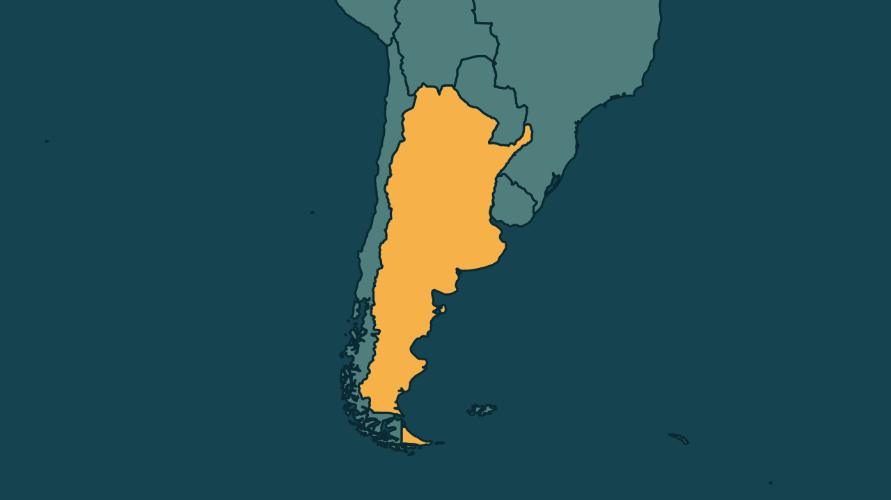

# Papa Leão XIV chega à Argentina e é recebido por Milei

*Heimdall News, edição internacional. 8 de novembro de 2026*

## A notícia

O papa Leão XIV chegou a Buenos Aires neste domingo, 8, e foi recebido pelo presidente Javier Milei no aeroporto. É a primeira visita de um papa à Argentina em 39 anos. Francisco, argentino, não voltou ao país como papa. [1][2][3]

A visita dura quatro dias, com missas em Buenos Aires, Córdoba e Luján. Autoridades argentinas estimam que cerca de 7 milhões de pessoas participem dos eventos. Na quarta, o papa segue para o Peru. [4][5][6][7]

A viagem ocorre em meio a críticas da Igreja argentina aos cortes de Milei. Na segunda, o papa visita o Cottolengo Dom Orione, que abriga cerca de 400 pessoas com deficiência e foi atingido pelos cortes. [8][9][10]

## Quem se manifestou

- **Leão XIV, americano, papa:** disse que a viagem à Argentina é uma homenagem a Francisco. No sábado, na fronteira entre o Uruguai e a Argentina, pediu aos latino-americanos que ajam uns com os outros com justiça, honestidade e fidelidade. [11][12][13]
- **Secretaria de Inteligência de Estado, Argentina:** informou a prisão, na sexta-feira, de um suspeito de ameaçar matar o papa e reafirmou o compromisso de prevenir ameaças para que a visita transcorra com segurança. [14][15][16]

## Reação no Brasil

- **Luiz Inácio Lula da Silva, brasileiro, presidente:** agradeceu, na sexta-feira, a mensagem que o papa enviou ao sobrevoar o Brasil e renovou o convite para que ele visite o país, afirmando que o povo brasileiro o receberá com carinho, acolhimento e fé. [17][18][19]

## Fontes

1. G1, [Papa Leão XIV chega à Argentina em viagem em homenagem a Francisco](https://g1.globo.com/mundo/noticia/2026/11/08/papa-leao-xiv-chega-a-argentina.ghtml): "O presidente do país, Javier Milei, foi ao aeroporto receber o pontífice"
2. Revista Oeste, [Papa chega a Buenos Aires para encontro com Milei](https://revistaoeste.com/mundo/papa-chega-a-buenos-aires-para-encontro-com-milei/): "A visita marca o retorno de um papa à Argentina depois de 39 anos."
3. G1, [Papa Leão XIV chega à Argentina em viagem em homenagem a Francisco](https://g1.globo.com/mundo/noticia/2026/11/08/papa-leao-xiv-chega-a-argentina.ghtml): "O papa Francisco, que era argentino, nunca visitou seu país durante seu papado."
4. Revista Oeste, [Papa chega a Buenos Aires para encontro com Milei](https://revistaoeste.com/mundo/papa-chega-a-buenos-aires-para-encontro-com-milei/): "para uma visita de quatro dias que inclui um encontro com o presidente Javier Milei"
5. CNN Brasil, [Papa Leão XIV chega à Argentina e deve reunir 7 milhões de pessoas](https://www.cnnbrasil.com.br/internacional/papa-leao-xiv-chega-a-argentina-e-deve-reunir-7-milhoes-de-pessoas/): "celebrar missas em Buenos Aires, Luján e Córdoba"
6. Revista Oeste, [Papa Leão XIV vai à Argentina e deve reunir 7 milhões de fiéis](https://revistaoeste.com/mundo/papa-leao-xiv-vai-a-argentina-e-deve-reunir-7-milhoes-de-fieis/): "Autoridades argentinas estimam que cerca de 7 milhões de pessoas devem comparecer a eventos com o papa."
7. G1, [Papa Leão XIV chega à Argentina em viagem em homenagem a Francisco](https://g1.globo.com/mundo/noticia/2026/11/08/papa-leao-xiv-chega-a-argentina.ghtml): "Depois da Argentina, ele seguirá para o Peru, a última parada da viagem, na quarta-feira (11)."
8. CartaCapital, [Leão XIV viaja à Argentina e se reúne com Milei, alvo de críticas da Igreja por cortes sociais](https://www.cartacapital.com.br/mundo/leao-xiv-viaja-a-argentina-e-se-reune-com-milei-alvo-de-criticas-da-igreja-por-cortes-sociais/): "A Igreja argentina critica duramente o governo por tratar serviços sociais essenciais apenas como um fardo para o orçamento"
9. Revista Oeste, [Papa chega a Buenos Aires para encontro com Milei](https://revistaoeste.com/mundo/papa-chega-a-buenos-aires-para-encontro-com-milei/): "Na segunda-feira 9, Leão XIV dará continuidade à programação com uma visita ao Pequeno Cottolengo Dom Orione"
10. Metrópoles, [Papa Leão XIV chega à Argentina e é recebido por Javier Milei](https://www.metropoles.com/mundo/papa-leao-xiv-chega-a-argentina-e-e-recebido-por-javier-milei): "A instituição católica abriga cerca de 400 pessoas com deficiência e foi uma das atingidas por cortes de gastos de Javier Milei."
11. G1, [Papa Leão XIV chega à Argentina em viagem em homenagem a Francisco](https://g1.globo.com/mundo/noticia/2026/11/08/papa-leao-xiv-chega-a-argentina.ghtml): "Leão XIV disse que sua viagem ao país é uma homenagem a Francisco."
12. CNN Brasil, [Papa Leão XIV chega à Argentina e deve reunir 7 milhões de pessoas](https://www.cnnbrasil.com.br/internacional/papa-leao-xiv-chega-a-argentina-e-deve-reunir-7-milhoes-de-pessoas/): "A fala foi feita em um evento na fronteira entre o Uruguai e a Argentina"
13. CNN Brasil, [Papa Leão XIV chega à Argentina e deve reunir 7 milhões de pessoas](https://www.cnnbrasil.com.br/internacional/papa-leao-xiv-chega-a-argentina-e-deve-reunir-7-milhoes-de-pessoas/): "pediu aos latino-americanos que ajam uns com os outros com “justiça, honestidade e fidelidade”"
14. CNN Brasil, [Argentina prende suspeito de ameaçar matar o papa Leão XIV](https://www.cnnbrasil.com.br/internacional/argentina-prende-suspeito-de-ameacar-matar-o-papa-leao-xiv/): "foi detido na sexta-feira (6) após uma denúncia anônima sobre supostas ameaças contra o Papa"
15. Revista Oeste, [Argentina prende suspeito de ameaçar matar Leão XIV](https://revistaoeste.com/mundo/argentina-prende-suspeito-de-ameacar-matar-leao-xiv/): "A Side também reafirmou o compromisso de identificar possíveis riscos e prevenir ameaças durante a permanência de Leão XIV no país."
16. Revista Oeste, [Argentina prende suspeito de ameaçar matar Leão XIV](https://revistaoeste.com/mundo/argentina-prende-suspeito-de-ameacar-matar-leao-xiv/): "o objetivo é garantir que a visita transcorra normalmente e em condições de segurança"
17. Poder360, [Lula recebe mensagem do papa e renova convite de visita ao Brasil](https://www.poder360.com.br/poder-internacional/lula-recebe-mensagem-de-papa-e-renova-convite-de-visita-ao-brasil/): "Em publicação no X, Lula agradeceu a mensagem e renovou o convite para que o pontífice visite o Brasil."
18. Brasil de Fato, [Papa Leão XIV envia mensagem a Lula; presidente responde com convite para visitar o Brasil](https://www.brasildefato.com.br/2026/11/06/papa-leao-xiv-envia-mensagem-a-lula-presidente-responde-com-convite-para-visitar-o-brasil/): "O contato ocorreu enquanto o pontífice sobrevoava o território brasileiro"
19. Poder360, [Lula recebe mensagem do papa e renova convite de visita ao Brasil](https://www.poder360.com.br/poder-internacional/lula-recebe-mensagem-de-papa-e-renova-convite-de-visita-ao-brasil/): "“O povo brasileiro receberá Sua Santidade com muito carinho, acolhimento e fé“"
