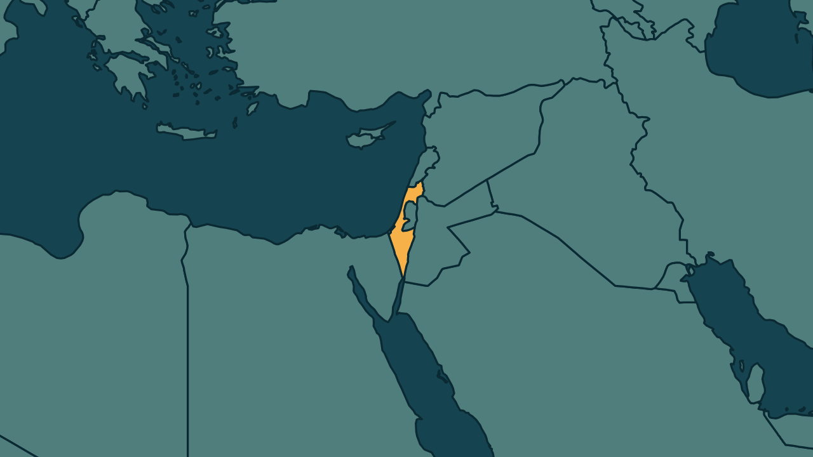

# Eisenkot recebe mandato em Israel e convida aliados de Netanyahu

*Heimdall News, edição internacional. 8 de novembro de 2026*

## A notícia

O presidente de Israel, Isaac Herzog, entregou no domingo a Gadi Eisenkot, principal adversário do primeiro-ministro Benjamin Netanyahu, o mandato para formar o próximo governo. [1][2]

Eisenkot convidou o Likud, partido de Netanyahu, e o Sionismo Religioso a apoiar um governo de emergência nacional sob o seu comando. [3][4][5]

Ele tem 28 dias para formar a coalizão, prorrogáveis por mais 14. Se nenhum lado conseguir, Israel terá novas eleições. [6][7]

Na segunda-feira, Eisenkot se reúne com Avigdor Liberman, que rejeita um governo dependente dos partidos árabes. O novo Parlamento toma posse na terça. [8][9][10]

## Quem se manifestou

- **Gadi Eisenkot, israelense, líder do partido Yashar:** afirmou que não vê motivo para o Likud e o Sionismo Religioso não apoiarem um governo liderado por ele, e disse que sua porta está aberta. [11][12]
- **Isaac Herzog, israelense, presidente:** disse que o país precisa de um governo estável e citou a nova situação política nos Estados Unidos. [13][14]
- **Benjamin Netanyahu, israelense, primeiro-ministro:** criticou a possibilidade de um governo apoiado por partidos árabes e defendeu uma coalizão de unidade nacional com o seu bloco. [15][16]

## Reação no Brasil

Nenhum posicionamento encontrado.

## Fontes

1. Revista Oeste, [Rival de Netanyahu recebe mandato oficial para formar governo em Israel](https://revistaoeste.com/mundo/rival-de-netanyahu-recebe-mandato-oficial-para-formar-governo-em-israel/): "O presidente de Israel, Isaac Herzog, entregou neste domingo, 8, ao líder do partido Yashar, Gadi Eisenkot, o mandato para formar o próximo governo do país."
2. G1, [Presidente de Israel oficializa escolha de rival de Netanyahu para tentar formar novo governo](https://g1.globo.com/mundo/noticia/2026/11/08/presidente-de-israel-oficializa-escolha-de-rival-de-netanyahu-para-tentar-formar-novo-governo.ghtml): "Gadi Eisenkot, principal adversário do primeiro-ministro Benjamin Netanyahu, tente formar um novo governo"
3. Metrópoles, [Rival de Netanyahu convida aliados de primeiro-ministro para formar governo](https://www.metropoles.com/mundo/rival-de-netanyahu-convida-aliados-de-primeiro-ministro-para-formar-governo): "convidou, neste domingo (8/11), aliados do primeiro-ministro interino Benjamin Netanyahu para integrar o governo nacional de emergência"
4. Folha de S.Paulo, [Eisenkot convida partido de Netanyahu a formar coalizão após eleições em Israel](https://www1.folha.uol.com.br/mundo/2026/11/eisenkot-convida-partido-de-netanyahu-a-formar-coalizao-apos-eleicoes-em-israel.shtml): "em referência ao partido de Netanyahu e à legenda do ministro das Finanças, o extremista Bezalel Smotrich"
5. Folha de S.Paulo, [Eisenkot convida partido de Netanyahu a formar coalizão após eleições em Israel](https://www1.folha.uol.com.br/mundo/2026/11/eisenkot-convida-partido-de-netanyahu-a-formar-coalizao-apos-eleicoes-em-israel.shtml): "desde que sob o seu comando"
6. Estadão, [Presidente de Israel encarrega oficialmente Eisenkot, opositor de Netanyahu, a formar novo governo](https://www.estadao.com.br/internacional/presidente-de-israel-encarrega-oficialmente-eisenkot-opositor-de-netanyahu-a-formar-novo-governo/): "terá 28 dias para conseguir obter maioria para formar um governo no país, prorrogáveis por mais 14"
7. Estadão, [Presidente de Israel encarrega oficialmente Eisenkot, opositor de Netanyahu, a formar novo governo](https://www.estadao.com.br/internacional/presidente-de-israel-encarrega-oficialmente-eisenkot-opositor-de-netanyahu-a-formar-novo-governo/): "Se não houver acordo para nenhum dos lados, novas eleições terão que ser convocadas."
8. Revista Oeste, [Rival de Netanyahu recebe mandato oficial para formar governo em Israel](https://revistaoeste.com/mundo/rival-de-netanyahu-recebe-mandato-oficial-para-formar-governo-em-israel/): "Eisenkot se reúne nesta segunda-feira, 9, com Avigdor Lieberman, líder do partido Yisrael Beiteinu, em busca de um acordo."
9. Poder360, [Presidente de Israel indica rival de Netanyahu para formar governo](https://www.poder360.com.br/poder-internacional/presidente-de-israel-indica-rival-de-netanyahu-para-formar-governo/): "que rejeita um governo dependente dos partidos árabes"
10. Poder360, [Presidente de Israel indica rival de Netanyahu para formar governo](https://www.poder360.com.br/poder-internacional/presidente-de-israel-indica-rival-de-netanyahu-para-formar-governo/): "O 1º teste da nova composição será na 3ª feira (10.nov), durante a posse do novo Knesset."
11. Estadão, [Presidente de Israel encarrega oficialmente Eisenkot, opositor de Netanyahu, a formar novo governo](https://www.estadao.com.br/internacional/presidente-de-israel-encarrega-oficialmente-eisenkot-opositor-de-netanyahu-a-formar-novo-governo/): "não vejo motivo para que não apoiem um governo liderado por mim e baseado nos princípios que apresentei"
12. Folha de S.Paulo, [Eisenkot convida partido de Netanyahu a formar coalizão após eleições em Israel](https://www1.folha.uol.com.br/mundo/2026/11/eisenkot-convida-partido-de-netanyahu-a-formar-coalizao-apos-eleicoes-em-israel.shtml): "Minha porta está aberta e estendo minha mão"
13. Revista Oeste, [Rival de Netanyahu recebe mandato oficial para formar governo em Israel](https://revistaoeste.com/mundo/rival-de-netanyahu-recebe-mandato-oficial-para-formar-governo-em-israel/): "O Estado de Israel precisa de um governo estável, capaz de enfrentá-los ao longo do tempo."
14. CNN Brasil, [Líder de Israel oficializa rival de Netanyahu para tentar formar governo](https://www.cnnbrasil.com.br/internacional/lider-de-israel-oficializa-rival-de-netanyahu-para-tentar-formar-governo/): "lidar com uma nova situação política nos Estados Unidos"
15. Poder360, [Presidente de Israel indica rival de Netanyahu para formar governo](https://www.poder360.com.br/poder-internacional/presidente-de-israel-indica-rival-de-netanyahu-para-formar-governo/): "criticou a possibilidade de um governo apoiado por partidos árabes"
16. Poder360, [Presidente de Israel indica rival de Netanyahu para formar governo](https://www.poder360.com.br/poder-internacional/presidente-de-israel-indica-rival-de-netanyahu-para-formar-governo/): "O premiê defende uma coalizão de unidade nacional com seu bloco político."
