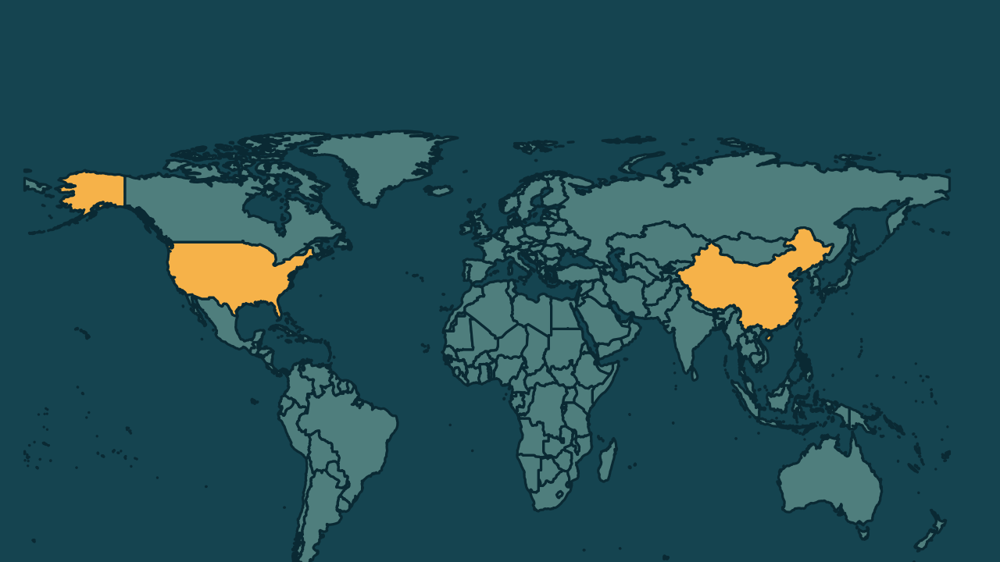

# Nvidia investiga se CEO foi alvo de espionagem e ações caem

*Heimdall News, edição internacional. 9 de novembro de 2026*

## A notícia

A Nvidia, a fabricante de chips mais valiosa do mundo, abriu no domingo uma investigação independente para apurar se o fundador e presidente-executivo, Jensen Huang, foi alvo de uma operação de inteligência estrangeira. [1][2][3]

Segundo o jornal The New York Times, autoridades americanas concluíram que Alice Huang, ex-executiva de uma empresa de Singapura que compra chips da Nvidia, atuava como agente da inteligência chinesa. Em carta aos funcionários, Huang escreveu que foi infiel à esposa. [4][5][6][7]

Nesta segunda-feira, as ações da Nvidia caíram pouco mais de 4% antes da abertura da bolsa de Nova York. Huang continua no cargo durante a investigação. [8][9][10]

## Quem se manifestou

- **Jensen Huang, americano, fundador da Nvidia:** escreveu que assume total responsabilidade e está comprometido em apoiar a segurança nacional dos Estados Unidos. [11][12]
- **Guo Jiakun, chinês, porta-voz das Relações Exteriores:** afirmou que a alegação de espionagem chinesa é infundada e não passa de difamação contra a China. [13]
- **Donald Trump, americano, presidente:** disse que considera Huang um homem honrado, que provavelmente tem uma explicação, e que não deveria ter agido com base nas informações de inteligência. [14][15]

## Reação no Brasil

Nenhum posicionamento encontrado.

## Fontes

1. G1, [Traição, espionagem e investigação: entenda o caso que expõe a Nvidia e seu CEO](https://g1.globo.com/tecnologia/ciberseguranca/noticia/2026/11/09/traicao-espionagem-investigacao-entenda-caso-expoe-nvidia-ceo-jensen-huang.ghtml): "A empresa anunciou neste domingo (8) que abriu uma investigação independente para apurar se ele foi alvo de uma operação de inteligência de outro país."
2. G1, [Ações da Nvidia despencam após investigação sobre suspeita de espionagem envolvendo CEO](https://g1.globo.com/economia/noticia/2026/11/09/acoes-da-nvidia-despencam-apos-investigacao-sobre-suspeita-de-espionagem-envolvendo-ceo.ghtml): "a fabricante de chips mais valiosa do mundo"
3. CNN Brasil, [Nvidia vai apurar se CEO foi alvo de ação de “inteligência estrangeira”](https://www.cnnbrasil.com.br/economia/money/tecnologia/nvidia-vai-apurar-se-ceo-foi-alvo-de-acao-de-inteligencia-estrangeira/): "está abrindo uma investigação independente sobre seu diretor-executivo e fundador, Jensen Huang"
4. G1, [Traição, espionagem e investigação: entenda o caso que expõe a Nvidia e seu CEO](https://g1.globo.com/tecnologia/ciberseguranca/noticia/2026/11/09/traicao-espionagem-investigacao-entenda-caso-expoe-nvidia-ceo-jensen-huang.ghtml): "Huang teve um relacionamento com Alice Huang, ex-executiva da Megaspeed, empresa de data centers sediada em Singapura"
5. G1, [Traição, espionagem e investigação: entenda o caso que expõe a Nvidia e seu CEO](https://g1.globo.com/tecnologia/ciberseguranca/noticia/2026/11/09/traicao-espionagem-investigacao-entenda-caso-expoe-nvidia-ceo-jensen-huang.ghtml): "Autoridades dos EUA investigaram a executiva e concluíram que ela atuava como agente da inteligência chinesa."
6. Revista Oeste, [Nvidia investiga suspeita de espionagem envolvendo CEO](https://revistaoeste.com/mundo/nvidia-investiga-suspeita-de-espionagem-envolvendo-ceo/): "empresa sediada em Singapura que compra chips de inteligência artificial da Nvidia"
7. Gazeta do Povo, com Reuters, [Nvidia abre investigação após reportagem apontar que CEO teve caso com espiã da China](https://www.gazetadopovo.com.br/mundo/nvidia-abre-investigacao-apos-reportagem-apontar-ceo-teve-caso-espia-china/): "Huang admitiu ter sido infiel à esposa"
8. CNN Brasil, [Ações da Nvidia despencam após investigação de espionagem contra CEO](https://www.cnnbrasil.com.br/economia/money/mercado/acoes-da-nvidia-despencam-apos-investigacao-de-espionagem-contra-ceo/): "As ações da Nvidia caíram pouco mais de 4% nas negociações pré-mercado"
9. G1, [Ações da Nvidia despencam após investigação sobre suspeita de espionagem envolvendo CEO](https://g1.globo.com/economia/noticia/2026/11/09/acoes-da-nvidia-despencam-apos-investigacao-sobre-suspeita-de-espionagem-envolvendo-ceo.ghtml): "antes da abertura da bolsa de Nova York"
10. Gazeta do Povo, com Reuters, [Nvidia abre investigação após reportagem apontar que CEO teve caso com espiã da China](https://www.gazetadopovo.com.br/mundo/nvidia-abre-investigacao-apos-reportagem-apontar-ceo-teve-caso-espia-china/): "Ele continuará no cargo durante a investigação."
11. CNN Brasil, [Nvidia vai apurar se CEO foi alvo de ação de “inteligência estrangeira”](https://www.cnnbrasil.com.br/economia/money/tecnologia/nvidia-vai-apurar-se-ceo-foi-alvo-de-acao-de-inteligencia-estrangeira/): "Assumo total responsabilidade pelo que fiz e pela dor que causei"
12. CNN Brasil, [Nvidia vai apurar se CEO foi alvo de ação de “inteligência estrangeira”](https://www.cnnbrasil.com.br/economia/money/tecnologia/nvidia-vai-apurar-se-ceo-foi-alvo-de-acao-de-inteligencia-estrangeira/): "Estou comprometido em proteger a NVIDIA e apoiar a segurança nacional dos Estados Unidos."
13. Estadão, com AP, [China nega acusação de espionagem envolvendo CEO da Nvidia; analistas sugerem afastamento do cargo](https://www.estadao.com.br/economia/china-nega-acusacao-espionagem-ceo-nvidia/): "A chamada alegação de espionagem chinesa é infundada. Não passa de difamação contra a China"
14. Gazeta do Povo, com Reuters, [Nvidia abre investigação após reportagem apontar que CEO teve caso com espiã da China](https://www.gazetadopovo.com.br/mundo/nvidia-abre-investigacao-apos-reportagem-apontar-ceo-teve-caso-espia-china/): "Acho que ele é um cara honrado. Acho que ele provavelmente tem uma explicação para isso."
15. Gazeta do Povo, com Reuters, [Nvidia abre investigação após reportagem apontar que CEO teve caso com espiã da China](https://www.gazetadopovo.com.br/mundo/nvidia-abre-investigacao-apos-reportagem-apontar-ceo-teve-caso-espia-china/): "Ao ser perguntado se deveria ter agido com base nas informações de inteligência sobre o caso do CEO, Trump disse que não."
