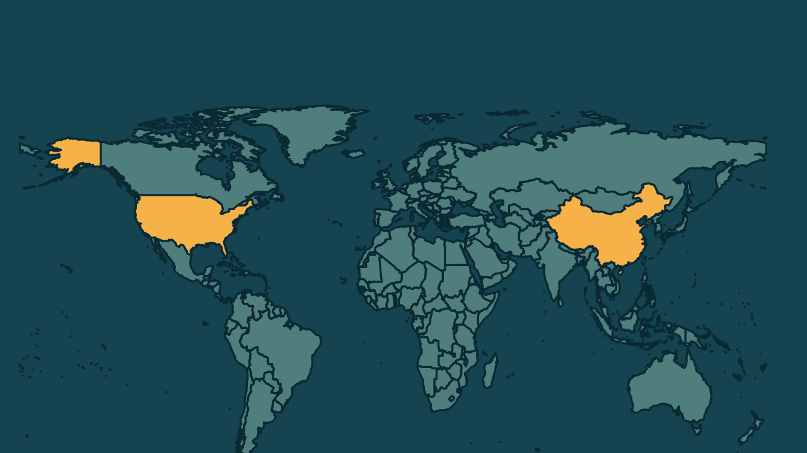

# China prorroga trégua comercial com os Estados Unidos por dois meses

*Heimdall News, edição internacional. 9 de novembro de 2026*

## A notícia

A China prorrogou nesta segunda-feira, por mais dois meses, a trégua comercial com os Estados Unidos, que venceria na terça-feira. A tarifa adicional de 24% sobre produtos americanos segue suspensa, mas uma tarifa de 10% continua em vigor. [1][2][3][4]

Até 10 de janeiro de 2027, também ficam suspensos parte dos controles chineses sobre a exportação de minerais críticos e as taxas portuárias especiais sobre navios ligados aos Estados Unidos. [5][6]

Em setembro, em Washington, os dois países propuseram um pacote de 60 bilhões de dólares em cortes recíprocos de tarifas, que ainda não foi finalizado. Xi Jinping e Donald Trump devem se reunir na próxima semana, na cúpula da Ásia-Pacífico, na China. [7][8][9]

## Quem se manifestou

- **Comissão de Tarifas do Conselho de Estado, China:** afirmou que a prorrogação cumpre o que os dois presidentes acertaram em Washington, e que vai acompanhar as próximas medidas americanas e ajustar suas contramedidas se for preciso. [10][11]
- **Jamieson Greer, americano, representante comercial:** afirmou que o acordo de setembro significa desbloquear um melhor acesso ao mercado chinês para cerca de 30% das exportações americanas para a China. [12]

## Reação no Brasil

- **Patrícia Ellen, brasileira, líder global da Systemiq:** afirmou que a diferença de 10 pontos nas tarifas chinesas sobre a soja ajuda a preservar a competitividade brasileira, pelo menos no curto prazo. [13]
- **Larissa Wachholz, brasileira, especialista em China:** disse que a China pode sempre usar o tamanho do seu mercado como instrumento de negociação com os Estados Unidos. [14][15]

## Fontes

1. Folha de S.Paulo, [China prorroga trégua comercial com os EUA por mais dois meses](https://www1.folha.uol.com.br/mercado/2026/11/china-prorroga-tregua-comercial-com-os-eua-por-mais-dois-meses.shtml): "A China prorrogou nesta segunda-feira (9) a trégua comercial com os Estados Unidos por mais dois meses"
2. Folha de S.Paulo, [China prorroga trégua comercial com os EUA por mais dois meses](https://www1.folha.uol.com.br/mercado/2026/11/china-prorroga-tregua-comercial-com-os-eua-por-mais-dois-meses.shtml): "A trégua estava prevista para expirar na terça-feira (10)."
3. Folha de S.Paulo, [China prorroga trégua comercial com os EUA por mais dois meses](https://www1.folha.uol.com.br/mercado/2026/11/china-prorroga-tregua-comercial-com-os-eua-por-mais-dois-meses.shtml): "Uma tarifa adicional de 24% sobre as importações americanas permanecerá suspensa por dois meses"
4. Folha de S.Paulo, [China prorroga trégua comercial com os EUA por mais dois meses](https://www1.folha.uol.com.br/mercado/2026/11/china-prorroga-tregua-comercial-com-os-eua-por-mais-dois-meses.shtml): "Uma tarifa de 10%, porém, continuará em vigor"
5. Folha de S.Paulo, [China prorroga trégua comercial com os EUA por mais dois meses](https://www1.folha.uol.com.br/mercado/2026/11/china-prorroga-tregua-comercial-com-os-eua-por-mais-dois-meses.shtml): "a China prorrogou até 10 de janeiro de 2027 a suspensão de algumas medidas de seu pacote de controles de exportação de minerais críticos"
6. Poder360, [China prorroga suspensão de tarifa de 24% sobre produtos dos EUA](https://www.poder360.com.br/poder-china/china-prorroga-suspensao-de-tarifa-de-24-sobre-produtos-dos-eua/): "o Ministério dos Transportes informou que as taxas portuárias especiais continuarão suspensas até 10 de janeiro de 2027"
7. Folha de S.Paulo, [China prorroga trégua comercial com os EUA por mais dois meses](https://www1.folha.uol.com.br/mercado/2026/11/china-prorroga-tregua-comercial-com-os-eua-por-mais-dois-meses.shtml): "os dois países propuseram um pacote de US$ 60 bilhões (R$ 330 bilhões) em cortes tarifários recíprocos"
8. Folha de S.Paulo, [China prorroga trégua comercial com os EUA por mais dois meses](https://www1.folha.uol.com.br/mercado/2026/11/china-prorroga-tregua-comercial-com-os-eua-por-mais-dois-meses.shtml): "mas o plano ainda não foi finalizado"
9. Folha de S.Paulo, [China prorroga trégua comercial com os EUA por mais dois meses](https://www1.folha.uol.com.br/mercado/2026/11/china-prorroga-tregua-comercial-com-os-eua-por-mais-dois-meses.shtml): "devem se reunir pela terceira vez neste ano durante a cúpula de líderes da Apec"
10. Folha de S.Paulo, [China prorroga trégua comercial com os EUA por mais dois meses](https://www1.folha.uol.com.br/mercado/2026/11/china-prorroga-tregua-comercial-com-os-eua-por-mais-dois-meses.shtml): "resultados e consensos alcançados na reunião em Washington entre os chefes de Estado da China e dos Estados Unidos"
11. Folha de S.Paulo, [China prorroga trégua comercial com os EUA por mais dois meses](https://www1.folha.uol.com.br/mercado/2026/11/china-prorroga-tregua-comercial-com-os-eua-por-mais-dois-meses.shtml): "acompanhará de perto as medidas subsequentes adotadas pelos Estados Unidos e, conforme apropriado, ajustará as contramedidas tarifárias pertinentes"
12. CNN Brasil, [China prorroga suspensão de tarifa de 24% sobre produtos dos EUA](https://www.cnnbrasil.com.br/economia/china-prorroga-suspensao-de-tarifa-de-24-sobre-produtos-dos-eua/): "isso significou “desbloquear um melhor acesso ao mercado” para cerca de 30% das exportações americanas para a China"
13. G1, com AFP, [Brasil pode perder seu maior comprador de soja? Entenda os planos da China e a disputa com os EUA](https://g1.globo.com/economia/agronegocios/noticia/2026/11/08/brasil-pode-perder-seu-maior-comprador-de-soja-entenda-os-planos-da-china-e-a-disputa-com-os-eua.ghtml): "Essa diferença de 10 pontos percentuais ajuda a preservar a competitividade brasileira, pelo menos no curto prazo"
14. G1, com AFP, [Brasil pode perder seu maior comprador de soja? Entenda os planos da China e a disputa com os EUA](https://g1.globo.com/economia/agronegocios/noticia/2026/11/08/brasil-pode-perder-seu-maior-comprador-de-soja-entenda-os-planos-da-china-e-a-disputa-com-os-eua.ghtml): "Sempre será uma carta na manga o fato de a China ser um mercado tão demandante."
15. G1, com AFP, [Brasil pode perder seu maior comprador de soja? Entenda os planos da China e a disputa com os EUA](https://g1.globo.com/economia/agronegocios/noticia/2026/11/08/brasil-pode-perder-seu-maior-comprador-de-soja-entenda-os-planos-da-china-e-a-disputa-com-os-eua.ghtml): "Então, ela pode sempre usar isso como instrumento de negociação"
