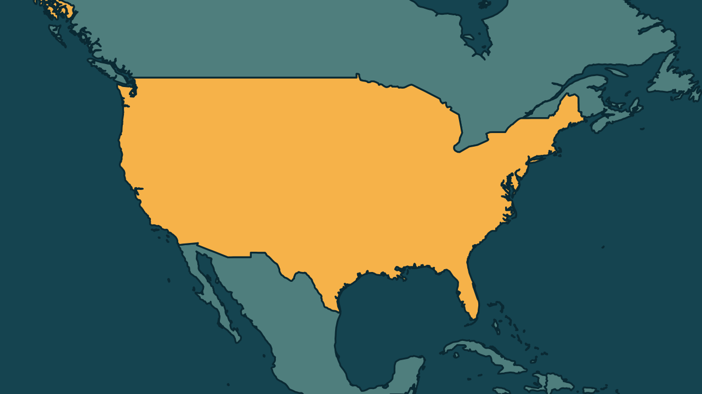

# Trump põe em dúvida eleição de meio de mandato nos Estados Unidos

*Heimdall News, edição internacional. 9 de novembro de 2026*

## A notícia

O presidente dos Estados Unidos, Donald Trump, questionou nesta segunda-feira, 9 de novembro, o resultado das eleições de meio de mandato, realizadas no dia 3. [1][2]

Numa rede social, ele perguntou se alguém acredita que a eleição foi honesta e como as pesquisas puderam estar tão erradas. [3][4]

Na noite da eleição, Trump tinha dito ao jornal The New York Times que estava disposto a aceitar os resultados. Foi a primeira vez que ele questionou diretamente a lisura da votação. [5][6]

O Partido Democrata conquistou a maioria no Senado e na Câmara dos Representantes, como várias pesquisas indicavam, e venceu em 22 dos 36 estados que escolheram governador. [7][8][9]

## Quem se manifestou

- **Donald Trump, americano, presidente:** disse à rede CBS que os eleitores não gostaram da guerra nem da alta da gasolina, e que sua política de deportações foi dura demais. [10][11]
- **JD Vance, americano, vice-presidente:** apontou a guerra no Irã como um dos principais fatores da derrota e sugeriu repensar o apoio a Israel. [12][13]
- **Amir Tibon, israelense, jornalista:** escreveu que democratas e republicanos disputam quem se distancia mais de Israel. [14]

## Reação no Brasil

Nenhum posicionamento encontrado.

## Fontes

1. CNN Brasil, [Trump questiona resultados das Midterms após inicialmente aceitar derrota](https://www.cnnbrasil.com.br/internacional/trump-questiona-resultados-das-midterms-apos-inicialmente-aceitar-derrota/): "questionou nesta segunda-feira (9) os resultados das Midterms"
2. Gazeta do Povo, [Seis dias depois, Trump questiona resultado das midterms: “Alguém acredita que foram honestas?”](https://www.gazetadopovo.com.br/mundo/seis-dias-depois-trump-questiona-resultado-midterms/): "realizadas na terça-feira passada (3)"
3. CNN Brasil, [Trump questiona resultados das Midterms após inicialmente aceitar derrota](https://www.cnnbrasil.com.br/internacional/trump-questiona-resultados-das-midterms-apos-inicialmente-aceitar-derrota/): "Alguém realmente acredita que esta ‘eleição’ foi honesta? Como as pesquisas puderam estar tão erradas???"
4. Gazeta do Povo, [Seis dias depois, Trump questiona resultado das midterms: “Alguém acredita que foram honestas?”](https://www.gazetadopovo.com.br/mundo/seis-dias-depois-trump-questiona-resultado-midterms/): "escreveu Trump na rede Truth Social"
5. CNN Brasil, [Trump questiona resultados das Midterms após inicialmente aceitar derrota](https://www.cnnbrasil.com.br/internacional/trump-questiona-resultados-das-midterms-apos-inicialmente-aceitar-derrota/): "Em uma entrevista ao The New York Times na noite da eleição, o presidente afirmou que estava “absolutamente disposto” a aceitar os resultados"
6. Gazeta do Povo, [Seis dias depois, Trump questiona resultado das midterms: “Alguém acredita que foram honestas?”](https://www.gazetadopovo.com.br/mundo/seis-dias-depois-trump-questiona-resultado-midterms/): "Esta foi a primeira vez que ele questionou diretamente a lisura do processo"
7. CNN Brasil, [Trump questiona resultados das Midterms após inicialmente aceitar derrota](https://www.cnnbrasil.com.br/internacional/trump-questiona-resultados-das-midterms-apos-inicialmente-aceitar-derrota/): "O Partido Republicano perdeu a maioria tanto no Senado quanto na Câmara dos Representantes"
8. Gazeta do Povo, [Seis dias depois, Trump questiona resultado das midterms: “Alguém acredita que foram honestas?”](https://www.gazetadopovo.com.br/mundo/seis-dias-depois-trump-questiona-resultado-midterms/): "várias pesquisas já indicavam que os democratas venceriam a disputa"
9. Metrópoles, [EUA: Trump atribui derrota republicana nas midterms à "antipatia a Israel"](https://www.metropoles.com/mundo/eua-trump-atribui-derrota-republicana-nas-midterms-a-antipatia-a-israel): "foram escolhidos governadores em 36 dos 50 estados dos EUA. Democratas venceram em 22 estados"
10. Metrópoles, [EUA: Trump atribui derrota republicana nas midterms à "antipatia a Israel"](https://www.metropoles.com/mundo/eua-trump-atribui-derrota-republicana-nas-midterms-a-antipatia-a-israel): "Eles não gostaram da guerra. Não gostaram do fato de o preço da gasolina ter subido"
11. Gazeta do Povo, [Após derrota nas midterms, Trump diz que sua política de migração foi “dura demais”](https://www.gazetadopovo.com.br/mundo/apos-derrota-midterms-trump-diz-politica-migracao-foi-dura-demais/): "disse Trump, sobre sua política de deportações em massa"
12. Gazeta do Povo, [Após derrota nas midterms, Trump diz que sua política de migração foi “dura demais”](https://www.gazetadopovo.com.br/mundo/apos-derrota-midterms-trump-diz-politica-migracao-foi-dura-demais/): "J.D. Vance e o próprio Trump admitiram na semana passada que foi um dos principais fatores para a derrota nas midterms"
13. CNN Brasil, [Trump diz que “grande aversão a Israel” cooperou para derrota nas Midterms](https://www.cnnbrasil.com.br/internacional/trump-diz-que-grande-aversao-a-israel-cooperou-para-derrota-nas-midterms/): "sugeriu que os republicanos precisariam repensar o apoio"
14. CNN Brasil, [Trump diz que “grande aversão a Israel” cooperou para derrota nas Midterms](https://www.cnnbrasil.com.br/internacional/trump-diz-que-grande-aversao-a-israel-cooperou-para-derrota-nas-midterms/): "Democratas e republicanos estão competindo para ver quem consegue se distanciar mais de nós"
