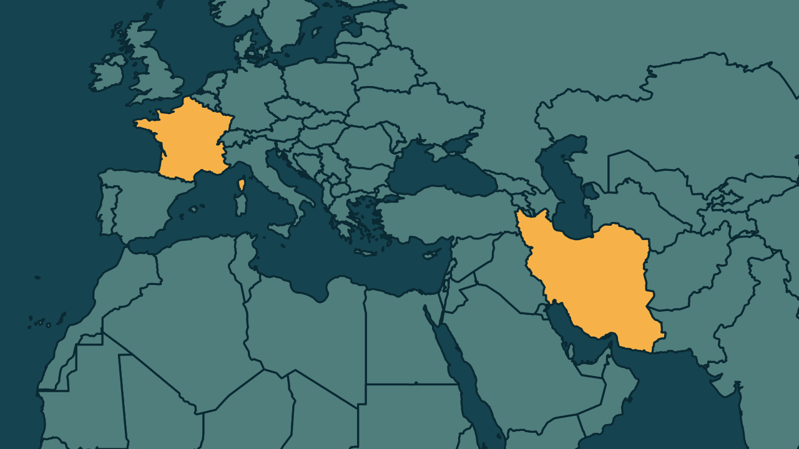

# França acusa Irã de ciberataque a supermercados e promete sanções

*Heimdall News, edição internacional. 9 de novembro de 2026*

## A notícia

A França acusou nesta segunda-feira a Guarda Revolucionária do Irã pelo ciberataque de outubro a cerca de 700 supermercados franceses. Os invasores elevaram a temperatura dos refrigeradores a 50 graus, causando incêndios e perdas de alimentos. [1][2][3][4]

A Procuradoria de Paris pediu mandados de prisão internacionais contra o chefe da unidade iraniana Shahid Kaveh e dois subordinados. A investigação encontrou o uso do idioma farsi e endereços de internet ligados a aparelhos no Irã. [5][6][7]

A França convocou o embaixador iraniano. No dia 2 de novembro, outros sete países europeus tiveram ataques parecidos, sem ligação confirmada. O Irã ainda não respondeu. [8][9][10][11]

## Quem se manifestou

- **Jean-Noël Barrot, francês, ministro das Relações Exteriores:** afirmou que o ataque tem magnitude e agressividade sem precedentes e prometeu sanções europeias contra todos os responsáveis. [12][13]
- **Laure Beccuau, francesa, procuradora de Paris:** explicou que os invasores tomaram o controle remoto dos equipamentos para iniciar ciclos anormais de degelo e desligaram os alertas. [14][15]
- **Kaja Kallas, estoniana, chefe da diplomacia europeia:** informou que o G7 foi avisado da responsabilidade do Irã e que os chanceleres europeus vão avaliar uma possível resposta contundente. [16][17]

## Reação no Brasil

Nenhum posicionamento encontrado.

## Fontes

1. Estadão, com AFP, [França acusa o Irã de hackear refrigeradores de supermercados e promete sanções](https://www.estadao.com.br/internacional/franca-acusa-o-ira-de-hackear-refrigeradores-de-supermercados-e-promete-sancoes-npr/): "A França denunciou nesta segunda-feira, 9, que uma unidade cibernética ligada à Guarda Revolucionária do Irã está por trás do ataque"
2. Poder360, [França culpa Irã por ataque cibernético a supermercados](https://www.poder360.com.br/poder-internacional/franca-culpa-ira-por-ataque-cibernetico-a-supermercados/): "responsabilizou a Guarda Revolucionária do Irã por um ataque cibernético que atingiu sistemas de refrigeração de cerca de 700 supermercados franceses em outubro"
3. Poder360, [França culpa Irã por ataque cibernético a supermercados](https://www.poder360.com.br/poder-internacional/franca-culpa-ira-por-ataque-cibernetico-a-supermercados/): "elevaram a temperatura dos aparelhos para 50ºC"
4. Poder360, [França culpa Irã por ataque cibernético a supermercados](https://www.poder360.com.br/poder-internacional/franca-culpa-ira-por-ataque-cibernetico-a-supermercados/): "A mudança de temperatura causou incêndios e perdas de alimentos em centenas de lojas."
5. Poder360, [França culpa Irã por ataque cibernético a supermercados](https://www.poder360.com.br/poder-internacional/franca-culpa-ira-por-ataque-cibernetico-a-supermercados/): "a Procuradoria de Paris solicitou a emissão de mandados de prisão internacional contra 3 integrantes do grupo iraniano Shahid Kaveh"
6. Poder360, [França culpa Irã por ataque cibernético a supermercados](https://www.poder360.com.br/poder-internacional/franca-culpa-ira-por-ataque-cibernetico-a-supermercados/): "O pedido tem como alvos o chefe da organização e 2 subordinados."
7. Poder360, [França culpa Irã por ataque cibernético a supermercados](https://www.poder360.com.br/poder-internacional/franca-culpa-ira-por-ataque-cibernetico-a-supermercados/): "como o uso do idioma farsi e de endereços IP vinculados a dispositivos localizados no Irã"
8. Poder360, [França culpa Irã por ataque cibernético a supermercados](https://www.poder360.com.br/poder-internacional/franca-culpa-ira-por-ataque-cibernetico-a-supermercados/): "convocamos o embaixador iraniano na França"
9. G1, [França investiga se Irã está por trás de ataque a refrigeradores e promete sanções ao país](https://g1.globo.com/mundo/noticia/2026/11/09/franca-investiga-se-ira-esta-por-tras-de-ataque-a-refrigeradores-e-promete-sancoes-ao-pais.ghtml): "No dia 2 de novembro, o mesmo ocorreu na Suécia, Irlanda, Holanda, Estônia, Finlândia, Bélgica e Luxemburgo"
10. Folha de S.Paulo, [França acusa o Irã de hackear refrigeradores de supermercados](https://www1.folha.uol.com.br/mercado/2026/11/franca-acusa-o-ira-de-hackear-refrigeradores-de-supermercados.shtml): "Não se sabe se os episódios estão relacionados."
11. Folha de S.Paulo, [França acusa o Irã de hackear refrigeradores de supermercados](https://www1.folha.uol.com.br/mercado/2026/11/franca-acusa-o-ira-de-hackear-refrigeradores-de-supermercados.shtml): "O Irã ainda não respondeu às alegações de Barrot."
12. Estadão, com AFP, [França acusa o Irã de hackear refrigeradores de supermercados e promete sanções](https://www.estadao.com.br/internacional/franca-acusa-o-ira-de-hackear-refrigeradores-de-supermercados-e-promete-sancoes-npr/): "É um ataque de uma magnitude sem precedentes e de uma agressividade inédita"
13. Poder360, [França culpa Irã por ataque cibernético a supermercados](https://www.poder360.com.br/poder-internacional/franca-culpa-ira-por-ataque-cibernetico-a-supermercados/): "Aplicaremos sanções, no âmbito da União Europeia, contra todos os responsáveis por esse ataque"
14. Estadão, com AFP, [França acusa o Irã de hackear refrigeradores de supermercados e promete sanções](https://www.estadao.com.br/internacional/franca-acusa-o-ira-de-hackear-refrigeradores-de-supermercados-e-promete-sancoes-npr/): "Os invasores assumiram o controle remoto dos equipamentos por meio de interfaces web para iniciar ciclos anormais de degelo de duração ilimitada"
15. Estadão, com AFP, [França acusa o Irã de hackear refrigeradores de supermercados e promete sanções](https://www.estadao.com.br/internacional/franca-acusa-o-ira-de-hackear-refrigeradores-de-supermercados-e-promete-sancoes-npr/): "ao mesmo tempo em que desativavam os alertas de segurança dos sensores"
16. Estadão, com AFP, [França acusa o Irã de hackear refrigeradores de supermercados e promete sanções](https://www.estadao.com.br/internacional/franca-acusa-o-ira-de-hackear-refrigeradores-de-supermercados-e-promete-sancoes-npr/): "informou que os representantes do G7 acabavam de ser informados sobre a responsabilidade do Irã"
17. Estadão, com AFP, [França acusa o Irã de hackear refrigeradores de supermercados e promete sanções](https://www.estadao.com.br/internacional/franca-acusa-o-ira-de-hackear-refrigeradores-de-supermercados-e-promete-sancoes-npr/): "para avaliar uma possível “resposta contundente”"
