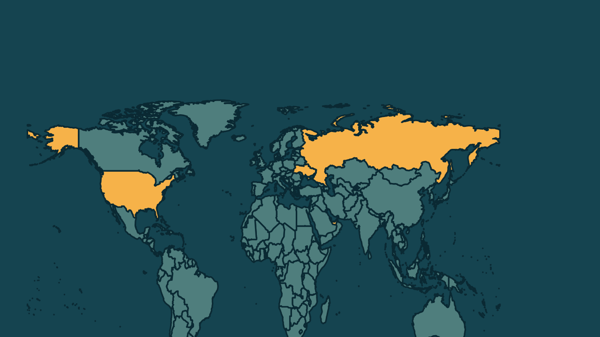

# Ucrânia, Rússia e Estados Unidos retomam negociações em Abu Dhabi

*Heimdall News, edição internacional. 10 de novembro de 2026*

## A notícia

Negociadores da Ucrânia, da Rússia e dos Estados Unidos começaram nesta terça-feira, em Abu Dhabi, a primeira rodada de conversas desde fevereiro para tentar encerrar a guerra. A sessão dura 2 dias, com foco nas garantias de segurança. [1][2][3]

Os Estados Unidos são representados por Jared Kushner, genro de Donald Trump, e por Steve Witkoff. Rustem Umerov chefia a delegação ucraniana, e Vladimir Medinsky, a russa. Europeus se reuniram em separado com ucranianos e americanos. [4][5][6][7]

A Rússia exige que a Ucrânia entregue as partes de Donetsk que ainda controla, o que Kiev rejeita. Durante a noite, a Rússia lançou 162 drones e um míssil balístico, segundo a Força Aérea Ucraniana. [8][9][10]

## Quem se manifestou

- **Jared Kushner, americano, emissário:** afirmou que busca uma solução negociada para uma paz duradoura, e que um acordo vai exigir diálogo direto entre a Rússia e os parceiros europeus. [11][12]
- **Rustem Umerov, ucraniano, chefe da inteligência estrangeira:** afirmou que as prioridades são o fim das hostilidades e garantias confiáveis de segurança depois da guerra. [13]
- **Sergey Lavrov, russo, ministro das Relações Exteriores:** saudou a proposta dos negociadores de Trump de pôr a segurança coletiva no topo da agenda. [14]

## Reação no Brasil

Nenhum posicionamento encontrado.

## Fontes

1. Estadão, com AP, [Rússia e Ucrânia abrem nova rodada de negociações de paz nesta terça-feira](https://www.estadao.com.br/internacional/russia-ucrania-negociacoes-de-paz-abu-dhabi-npr/): "As negociações entre Rússia, Ucrânia e Estados Unidos começaram nesta terça-feira, 10, nos Emirados Árabes Unidos"
2. Estadão, com AP, [Rússia e Ucrânia abrem nova rodada de negociações de paz nesta terça-feira](https://www.estadao.com.br/internacional/russia-ucrania-negociacoes-de-paz-abu-dhabi-npr/): "A sessão de dois dias na capital dos Emirados Árabes Unidos, Abu Dhabi, é a primeira reunião desse tipo desde fevereiro."
3. Estadão, com AP, [Rússia e Ucrânia abrem nova rodada de negociações de paz nesta terça-feira](https://www.estadao.com.br/internacional/russia-ucrania-negociacoes-de-paz-abu-dhabi-npr/): "O foco será nas garantias de segurança, segundo informou a Casa Branca antes das discussões."
4. CNN Brasil, [Negociações entre EUA, Ucrânia e Rússia começam em Abu Dhabi, diz Moscou](https://www.cnnbrasil.com.br/internacional/negociacoes-entre-eua-ucrania-e-russia-comecam-em-abu-dhabi-diz-moscou/): "Os Estados Unidos são representados por Jared Kushner, genro do presidente Donald Trump, e pelo enviado especial Steve Witkoff."
5. CNN Brasil, [Negociações entre EUA, Ucrânia e Rússia começam em Abu Dhabi, diz Moscou](https://www.cnnbrasil.com.br/internacional/negociacoes-entre-eua-ucrania-e-russia-comecam-em-abu-dhabi-diz-moscou/): "A delegação ucraniana é liderada pelo chefe da inteligência estrangeira do país, Rustem Umerov"
6. CNN Brasil, [Negociações entre EUA, Ucrânia e Rússia começam em Abu Dhabi, diz Moscou](https://www.cnnbrasil.com.br/internacional/negociacoes-entre-eua-ucrania-e-russia-comecam-em-abu-dhabi-diz-moscou/): "a equipe russa é chefiada pelo assessor do Kremlin Vladimir Medinsky"
7. Estadão, com AP, [Rússia e Ucrânia abrem nova rodada de negociações de paz nesta terça-feira](https://www.estadao.com.br/internacional/russia-ucrania-negociacoes-de-paz-abu-dhabi-npr/): "uma reunião entre a equipe ucraniana, os enviados dos EUA e representantes do Reino Unido, França, Alemanha, Itália, Otan e Comissão Europeia"
8. CartaCapital, [Ucrânia e Rússia se reúnem em Abu Dhabi para negociar o fim da guerra](https://www.cartacapital.com.br/mundo/ucrania-e-russia-se-reunem-em-abu-dhabi-para-negociar-o-fim-da-guerra/): "Moscou exige que Kiev renuncie às partes da região ainda sob seu controle"
9. CartaCapital, [Ucrânia e Rússia se reúnem em Abu Dhabi para negociar o fim da guerra](https://www.cartacapital.com.br/mundo/ucrania-e-russia-se-reunem-em-abu-dhabi-para-negociar-o-fim-da-guerra/): "A Ucrânia rejeita a exigência"
10. Estadão, com AP, [Rússia e Ucrânia abrem nova rodada de negociações de paz nesta terça-feira](https://www.estadao.com.br/internacional/russia-ucrania-negociacoes-de-paz-abu-dhabi-npr/): "A Rússia lançou 162 drones de vários tipos e um míssil balístico contra a Ucrânia durante a noite, informou a Força Aérea Ucraniana."
11. Estadão, com AP, [Rússia e Ucrânia abrem nova rodada de negociações de paz nesta terça-feira](https://www.estadao.com.br/internacional/russia-ucrania-negociacoes-de-paz-abu-dhabi-npr/): "solução negociada que possa trazer paz duradoura"
12. Estadão, com AP, [Rússia e Ucrânia abrem nova rodada de negociações de paz nesta terça-feira](https://www.estadao.com.br/internacional/russia-ucrania-negociacoes-de-paz-abu-dhabi-npr/): "um acordo abrangente e duradouro também exigirá um diálogo direto entre a Rússia e nossos parceiros europeus"
13. CNN Brasil, [Negociações entre EUA, Ucrânia e Rússia começam em Abu Dhabi, diz Moscou](https://www.cnnbrasil.com.br/internacional/negociacoes-entre-eua-ucrania-e-russia-comecam-em-abu-dhabi-diz-moscou/): "Nossas principais prioridades são a cessação das hostilidades, garantias confiáveis de segurança no pós-guerra"
14. Estadão, com AP, [Rússia e Ucrânia abrem nova rodada de negociações de paz nesta terça-feira](https://www.estadao.com.br/internacional/russia-ucrania-negociacoes-de-paz-abu-dhabi-npr/): "Só podemos saudar a proposta dos negociadores (americanos) do presidente Donald Trump de colocar a questão da segurança coletiva no topo da agenda"
