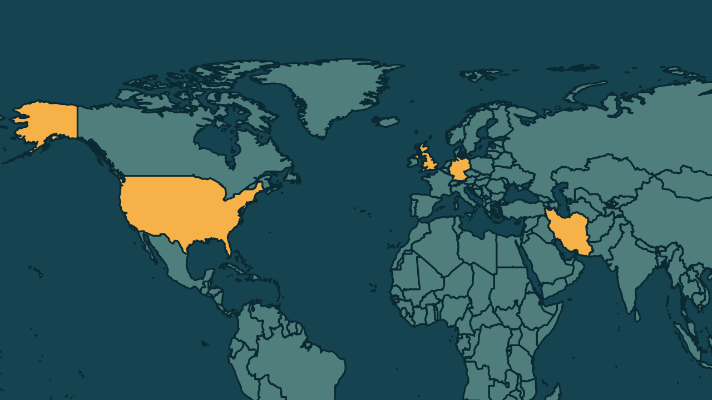

# Estados Unidos retiram aviões de base britânica após ameaça do Irã

*Heimdall News, edição internacional. 10 de novembro de 2026*

## A notícia

Os Estados Unidos retiraram aviões-tanque da base aérea de Mildenhall, no leste da Inglaterra, na segunda-feira, depois de uma ameaça atribuída ao Irã, segundo o Wall Street Journal. Os aviões foram levados para a Alemanha e outros locais. [1][2][3]

É o segundo caso desse tipo em cerca de um mês. Em setembro, os americanos tiraram bombardeiros B-1, usados em ataques ao Irã, da base de Fairford, depois de um incidente de segurança. Dois homens foram detidos sob suspeita de ajudar a inteligência iraniana. [4][5][6]

Os Estados Unidos também elevaram o alerta nas bases de Mildenhall e Lakenheath para o segundo nível mais alto, usado quando a inteligência indica possível ação terrorista. [7][8][9]

## Quem se manifestou

- **Ministério da Defesa, Reino Unido:** disse que não comenta atividades de outras nações e que aeronaves são deslocadas conforme as necessidades operacionais. [10][11]
- **Comando Europeu, Estados Unidos:** disse que a Força Aérea desloca aeronaves por vários motivos, sem confirmar as movimentações. [12][13]
- **Andy Burnham, britânico, primeiro-ministro:** afirmou no mês passado que a atividade na base de Fairford provavelmente foi coordenada no Irã. [14]
- **Embaixada do Irã no Reino Unido, Irã:** negou envolvimento iraniano em qualquer plano contra a base. [15]

## Reação no Brasil

Nenhum posicionamento encontrado.

## Fontes

1. Estadão, [EUA retiram aviões-tanque de base britânica após ameaça do Irã, diz jornal](https://www.estadao.com.br/internacional/eua-retiram-avioes-tanque-de-base-britanica-apos-ameaca-do-ira-npr/): "Os Estados Unidos retiraram aviões-tanque de uma base aérea britânica após uma ameaça atribuída ao Irã, informou o Wall Street Journal"
2. Gazeta do Povo, [EUA retiram aviões de segunda base militar no Reino Unido após ameaças do Irã](https://www.gazetadopovo.com.br/mundo/eua-retiram-avioes-segunda-base-militar-reino-unido-apos-ameacas-ira/): "retiraram aeronaves americanas de uma base aérea na Inglaterra nesta segunda-feira (9) devido a ameaças do Irã"
3. Estadão, [EUA retiram aviões-tanque de base britânica após ameaça do Irã, diz jornal](https://www.estadao.com.br/internacional/eua-retiram-avioes-tanque-de-base-britanica-apos-ameaca-do-ira-npr/): "A movimentação ocorreu na RAF Mildenhall, no leste da Inglaterra, e envolveu a transferência de aeronaves para a Alemanha e outros locais."
4. Gazeta do Povo, [EUA retiram aviões de segunda base militar no Reino Unido após ameaças do Irã](https://www.gazetadopovo.com.br/mundo/eua-retiram-avioes-segunda-base-militar-reino-unido-apos-ameacas-ira/): "no segundo caso desse tipo em cerca de um mês"
5. Estadão, [EUA retiram aviões-tanque de base britânica após ameaça do Irã, diz jornal](https://www.estadao.com.br/internacional/eua-retiram-avioes-tanque-de-base-britanica-apos-ameaca-do-ira-npr/): "Em setembro, os EUA retiraram da instalação aeronaves B-1, utilizadas em ataques contra o território iraniano"
6. CNN Brasil, [EUA retiram aviões de base no Reino Unido após ameaça do Irã, diz jornal](https://www.cnnbrasil.com.br/internacional/eua-retiram-avioes-de-base-no-reino-unido-apos-ameaca-do-ira-diz-jornal/): "Outros dois foram detidos posteriormente sob suspeita de prestar assistência à inteligência iraniana."
7. Estadão, [EUA retiram aviões-tanque de base britânica após ameaça do Irã, diz jornal](https://www.estadao.com.br/internacional/eua-retiram-avioes-tanque-de-base-britanica-apos-ameaca-do-ira-npr/): "os EUA elevaram o nível de segurança nas bases aéreas da RAF Mildenhall e da RAF Lakenheath"
8. Estadão, [EUA retiram aviões-tanque de base britânica após ameaça do Irã, diz jornal](https://www.estadao.com.br/internacional/eua-retiram-avioes-tanque-de-base-britanica-apos-ameaca-do-ira-npr/): "o segundo estágio mais alto do sistema de alerta de proteção militar americano"
9. Estadão, [EUA retiram aviões-tanque de base britânica após ameaça do Irã, diz jornal](https://www.estadao.com.br/internacional/eua-retiram-avioes-tanque-de-base-britanica-apos-ameaca-do-ira-npr/): "é adotada quando informações de inteligência indicam a possibilidade de uma ação terrorista"
10. CNN Brasil, [EUA retiram aviões de base no Reino Unido após ameaça do Irã, diz jornal](https://www.cnnbrasil.com.br/internacional/eua-retiram-avioes-de-base-no-reino-unido-apos-ameaca-do-ira-diz-jornal/): "Não comentamos rotineiramente as atividades de outras nações."
11. CNN Brasil, [EUA retiram aviões de base no Reino Unido após ameaça do Irã, diz jornal](https://www.cnnbrasil.com.br/internacional/eua-retiram-avioes-de-base-no-reino-unido-apos-ameaca-do-ira-diz-jornal/): "Aeronaves e outros recursos são deslocados regularmente de acordo com as necessidades operacionais"
12. Estadão, [EUA retiram aviões-tanque de base britânica após ameaça do Irã, diz jornal](https://www.estadao.com.br/internacional/eua-retiram-avioes-tanque-de-base-britanica-apos-ameaca-do-ira-npr/): "o Comando Europeu dos Estados Unidos afirmou que a Força Aérea americana desloca aeronaves entre diferentes instalações por uma série de motivos"
13. Estadão, [EUA retiram aviões-tanque de base britânica após ameaça do Irã, diz jornal](https://www.estadao.com.br/internacional/eua-retiram-avioes-tanque-de-base-britanica-apos-ameaca-do-ira-npr/): "mas não confirmou as movimentações específicas"
14. CNN Brasil, [EUA retiram aviões de base no Reino Unido após ameaça do Irã, diz jornal](https://www.cnnbrasil.com.br/internacional/eua-retiram-avioes-de-base-no-reino-unido-apos-ameaca-do-ira-diz-jornal/): "afirmou no mês passado que a atividade em RAF Fairford provavelmente havia sido coordenada no Irã"
15. CNN Brasil, [EUA retiram aviões de base no Reino Unido após ameaça do Irã, diz jornal](https://www.cnnbrasil.com.br/internacional/eua-retiram-avioes-de-base-no-reino-unido-apos-ameaca-do-ira-diz-jornal/): "o embaixador de Teerã no Reino Unido tenha negado as acusações de envolvimento iraniano em qualquer plano contra a base aérea"
