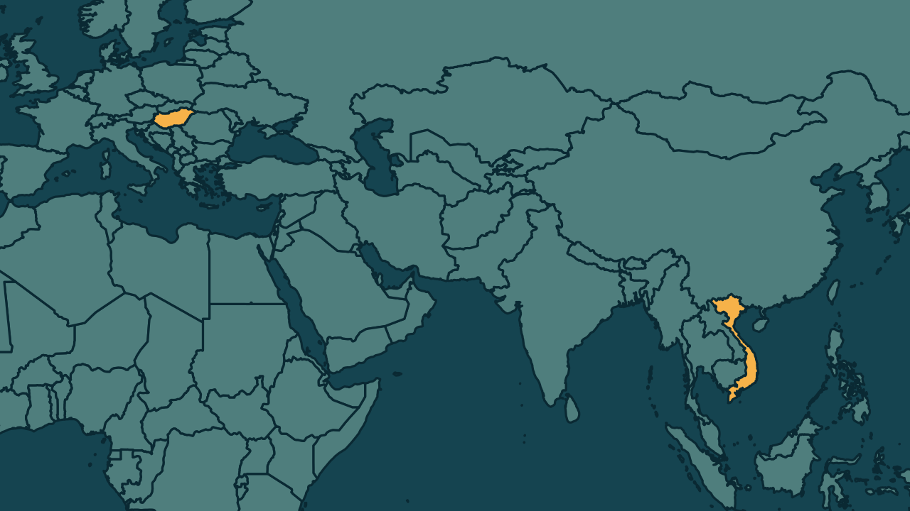

# Irmão de Viktor Orbán é preso na Hungria em caso de tráfico de pessoas

*Heimdall News, edição internacional. 10 de novembro de 2026*

## A notícia

Áron Orbán, irmão do ex-primeiro-ministro da Hungria Viktor Orbán, foi preso na segunda-feira numa investigação de tráfico de pessoas. Quatro pessoas foram detidas em Budapeste e na região vizinha. [1][2]

Segundo as autoridades, os detidos ajudaram, em 2024, mais de cem vietnamitas a obter autorização de residência na Hungria para seguir para a Europa Ocidental, cobrando uma taxa nas missões diplomáticas húngaras no Vietnã. [3][4][5]

O caso é do órgão anticorrupção criado pelo primeiro-ministro Péter Magyar, que derrotou Orbán na eleição de abril. Dois ex-ministros de Orbán e o ex-presidente do Banco Central já estão presos em outras investigações. [6][7]

## Quem se manifestou

- **Viktor Orbán, húngaro, ex-primeiro-ministro:** classificou a prisão como vingança política. Disse que ele é o alvo, que o irmão é só um instrumento e que o objetivo é eliminar o adversário e instaurar um sistema de partido único. Ele nega as acusações de corrupção do seu governo. [8][9][10][11]
- **Péter Magyar, húngaro, primeiro-ministro:** confirmou a prisão num discurso em Berlim e disse que três ex-ministros de Orbán já estão presos. [12][13]

## Reação no Brasil

Nenhum posicionamento encontrado.

## Fontes

1. Gazeta do Povo, [Irmão de Orbán é preso por acusações de tráfico de pessoas; ex-premiê alega motivação política](https://www.gazetadopovo.com.br/mundo/irmao-orban-preso-acusacoes-trafico-pessoas-ex-premie-alega-motivacao-politica/): "Áron Orbán, irmão de Viktor Orbán, primeiro-ministro da Hungria entre 2010 e este ano, foi preso nesta segunda-feira (9)"
2. Folha de S.Paulo, [Irmão de Viktor Orbán é preso sob suspeita de envolvimento em tráfico de pessoas](https://www1.folha.uol.com.br/mundo/2026/11/irmao-de-viktor-orban-e-preso-sob-suspeita-de-envolvimento-em-trafico-de-pessoas.shtml): "havia detido quatro pessoas e realizado buscas em residências de vários locais de Budapeste e do condado de Pest"
3. Gazeta do Povo, [Irmão de Orbán é preso por acusações de tráfico de pessoas; ex-premiê alega motivação política](https://www.gazetadopovo.com.br/mundo/irmao-orban-preso-acusacoes-trafico-pessoas-ex-premie-alega-motivacao-politica/): "facilitado em 2024 a obtenção de autorizações de residência na Hungria para mais de cem cidadãos vietnamitas"
4. Gazeta do Povo, [Irmão de Orbán é preso por acusações de tráfico de pessoas; ex-premiê alega motivação política](https://www.gazetadopovo.com.br/mundo/irmao-orban-preso-acusacoes-trafico-pessoas-ex-premie-alega-motivacao-politica/): "que tinham planos de seguir para países da Europa Ocidental"
5. G1, [Hungria detém irmão de Viktor Orbán em investigação por tráfico de pessoas, diz primeiro-ministro](https://g1.globo.com/mundo/noticia/2026/11/10/hungria-detem-irmao-de-viktor-orban-em-investigacao-por-trafico-de-pessoas.ghtml): "cobravam dos solicitantes de visto uma suposta taxa de recrutamento nas missões diplomáticas da Hungria no Vietnã"
6. Folha de S.Paulo, [Irmão de Viktor Orbán é preso sob suspeita de envolvimento em tráfico de pessoas](https://www1.folha.uol.com.br/mundo/2026/11/irmao-de-viktor-orban-e-preso-sob-suspeita-de-envolvimento-em-trafico-de-pessoas.shtml): "A instituição foi criada por Magyar, que derrotou seu antecessor nas eleições realizadas em abril"
7. Folha de S.Paulo, [Irmão de Viktor Orbán é preso sob suspeita de envolvimento em tráfico de pessoas](https://www1.folha.uol.com.br/mundo/2026/11/irmao-de-viktor-orban-e-preso-sob-suspeita-de-envolvimento-em-trafico-de-pessoas.shtml): "Dois ex-ministros de Orbán e o ex-presidente do Banco Central, Gyorgy Matolcsy, estão atualmente presos"
8. Folha de S.Paulo, [Irmão de Viktor Orbán é preso sob suspeita de envolvimento em tráfico de pessoas](https://www1.folha.uol.com.br/mundo/2026/11/irmao-de-viktor-orban-e-preso-sob-suspeita-de-envolvimento-em-trafico-de-pessoas.shtml): "classificou a detenção do irmão como um ato de vingança política"
9. Folha de S.Paulo, [Irmão de Viktor Orbán é preso sob suspeita de envolvimento em tráfico de pessoas](https://www1.folha.uol.com.br/mundo/2026/11/irmao-de-viktor-orban-e-preso-sob-suspeita-de-envolvimento-em-trafico-de-pessoas.shtml): "Eu sou o alvo; meu irmão mais novo é apenas um instrumento"
10. Folha de S.Paulo, [Irmão de Viktor Orbán é preso sob suspeita de envolvimento em tráfico de pessoas](https://www1.folha.uol.com.br/mundo/2026/11/irmao-de-viktor-orban-e-preso-sob-suspeita-de-envolvimento-em-trafico-de-pessoas.shtml): "o objetivo é eliminar o adversário político e instaurar um sistema de partido único"
11. Folha de S.Paulo, [Irmão de Viktor Orbán é preso sob suspeita de envolvimento em tráfico de pessoas](https://www1.folha.uol.com.br/mundo/2026/11/irmao-de-viktor-orban-e-preso-sob-suspeita-de-envolvimento-em-trafico-de-pessoas.shtml): "investigar denúncias de corrupção durante os 16 anos de governo de Orbán, que nega qualquer acusação"
12. Folha de S.Paulo, [Irmão de Viktor Orbán é preso sob suspeita de envolvimento em tráfico de pessoas](https://www1.folha.uol.com.br/mundo/2026/11/irmao-de-viktor-orban-e-preso-sob-suspeita-de-envolvimento-em-trafico-de-pessoas.shtml): "confirmou o primeiro-ministro Péter Magyar em um discurso na segunda-feira (9) em Berlim"
13. Folha de S.Paulo, [Irmão de Viktor Orbán é preso sob suspeita de envolvimento em tráfico de pessoas](https://www1.folha.uol.com.br/mundo/2026/11/irmao-de-viktor-orban-e-preso-sob-suspeita-de-envolvimento-em-trafico-de-pessoas.shtml): "Três ex-ministros de Orbán já estão presos"
