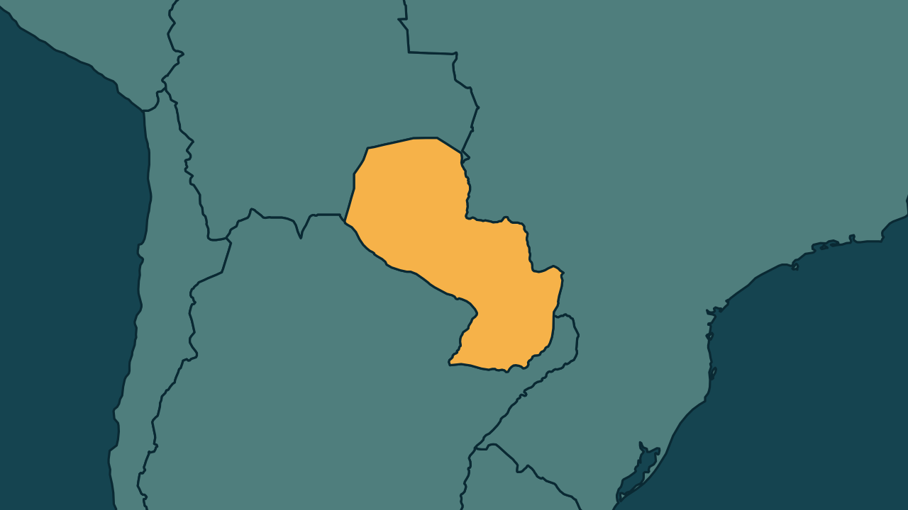

# Paraguai devolve dinheiro a 93% dos clientes do Ueno Bank

*Heimdall News, edição internacional. 10 de novembro de 2026*

## A notícia

O Banco Central do Paraguai informou que 93% dos clientes do Ueno Bank com direito à garantia estatal já receberam ao menos parte do dinheiro, uma semana depois do colapso do banco digital. [1][2]

Cerca de 1,7 milhão de pessoas recuperaram 340 milhões de dólares. O último lote, de quem tem saldos mais altos, deve ser pago até quarta-feira, e os adiantamentos têm limite de 40 salários mínimos por conta. [3][4][5]

O banco tinha mais de 800 milhões de dólares em fundos públicos, com devolução ainda incerta. O Ministério Público procura bens no exterior com Estados Unidos, Luxemburgo e Argentina. A crise levou à destituição do presidente Santiago Peña. [6][7][8]

## Quem se manifestou

- **Pedro Alliana, paraguaio, presidente:** afirmou que quase 95% dos poupadores já foram pagos, que o restante sai até quarta-feira e que recuperar os recursos da previdência será prioridade. [9][10]
- **Oscar Orué, paraguaio, diretor de Receitas Tributárias:** descartou aumento de impostos por causa da crise. [11]
- **Rafael Resquín, paraguaio, presidente da União dos Educadores:** disse que os sindicatos voltarão às ruas se a confiança no novo governo for quebrada. [12]

## Reação no Brasil

Nenhum posicionamento encontrado.

## Fontes

1. Estadão, com AFP, [Banco Central do Paraguai afirma que devolveu o dinheiro de 93% dos clientes do Ueno Bank](https://www.estadao.com.br/economia/banco-central-do-paraguai-afirma-que-devolveu-o-dinheiro-de-93-dos-clientes-do-ueno-bank-npr/): "93% dos clientes do Ueno Bank com direito a uma garantia estatal já receberam pelo menos parte de suas economias"
2. Estadão, com AFP, [Banco Central do Paraguai afirma que devolveu o dinheiro de 93% dos clientes do Ueno Bank](https://www.estadao.com.br/economia/banco-central-do-paraguai-afirma-que-devolveu-o-dinheiro-de-93-dos-clientes-do-ueno-bank-npr/): "uma semana depois do colapso do banco digital"
3. Estadão, com AFP, [Banco Central do Paraguai afirma que devolveu o dinheiro de 93% dos clientes do Ueno Bank](https://www.estadao.com.br/economia/banco-central-do-paraguai-afirma-que-devolveu-o-dinheiro-de-93-dos-clientes-do-ueno-bank-npr/): "cerca de 1,7 milhão de pessoas recuperaram um total de 340 milhões de dólares"
4. Revista Oeste, [Banco Central do Paraguai devolve dinheiro a 93% dos clientes do Ueno Bank](https://revistaoeste.com/mundo/banco-central-do-paraguai-devolve-dinheiro-a-93-dos-clientes-do-ueno-bank/): "O último lote, de correntistas com saldos mais altos, será pago até quarta-feira"
5. Revista Oeste, [Banco Central do Paraguai devolve dinheiro a 93% dos clientes do Ueno Bank](https://revistaoeste.com/mundo/banco-central-do-paraguai-devolve-dinheiro-a-93-dos-clientes-do-ueno-bank/): "os adiantamentos têm limite de 40 salários mínimos por conta"
6. Estadão, com AFP, [Banco Central do Paraguai afirma que devolveu o dinheiro de 93% dos clientes do Ueno Bank](https://www.estadao.com.br/economia/banco-central-do-paraguai-afirma-que-devolveu-o-dinheiro-de-93-dos-clientes-do-ueno-bank-npr/): "o banco tinha mais de 800 milhões de dólares em fundos públicos, cuja restituição ainda é incerta"
7. CartaCapital, [Paraguai amplia devolução de poupanças e busca no exterior dinheiro do Ueno Bank](https://www.cartacapital.com.br/mundo/paraguai-amplia-devolucao-de-poupancas-e-busca-no-exterior-dinheiro-do-ueno-bank/): "está realizando consultas junto aos Estados Unidos, Luxemburgo e Argentina para rastrear possíveis bens e recursos desviados"
8. Estadão, com AFP, [Banco Central do Paraguai afirma que devolveu o dinheiro de 93% dos clientes do Ueno Bank](https://www.estadao.com.br/economia/banco-central-do-paraguai-afirma-que-devolveu-o-dinheiro-de-93-dos-clientes-do-ueno-bank-npr/): "provocou a destituição do presidente Santiago Peña"
9. Metrópoles, [Novo presidente do Paraguai diz que 95% dos poupadores do Ueno já receberam](https://www.metropoles.com/mundo/novo-presidente-do-paraguai-diz-que-95-dos-poupadores-do-ueno-ja-receberam): "Respondemos com fatos: completamos o pagamento a quase 95% dos poupadores. O remanescente será creditado até amanhã"
10. Metrópoles, [Novo presidente do Paraguai diz que 95% dos poupadores do Ueno já receberam](https://www.metropoles.com/mundo/novo-presidente-do-paraguai-diz-que-95-dos-poupadores-do-ueno-ja-receberam): "a recuperação dos recursos previdenciários depositados no banco será uma prioridade do governo"
11. Revista Oeste, [Banco Central do Paraguai devolve dinheiro a 93% dos clientes do Ueno Bank](https://revistaoeste.com/mundo/banco-central-do-paraguai-devolve-dinheiro-a-93-dos-clientes-do-ueno-bank/): "Não falamos sobre aumento de impostos, nem o IVA nem o Imposto de Renda"
12. CartaCapital, [Paraguai amplia devolução de poupanças e busca no exterior dinheiro do Ueno Bank](https://www.cartacapital.com.br/mundo/paraguai-amplia-devolucao-de-poupancas-e-busca-no-exterior-dinheiro-do-ueno-bank/): "Se essa confiança for quebrada, nós iremos às ruas"
