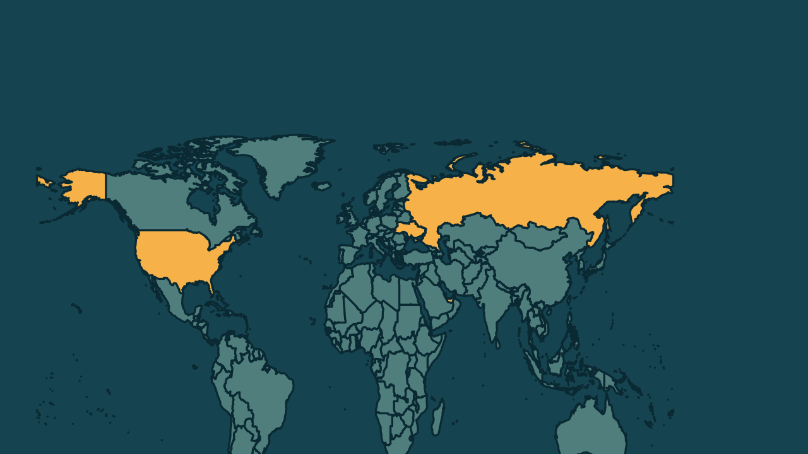

# Negociações entre Rússia e Ucrânia terminam sem acordo em Abu Dhabi

*Heimdall News, edição internacional. 11 de novembro de 2026*

## A notícia

As negociações entre a Rússia e a Ucrânia mediadas pelos Estados Unidos terminaram sem acordo nesta quarta-feira, em Abu Dhabi. A reunião a três durou só 2 horas. Depois, os ucranianos se reuniram com europeus e americanos. [1][2]

Segundo o negociador russo Vladimir Medinsky, os dois países combinaram uma troca de prisioneiros em larga escala. A Rússia não aceitou um cessar-fogo provisório e, na madrugada desta quarta, atingiu 6 grandes subestações de energia em 4 regiões da Ucrânia. [3][4][5]

O presidente russo, Vladimir Putin, exige que a Ucrânia entregue toda a região do Donbass, o que Kiev rejeita. As forças russas controlam cerca de um quinto do país. [6][7][8]

## Quem se manifestou

- **Vladimir Medinsky, russo, negociador-chefe:** afirmou que o diálogo vai continuar, mas que a Rússia não recebeu proposta concreta dos europeus. [9][10]
- **Jared Kushner, americano, enviado especial:** afirmou que a sessão foi muito produtiva e que a questão territorial será a mais difícil. [11][12]
- **Volodymyr Zelensky, ucraniano, presidente:** disse que o primeiro dia foi construtivo e bastante substancial, com foco em prisioneiros e garantias de segurança. [13][14][15]
- **Marco Rubio, americano, secretário de Estado:** defendeu que os europeus entrem, em algum momento, nas negociações. [16]

## Reação no Brasil

Nenhum posicionamento encontrado.

## Fontes

1. Estadão, com AP, [Negociações entre Rússia e Ucrânia medidas pelos EUA terminam sem acordo](https://www.estadao.com.br/internacional/negociacoes-entre-russia-e-ucrania-medidas-pelos-eua-terminam-sem-acordo-npr/): "terminou sem acordo nesta quarta-feira, 11, em Abu Dhabi"
2. Estadão, com AP, [Negociações entre Rússia e Ucrânia medidas pelos EUA terminam sem acordo](https://www.estadao.com.br/internacional/negociacoes-entre-russia-e-ucrania-medidas-pelos-eua-terminam-sem-acordo-npr/): "após a reunião trilateral, que durou apenas duas horas, seus negociadores iniciaram um encontro na cidade emiradense com aliados europeus e emissários dos Estados Unidos"
3. G1, [Negociações entre Rússia e Ucrânia terminam sem acordo](https://g1.globo.com/mundo/ucrania-russia/noticia/2026/11/11/negociacoes-russia-ucrania-terminam.ghtml): "afirmou que a Rússia e a Ucrânia concordaram com uma troca de prisioneiros em larga escala"
4. G1, [Negociações entre Rússia e Ucrânia terminam sem acordo](https://g1.globo.com/mundo/ucrania-russia/noticia/2026/11/11/negociacoes-russia-ucrania-terminam.ghtml): "Moscou não aceitou um cessar-fogo provisório"
5. G1, [Negociações entre Rússia e Ucrânia terminam sem acordo](https://g1.globo.com/mundo/ucrania-russia/noticia/2026/11/11/negociacoes-russia-ucrania-terminam.ghtml): "na madrugada desta quarta, a Rússia seguiu com seus ataques e bombardeou seis grandes subestações de energia elétrica, nas quatro regiões centrais da Ucrânia"
6. Folha de S.Paulo, [Rússia e Ucrânia retomam negociações pela 1ª vez desde fevereiro; EUA veem diferenças 'estreitadas'](https://www1.folha.uol.com.br/mundo/2026/11/russia-e-ucrania-retomam-negociacoes-pela-1a-vez-desde-fevereiro-eua-veem-diferencas-estreitadas.shtml): "mantém a exigência de que Kiev entregue toda a região oriental do Donbass como condição para um acordo de paz"
7. Folha de S.Paulo, [Rússia e Ucrânia retomam negociações pela 1ª vez desde fevereiro; EUA veem diferenças 'estreitadas'](https://www1.folha.uol.com.br/mundo/2026/11/russia-e-ucrania-retomam-negociacoes-pela-1a-vez-desde-fevereiro-eua-veem-diferencas-estreitadas.shtml): "rejeita ceder territórios"
8. G1, [Rússia e Ucrânia reabrem negociações mediadas pelos EUA, mas propostas seguem conflitantes](https://g1.globo.com/mundo/noticia/2026/11/10/russia-e-ucrania-reabrem-negociacoes-mediadas-pelos-eua-mas-propostas-seguem-conflitantes.ghtml): "As forças russas controlam cerca de um quinto da Ucrânia"
9. Estadão, com AP, [Negociações entre Rússia e Ucrânia medidas pelos EUA terminam sem acordo](https://www.estadao.com.br/internacional/negociacoes-entre-russia-e-ucrania-medidas-pelos-eua-terminam-sem-acordo-npr/): "O diálogo continuará, sem dúvida alguma"
10. Estadão, com AP, [Negociações entre Rússia e Ucrânia medidas pelos EUA terminam sem acordo](https://www.estadao.com.br/internacional/negociacoes-entre-russia-e-ucrania-medidas-pelos-eua-terminam-sem-acordo-npr/): "Não recebemos nenhuma iniciativa de paz, nem qualquer proposta concreta por parte dos países europeus"
11. G1, [Negociações entre Rússia e Ucrânia terminam sem acordo](https://g1.globo.com/mundo/ucrania-russia/noticia/2026/11/11/negociacoes-russia-ucrania-terminam.ghtml): "afirmou que "a sessão foi muito produtiva""
12. G1, [Negociações entre Rússia e Ucrânia terminam sem acordo](https://g1.globo.com/mundo/ucrania-russia/noticia/2026/11/11/negociacoes-russia-ucrania-terminam.ghtml): "A questão territorial será a mais difícil"
13. Estadão, [Rússia e Ucrânia realizam quase quatro horas de negociações mediadas pelos EUA em Abu Dhabi](https://www.estadao.com.br/internacional/russia-ucrania-quatro-horas-negociacoes-mediadas-eua-abu-dhabi-npr/): "Zelenski descreveu o primeiro dia de negociações como “construtivo e bastante substancial”"
14. Brasil de Fato, [Rússia, EUA e Ucrânia encerram primeiro dia de negociações de paz em Abu Dhabi; veja o que se sabe](https://www.brasildefato.com.br/2026/11/10/russia-eua-e-ucrania-encerram-primeiro-dia-de-negociacoes-de-paz-em-abu-dhabi-veja-o-que-se-sabe/): "Ele afirmou que os participantes discutiram possíveis medidas humanitárias, incluindo a libertação de prisioneiros"
15. Gazeta do Povo, [Em novas negociações, Ucrânia, Rússia e EUA discutem sistema de segurança europeu pós-guerra](https://www.gazetadopovo.com.br/mundo/novas-negociacoes-ucrania-russia-eua-discutem-sistema-seguranca-europeu-pos-guerra/): "Discutiu-se, de forma detalhada, o conteúdo das garantias de segurança para a Ucrânia"
16. Estadão, [Rússia e Ucrânia realizam quase quatro horas de negociações mediadas pelos EUA em Abu Dhabi](https://www.estadao.com.br/internacional/russia-ucrania-quatro-horas-negociacoes-mediadas-eua-abu-dhabi-npr/): "Acreditamos que o (formato) trilateral deveria incluir, em algum momento, nossos parceiros europeus na mesa de negociações"
