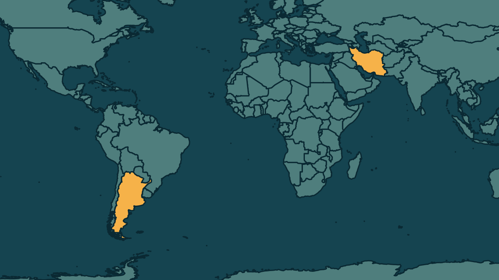

# Irã classifica Marinha e Força Aérea da Argentina como terroristas

*Heimdall News, edição internacional. 11 de novembro de 2026*

## A notícia

O Irã classificou nesta quarta-feira a Marinha e a Força Aérea da Argentina como organizações terroristas. O anúncio foi feito pelo Ministério das Relações Exteriores iraniano, que citou o princípio da reciprocidade e uma lei de 2019. [1][2][3]

A medida responde à decisão do governo de Javier Milei de declarar terrorista, neste ano, a Guarda Revolucionária Islâmica. O comunicado não menciona o Exército argentino. [4][5]

A Argentina acusa a Guarda Revolucionária de apoiar o Hezbollah, a quem atribui dois atentados em Buenos Aires. O de 1994, contra a Associação Mutual Israelita Argentina, matou 85 pessoas. No início do mês, o Irã fez o mesmo com as forças britânicas. [6][7][8]

## Quem se manifestou

- **Ministério das Relações Exteriores do Irã, Irã:** chamou a decisão argentina de medida hostil e afirmou que o governo argentino assumirá a responsabilidade por todas as consequências, sem detalhar quais medidas poderão ser adotadas. [9][10][11]

## Reação no Brasil

Nenhum posicionamento encontrado.

## Fontes

1. Estadão, com AFP, [Irã classifica força militar da Argentina como terrorista em retaliação a Milei](https://www.estadao.com.br/internacional/ira-declara-marinha-e-forca-aerea-da-argentina-como-organizacoes-terroristas-em-retaliacao-a-milei-npr/): "O Irã declarou nesta quarta-feira, 11, a Marinha e a Força Aérea da Argentina como organizações terroristas"
2. Revista Oeste, [Irã classifica Marinha e Força Aérea da Argentina como terroristas](https://revistaoeste.com/mundo/ira-classifica-marinha-e-forca-aerea-da-argentina-como-terroristas/): "O anúncio foi feito pelo Ministério das Relações Exteriores iraniano."
3. Estadão, com AFP, [Irã classifica força militar da Argentina como terrorista em retaliação a Milei](https://www.estadao.com.br/internacional/ira-declara-marinha-e-forca-aerea-da-argentina-como-organizacoes-terroristas-em-retaliacao-a-milei-npr/): "Teerã invocou o princípio da reciprocidade e uma lei aprovada em 2019 para justificar a classificação."
4. Gazeta do Povo, [Irã designa Marinha e Força Aérea da Argentina como organizações terroristas](https://www.gazetadopovo.com.br/mundo/ira-designa-marinha-forca-aerea-argentina-organizacoes-terroristas/): "do governo Javier Milei de declarar a Guarda Revolucionária Islâmica do Irã como organização terrorista este ano"
5. Folha de S.Paulo, [Irã rebate governo Milei e classifica Forças Armadas da Argentina como terroristas](https://www1.folha.uol.com.br/mundo/2026/11/ira-rebate-governo-milei-e-classifica-forcas-armadas-da-argentina-como-terroristas.shtml): "O texto não menciona o Exército argentino."
6. Revista Oeste, [Irã classifica Marinha e Força Aérea da Argentina como terroristas](https://revistaoeste.com/mundo/ira-classifica-marinha-e-forca-aerea-da-argentina-como-terroristas/): "A Argentina acusa a Guarda Revolucionária de apoiar o Hezbollah, grupo responsabilizado por dois atentados em Buenos Aires."
7. Estadão, com AFP, [Irã classifica força militar da Argentina como terrorista em retaliação a Milei](https://www.estadao.com.br/internacional/ira-declara-marinha-e-forca-aerea-da-argentina-como-organizacoes-terroristas-em-retaliacao-a-milei-npr/): "Em 1994, um ataque à sede da Associação Mutual Israelita Argentina (Amia), em Buenos Aires, matou 85 pessoas"
8. Gazeta do Povo, [Irã designa Marinha e Força Aérea da Argentina como organizações terroristas](https://www.gazetadopovo.com.br/mundo/ira-designa-marinha-forca-aerea-argentina-organizacoes-terroristas/): "No início do mês, o Irã também havia designado como grupos terroristas a Marinha Real e a Real Força Aérea britânicas"
9. CartaCapital, [Irã classifica Força Aérea e Marinha da Argentina como ‘organizações terroristas’](https://www.cartacapital.com.br/radar-carta/ira-classifica-forca-aerea-e-marinha-da-argentina-como-organizacoes-terroristas/): "O Ministério das Relações Exteriores do Irã classificou a decisão do governo argentino como uma “medida hostil”."
10. Estadão, com AFP, [Irã classifica força militar da Argentina como terrorista em retaliação a Milei](https://www.estadao.com.br/internacional/ira-declara-marinha-e-forca-aerea-da-argentina-como-organizacoes-terroristas-em-retaliacao-a-milei-npr/): "O Governo argentino assumirá a responsabilidade de todas as consequências derivadas desta ação"
11. Estadão, com AFP, [Irã classifica força militar da Argentina como terrorista em retaliação a Milei](https://www.estadao.com.br/internacional/ira-declara-marinha-e-forca-aerea-da-argentina-como-organizacoes-terroristas-em-retaliacao-a-milei-npr/): "afirmou o ministério, sem detalhar quais medidas poderão ser adotadas."
