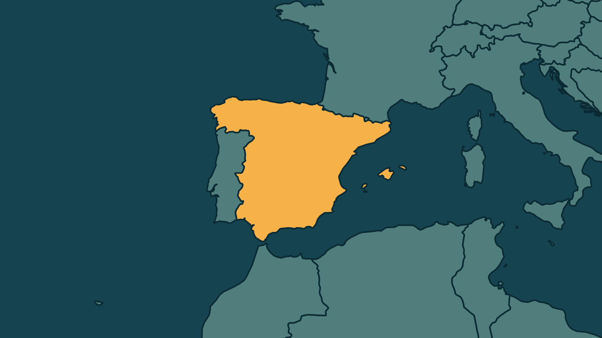

# Espanha tem primeira greve geral em 14 anos, contra o custo da moradia

*Heimdall News, edição internacional. 11 de novembro de 2026*

## A notícia

Milhões de trabalhadores fizeram nesta quarta-feira a primeira greve geral da Espanha em 14 anos, contra o custo da moradia. Houve confrontos com a polícia em Madri e bloqueios de vias em Barcelona. [1][2][3][4]

Segundo os sindicatos, a paralisação chegou a 90% nos portos e no setor automotivo. O aluguel médio quase dobrou em dez anos, e a revolta cresceu depois do despejo de uma aposentada de 87 anos, que morreu poucos dias depois. [5][6][7]

A greve ocorre a menos de três semanas das eleições antecipadas de 29 de novembro. O primeiro-ministro Pedro Sánchez antecipou o pleito depois que o Parlamento rejeitou decretos do governo para conter despejos. [8][9][10]

## Quem se manifestou

- **Unai Sordo, espanhol, secretário-geral:** afirmou que a greve superou as expectativas dos sindicatos e foi um sucesso de adesão. [11][12]
- **Confederação Espanhola de Organizações Empresariais, Espanha:** afirmou que a adesão foi baixa na maioria dos setores. A vice-presidente Angela de Miguel disse que a paralisação é contraproducente. [13][14]
- **Miguel Tellado, espanhol, porta-voz do Partido Popular:** afirmou, na véspera, que não é uma greve geral, e sim eleitoral. [15]
- **Pedro Sánchez, espanhol, primeiro-ministro:** alertou, num vídeo nesta semana, que a direita traria austeridade. [16][17]

## Reação no Brasil

Nenhum posicionamento encontrado.

## Fontes

1. Estadão, com AP, [Espanha tem 1ª greve geral em 14 anos; protestos registram confrontos entre polícia e manifestantes](https://www.estadao.com.br/internacional/espanha-tem-1-greve-geral-em-14-anos-protestos-registram-confrontos-entre-policia-e-manifestantes-npr/): "Milhões de trabalhadores espanhóis paralisaram atividades comerciais e causaram transtornos no transporte nesta quarta-feira"
2. Estadão, com AP, [Espanha tem 1ª greve geral em 14 anos; protestos registram confrontos entre polícia e manifestantes](https://www.estadao.com.br/internacional/espanha-tem-1-greve-geral-em-14-anos-protestos-registram-confrontos-entre-policia-e-manifestantes-npr/): "foi a primeira greve geral na Espanha em 14 anos"
3. G1, [Em dia de greve geral na Espanha, manifestantes entram em confronto com a polícia; VÍDEO](https://g1.globo.com/mundo/noticia/2026/11/11/greve-geral-espanha-manifestantes-confronto-policia-video.ghtml): "Manifestantes entraram em confronto com a polícia durante um protesto em Madri"
4. Estadão, com AP, [Espanha tem 1ª greve geral em 14 anos; protestos registram confrontos entre polícia e manifestantes](https://www.estadao.com.br/internacional/espanha-tem-1-greve-geral-em-14-anos-protestos-registram-confrontos-entre-policia-e-manifestantes-npr/): "Pneus foram incendiados em bloqueios de vias em Barcelona"
5. Folha de S.Paulo, [Espanha tem 1º greve geral desde 2012 com multidão nas ruas às vésperas das eleições legislativas](https://www1.folha.uol.com.br/mundo/2026/11/espanha-tem-1o-greve-geral-desde-2012-com-multidao-nas-ruas-as-vesperas-das-eleicoes-legislativas.shtml): "Segundo as centrais, a paralisação chegou a 90% nos portos e no setor automotivo"
6. Estadão, com AP, [Espanha tem 1ª greve geral em 14 anos; protestos registram confrontos entre polícia e manifestantes](https://www.estadao.com.br/internacional/espanha-tem-1-greve-geral-em-14-anos-protestos-registram-confrontos-entre-policia-e-manifestantes-npr/): "Nos últimos 10 anos, o valor médio do aluguel na Espanha quase dobrou"
7. Folha de S.Paulo, [Espanha tem 1º greve geral desde 2012 com multidão nas ruas às vésperas das eleições legislativas](https://www1.folha.uol.com.br/mundo/2026/11/espanha-tem-1o-greve-geral-desde-2012-com-multidao-nas-ruas-as-vesperas-das-eleicoes-legislativas.shtml): "o despejo, em setembro, de Maricarmen Abascal, aposentada de 87 anos que morreu poucos dias depois"
8. G1, [Em dia de greve geral na Espanha, manifestantes entram em confronto com a polícia; VÍDEO](https://g1.globo.com/mundo/noticia/2026/11/11/greve-geral-espanha-manifestantes-confronto-policia-video.ghtml): "A greve geral desta quarta acontece a menos de três semanas de uma eleição nacional"
9. CNN Brasil, [Trabalhadores realizam primeira greve geral em 14 anos na Espanha](https://www.cnnbrasil.com.br/internacional/trabalhadores-realizam-primeira-greve-geral-em-14-anos-na-espanha/): "antes das eleições antecipadas de 29 de novembro"
10. Folha de S.Paulo, [Espanha tem 1º greve geral desde 2012 com multidão nas ruas às vésperas das eleições legislativas](https://www1.folha.uol.com.br/mundo/2026/11/espanha-tem-1o-greve-geral-desde-2012-com-multidao-nas-ruas-as-vesperas-das-eleicoes-legislativas.shtml): "rejeição pelo Parlamento, no mês passado, de decretos do governo para conter despejos e limitar a pressão sobre os aluguéis, levaram o primeiro-ministro Pedro Sánchez a antecipar as eleições"
11. Estadão, com AP, [Espanha tem 1ª greve geral em 14 anos; protestos registram confrontos entre polícia e manifestantes](https://www.estadao.com.br/internacional/espanha-tem-1-greve-geral-em-14-anos-protestos-registram-confrontos-entre-policia-e-manifestantes-npr/): "“A greve superou as expectativas dos sindicatos”, afirmou Unai Sordo"
12. Estadão, com AP, [Espanha tem 1ª greve geral em 14 anos; protestos registram confrontos entre polícia e manifestantes](https://www.estadao.com.br/internacional/espanha-tem-1-greve-geral-em-14-anos-protestos-registram-confrontos-entre-policia-e-manifestantes-npr/): "“Tem sido um sucesso em termos de adesão.”"
13. Folha de S.Paulo, [Espanha tem 1º greve geral desde 2012 com multidão nas ruas às vésperas das eleições legislativas](https://www1.folha.uol.com.br/mundo/2026/11/espanha-tem-1o-greve-geral-desde-2012-com-multidao-nas-ruas-as-vesperas-das-eleicoes-legislativas.shtml): "Em comunicado, disse que a adesão foi baixa na maioria dos setores"
14. Folha de S.Paulo, [Espanha tem 1º greve geral desde 2012 com multidão nas ruas às vésperas das eleições legislativas](https://www1.folha.uol.com.br/mundo/2026/11/espanha-tem-1o-greve-geral-desde-2012-com-multidao-nas-ruas-as-vesperas-das-eleicoes-legislativas.shtml): "Sua vice-presidente, Angela de Miguel, disse à emissora pública TVE que a paralisação é contraproducente"
15. G1, [Espanha: primeira greve geral em 14 anos pressiona governo por moradia e habitação](https://g1.globo.com/mundo/noticia/2026/11/11/espanha-greve-geral.ghtml): "“Esta greve não é uma greve geral; é uma greve eleitoral”, disse o porta-voz do Partido Popular, Miguel Tellado, na terça-feira."
16. G1, [Espanha: primeira greve geral em 14 anos pressiona governo por moradia e habitação](https://g1.globo.com/mundo/noticia/2026/11/11/espanha-greve-geral.ghtml): "Sánchez publicou um longo vídeo nas redes sociais esta semana"
17. G1, [Espanha: primeira greve geral em 14 anos pressiona governo por moradia e habitação](https://g1.globo.com/mundo/noticia/2026/11/11/espanha-greve-geral.ghtml): "alertando, porém, que os partidos de direita trariam austeridade"
