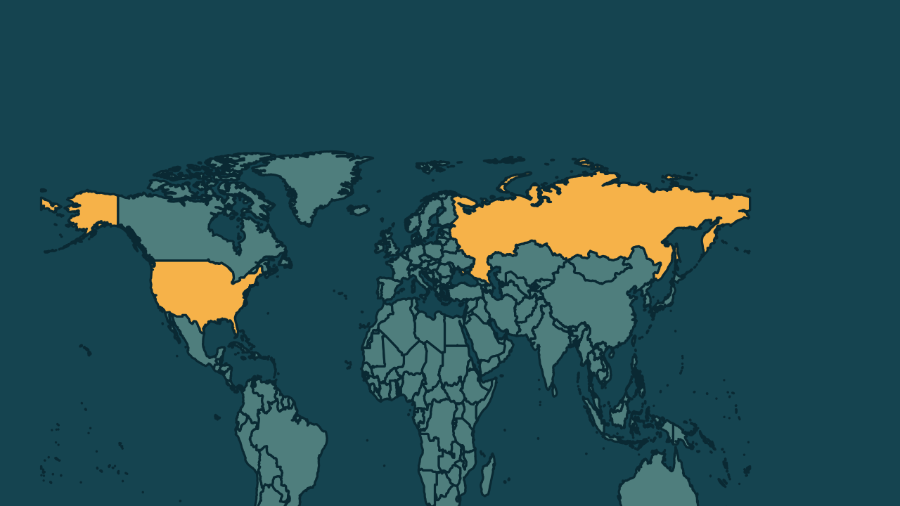

# Embaixador da Rússia nos Estados Unidos morre aos 66 anos

*Heimdall News, edição internacional. 11 de novembro de 2026*

## A notícia

O embaixador da Rússia nos Estados Unidos, Alexander Darchiev, morreu nesta quarta-feira, aos 66 anos, informou o Ministério das Relações Exteriores russo. A primeira nota falou em morte repentina, sem dar a causa. [1][2]

Darchiev foi nomeado pelo presidente Vladimir Putin e assumiu a embaixada em Washington em março de 2025, para liderar uma reaproximação com o governo de Donald Trump, que preocupa a Ucrânia e países europeus. [3][4]

Antes, foi embaixador no Canadá, de 2014 a 2021. Em 2022, classificou a invasão russa da Ucrânia como uma medida necessária. [5][6]

## Quem se manifestou

- **Ministério das Relações Exteriores da Rússia, Rússia:** afirmou que perdeu um diplomata excepcional, um líder experiente e um mentor, que dedicou a vida à defesa dos interesses russos na América do Norte. [7][8]
- **Maria Zakharova, russa, porta-voz da chancelaria:** afirmou depois que Darchiev morreu em Moscou, de uma doença crônica, e que a Rússia recebe condolências de todo o mundo. [9][10]
- **Organização das Nações Unidas:** expressou, pelo porta-voz do secretário-geral, condolências à família do embaixador e ao governo russo. [11][12]

## Reação no Brasil

Nenhum posicionamento encontrado.

## Fontes

1. CNN Brasil, [Embaixador da Rússia nos EUA morre “repentinamente”, diz governo russo](https://www.cnnbrasil.com.br/internacional/embaixador-da-russia-nos-eua-morre-repentinamente-diz-governo-russo/): "O embaixador da Rússia nos Estados Unidos, Alexander Darchiev, morreu aos 66 anos, informou o Ministério das Relações Exteriores russo nesta quarta-feira (11)"
2. Estadão, [Embaixador russo nos EUA morre repentinamente aos 66 anos](https://www.estadao.com.br/internacional/embaixador-russo-nos-estados-unidos-morre-repentinamente-aos-66-anos-npr/): "Não foram dados detalhes sobre a causa e o local do falecimento."
3. G1, [Embaixador russo nos EUA morre 'repentinamente', aos 66 anos](https://g1.globo.com/mundo/noticia/2026/11/11/embaixador-russo-nos-eua-morre-aos-66-anos.ghtml): "Putin nomeou Darchiev, um diplomata veterano conhecido por suas críticas públicas ao Ocidente, como embaixador em Washington em março de 2025"
4. G1, [Embaixador russo nos EUA morre 'repentinamente', aos 66 anos](https://g1.globo.com/mundo/noticia/2026/11/11/embaixador-russo-nos-eua-morre-aos-66-anos.ghtml): "com a missão de liderar uma reaproximação com o governo Trump - iniciativa que tem causado apreensão na Ucrânia e em países europeus"
5. CNN Brasil, [Embaixador da Rússia nos EUA morre “repentinamente”, diz governo russo](https://www.cnnbrasil.com.br/internacional/embaixador-da-russia-nos-eua-morre-repentinamente-diz-governo-russo/): "além de ter servido como embaixador da Rússia no Canadá de 2014 a 2021"
6. Poder360, [Embaixador russo nos EUA morre “subitamente” aos 66 anos](https://www.poder360.com.br/poder-internacional/embaixador-russo-nos-eua-morre-subitamente-aos-66-anos/): "Em 2022, quando a Rússia invadiu a Ucrânia, Darchiev declarou que a decisão era uma “medida necessária”."
7. Folha de S.Paulo, [Embaixador da Rússia nos EUA morre aos 66 anos](https://www1.folha.uol.com.br/mundo/2026/11/embaixador-da-russia-nos-eua-morre-aos-66-anos.shtml): "Perdemos um diplomata excepcional, um líder experiente, um colega generoso e um mentor"
8. Brasil de Fato, [Morre embaixador da Rússia nos EUA aos 66 anos](https://www.brasildefato.com.br/2026/11/11/morre-embaixador-da-russia-nos-eua-aos-66-anos/): "dedicou toda a sua vida à firme defesa dos interesses da Rússia na América do Norte"
9. Brasil de Fato, [Morre embaixador da Rússia nos EUA aos 66 anos](https://www.brasildefato.com.br/2026/11/11/morre-embaixador-da-russia-nos-eua-aos-66-anos/): "Alexander Nikitich faleceu hoje em Moscou em decorrência de uma doença crônica"
10. Brasil de Fato, [Morre embaixador da Rússia nos EUA aos 66 anos](https://www.brasildefato.com.br/2026/11/11/morre-embaixador-da-russia-nos-eua-aos-66-anos/): "o país está recebendo inúmeras condolências de todo o mundo"
11. Brasil de Fato, [Morre embaixador da Rússia nos EUA aos 66 anos](https://www.brasildefato.com.br/2026/11/11/morre-embaixador-da-russia-nos-eua-aos-66-anos/): "O porta-voz do secretário-geral da ONU, Farhan Haqm, declarou que as Nações Unidas expressaram condolências à Rússia"
12. Brasil de Fato, [Morre embaixador da Rússia nos EUA aos 66 anos](https://www.brasildefato.com.br/2026/11/11/morre-embaixador-da-russia-nos-eua-aos-66-anos/): "Expressamos nossas condolências à sua família e ao governo russo"
