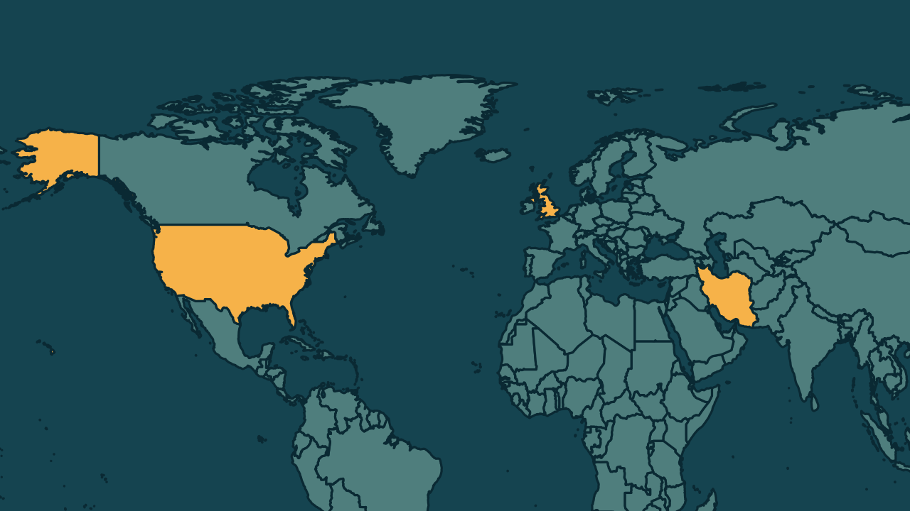

# Irã ameaça atacar bases dos Estados Unidos na Europa

*Heimdall News, edição internacional. 11 de novembro de 2026*

## A notícia

O secretário do Conselho Supremo de Segurança Nacional do Irã, Mohsen Rezaei, ameaçou nesta quarta-feira atacar bases dos Estados Unidos na Europa, caso sejam usadas para bombardear o Irã. A declaração foi feita à emissora libanesa Al Mayadeen. [1][2][3]

Nesta semana, os Estados Unidos retiraram 13 aviões militares da base britânica de Mildenhall, no leste da Inglaterra, depois de informações sobre uma possível ameaça. [4][5]

A guerra começou em 28 de fevereiro, com ataques americanos e israelenses. Catar e Paquistão tentam mediar um acordo. O Irã pede o fim das sanções e o descongelamento de recursos em troca de reabrir o Estreito de Ormuz. [6][7][8]

## Quem se manifestou

- **Mohsen Rezaei, iraniano, chefe de segurança:** afirmou que, se aviões americanos decolarem de uma base na Europa para bombardear o Irã, essa base será atacada. Disse ainda que nem um grama de material nuclear enriquecido sairá do país. [9][10]
- **Marco Rubio, americano, secretário de Estado:** afirmou na terça-feira que, neste momento, não há necessidade de novas operações militares de grande escala contra o Irã. [11]
- **Governo do Reino Unido, Reino Unido:** afirmou que suas instalações militares continuam seguras. [12]

## Reação no Brasil

Nenhum posicionamento encontrado.

## Fontes

1. Gazeta do Povo, [Irã ameaça atacar bases militares dos EUA na Europa caso seja alvo de novos bombardeios](https://www.gazetadopovo.com.br/mundo/ira-ameaca-atacar-bases-militares-dos-eua-na-europa-caso-seja-alvo-de-novos-bombardeios/): "A advertência foi feita por Mohsen Rezaei, secretário do Conselho Supremo de Segurança Nacional do Irã"
2. G1, [Irã ameaça atacar bases dos EUA na Europa se forem usadas contra o país](https://g1.globo.com/mundo/noticia/2026/11/11/ira-ameaca-atacar-bases-dos-eua-na-europa-se-forem-usadas-contra-o-pais.ghtml): "atacar bases militares americanas fora do Oriente Médio, incluindo na Europa, caso sejam usadas para lançar ataques contra o Irã"
3. Metrópoles, [Irã ameaça atacar bases dos EUA se país voltar a ser bombardeado](https://www.metropoles.com/mundo/ira-ameaca-atacar-bases-dos-eua-se-pais-voltar-a-ser-bombardeado): "A declaração foi feita nesta quarta-feira (11/11), em entrevista à emissora libanesa Al Mayadeen."
4. Gazeta do Povo, [Irã ameaça atacar bases militares dos EUA na Europa caso seja alvo de novos bombardeios](https://www.gazetadopovo.com.br/mundo/ira-ameaca-atacar-bases-militares-dos-eua-na-europa-caso-seja-alvo-de-novos-bombardeios/): "Nesta semana, os Estados Unidos retiraram 13 aeronaves militares da base britânica de RAF Mildenhall, no leste da Inglaterra"
5. Gazeta do Povo, [Irã ameaça atacar bases militares dos EUA na Europa caso seja alvo de novos bombardeios](https://www.gazetadopovo.com.br/mundo/ira-ameaca-atacar-bases-militares-dos-eua-na-europa-caso-seja-alvo-de-novos-bombardeios/): "após receberem informações sobre uma possível ameaça à instalação"
6. Estadão, com AFP, [Irã ameaça atacar bases dos EUA na Europa se elas forem usadas para bombardear Teerã](https://www.estadao.com.br/internacional/ira-ameaca-atacar-bases-dos-eua-na-europa-se-elas-forem-usadas-para-bombardear-teera-npr/): "A guerra no Oriente Médio começou em 28 de fevereiro, com ataques americanos e israelenses"
7. Gazeta do Povo, [Irã ameaça atacar bases militares dos EUA na Europa caso seja alvo de novos bombardeios](https://www.gazetadopovo.com.br/mundo/ira-ameaca-atacar-bases-militares-dos-eua-na-europa-caso-seja-alvo-de-novos-bombardeios/): "enquanto o Catar e o Paquistão tentam mediar um acordo para encerrar a guerra iniciada em fevereiro"
8. G1, [Irã ameaça atacar bases dos EUA na Europa se forem usadas contra o país](https://g1.globo.com/mundo/noticia/2026/11/11/ira-ameaca-atacar-bases-dos-eua-na-europa-se-forem-usadas-contra-o-pais.ghtml): "O governo iraniano exige dos Estados Unidos o descongelamento de ativos e a suspensão de sanções econômicas em troca da reabertura do Estreito de Ormuz."
9. Estadão, com AFP, [Irã ameaça atacar bases dos EUA na Europa se elas forem usadas para bombardear Teerã](https://www.estadao.com.br/internacional/ira-ameaca-atacar-bases-dos-eua-na-europa-se-elas-forem-usadas-para-bombardear-teera-npr/): "Se aviões americanos decolarem de uma base militar dos Estados Unidos, mesmo que esteja localizada em um país europeu"
10. Estadão, com AFP, [Irã ameaça atacar bases dos EUA na Europa se elas forem usadas para bombardear Teerã](https://www.estadao.com.br/internacional/ira-ameaca-atacar-bases-dos-eua-na-europa-se-elas-forem-usadas-para-bombardear-teera-npr/): "Não retiraremos do Irã nem um único grama de material nuclear enriquecido."
11. Gazeta do Povo, [Irã ameaça atacar bases militares dos EUA na Europa caso seja alvo de novos bombardeios](https://www.gazetadopovo.com.br/mundo/ira-ameaca-atacar-bases-militares-dos-eua-na-europa-caso-seja-alvo-de-novos-bombardeios/): "não há necessidade de realizar novas operações militares de grande escala contra o Irã neste momento"
12. Gazeta do Povo, [Irã ameaça atacar bases militares dos EUA na Europa caso seja alvo de novos bombardeios](https://www.gazetadopovo.com.br/mundo/ira-ameaca-atacar-bases-militares-dos-eua-na-europa-caso-seja-alvo-de-novos-bombardeios/): "O governo britânico afirmou que suas instalações militares continuam seguras e que os protocolos de proteção dos locais estão sendo constantemente revisados."
