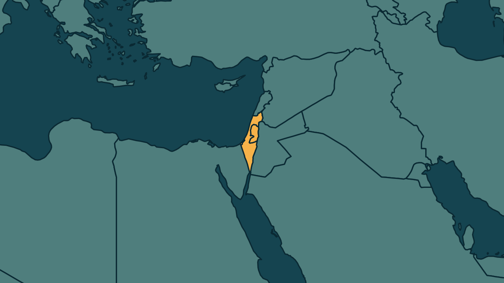

# Ataque de Israel a hospital em Gaza deixa 6 mortos

*Heimdall News, edição internacional. 12 de novembro de 2026*

## A notícia

Um ataque aéreo de Israel atingiu nesta quinta-feira o departamento de cirurgia do Hospital Nasser, em Khan Younis, no sul da Faixa de Gaza. Morreram 6 pessoas, entre elas um cirurgião, e cerca de 20 ficaram feridas, segundo a Defesa Civil de Gaza. [1][2][3][4]

Israel afirmou que o alvo era Muhammad Abu Ismail, comandante local do Hamas, e que o grupo usava o hospital como centro de comando. Ainda não foi confirmado se ele morreu. [5][6][7]

Há um cessar-fogo desde outubro de 2025, e os dois lados se acusam de violá-lo. Desde então, mais de 1.600 palestinos foram mortos, segundo o Ministério da Saúde de Gaza. [8][9][10]

## Quem se manifestou

- **Forças de Defesa de Israel, Israel:** afirmaram que o Hamas transformou o hospital num quartel-general, com armas, interrogatórios, tortura e salas de comando, e que tomaram precauções para reduzir danos a civis, com avisos prévios e munições de precisão. [11][12][13][14]
- **Hazem Qassem, palestino, porta-voz do Hamas:** classificou o ataque como crime de guerra e responsabilizou o Conselho de Paz, apoiado pelos Estados Unidos e encarregado de supervisionar o cessar-fogo, por não tê-lo impedido. [15][16]

## Reação no Brasil

Nenhum posicionamento encontrado.

## Fontes

1. CNN Brasil, [Ataque israelense a hospital em Gaza deixa seis mortos, diz Defesa Civil](https://www.cnnbrasil.com.br/internacional/ataque-israelense-a-hospital-em-gaza-mata-pessoas-diz-defesa-civil/): "Um ataque aéreo israelense contra um prédio do Hospital Nasser, no sul de Gaza, matou pelo menos seis pessoas, incluindo um cirurgião"
2. CNN Brasil, [Ataque israelense a hospital em Gaza deixa seis mortos, diz Defesa Civil](https://www.cnnbrasil.com.br/internacional/ataque-israelense-a-hospital-em-gaza-mata-pessoas-diz-defesa-civil/): "deixou outras 20 feridas na madrugada desta quinta-feira (12), informou à Reuters um porta-voz da Defesa Civil de Gaza"
3. G1, [Ataque israelense a hospital em Gaza deixa 6 mortos](https://g1.globo.com/mundo/noticia/2026/11/12/ataque-israelense-a-hospital-em-gaza-deixa-mortos.ghtml): "o ataque atingiu o departamento de cirurgia do hospital"
4. G1, [Ataque israelense a hospital em Gaza deixa 6 mortos](https://g1.globo.com/mundo/noticia/2026/11/12/ataque-israelense-a-hospital-em-gaza-deixa-mortos.ghtml): "O Hospital Nasser, na cidade de Khan Younis"
5. Gazeta do Povo, [Ataque de Israel a hospital em Gaza visa líder do Hamas; grupo terrorista fala em crime de guerra](https://www.gazetadopovo.com.br/mundo/ataque-israel-hospital-gaza-visa-lider-hamas-grupo-terrorista-fala-crime-guerra/): "visou Muhammad Abu Ismail, comandante da brigada local do Hamas"
6. Folha de S.Paulo, [Ataque israelense mata seis pessoas em hospital no sul de Gaza, diz Defesa Civil](https://www1.folha.uol.com.br/mundo/2026/11/ataque-israelense-mata-seis-pessoas-em-hospital-no-sul-de-gaza-diz-defesa-civil.shtml): "estabeleceu uma presença dentro do complexo hospitalar e o utilizou como centro de comando"
7. Gazeta do Povo, [Ataque de Israel a hospital em Gaza visa líder do Hamas; grupo terrorista fala em crime de guerra](https://www.gazetadopovo.com.br/mundo/ataque-israel-hospital-gaza-visa-lider-hamas-grupo-terrorista-fala-crime-guerra/): "Ainda não foi confirmado se Abu Ismail foi morto no ataque."
8. Estadão, com AFP, [Ataque israelense mata seis pessoas em hospital no sul da Faixa de Gaza](https://www.estadao.com.br/internacional/ataque-israelense-mata-seis-pessoas-em-hospital-no-sul-da-faixa-de-gaza-npr/): "violar o cessar-fogo em vigor desde outubro de 2025"
9. Folha de S.Paulo, [Ataque israelense mata seis pessoas em hospital no sul de Gaza, diz Defesa Civil](https://www1.folha.uol.com.br/mundo/2026/11/ataque-israelense-mata-seis-pessoas-em-hospital-no-sul-de-gaza-diz-defesa-civil.shtml): "Israel e Hamas acusam um ao outro de violar o cessar-fogo"
10. Folha de S.Paulo, [Ataque israelense mata seis pessoas em hospital no sul de Gaza, diz Defesa Civil](https://www1.folha.uol.com.br/mundo/2026/11/ataque-israelense-mata-seis-pessoas-em-hospital-no-sul-de-gaza-diz-defesa-civil.shtml): "Mais de 1.600 palestinos foram mortos desde o início do cessar-fogo, segundo o Ministério da Saúde de Gaza"
11. Gazeta do Povo, [Ataque de Israel a hospital em Gaza visa líder do Hamas; grupo terrorista fala em crime de guerra](https://www.gazetadopovo.com.br/mundo/ataque-israel-hospital-gaza-visa-lider-hamas-grupo-terrorista-fala-crime-guerra/): "transformando-as em um quartel-general para atividades militares e terroristas"
12. Metrópoles, [Ataque israelense a hospital em Gaza deixa seis mortos](https://www.metropoles.com/mundo/ataque-israelense-a-hospital-em-gaza-deixa-seis-mortos): "armazenamento de armas, realização de interrogatórios e tortura, operação de salas de comando e controle"
13. Gazeta do Povo, [Ataque de Israel a hospital em Gaza visa líder do Hamas; grupo terrorista fala em crime de guerra](https://www.gazetadopovo.com.br/mundo/ataque-israel-hospital-gaza-visa-lider-hamas-grupo-terrorista-fala-crime-guerra/): "tomaram precauções para reduzir danos a civis"
14. Gazeta do Povo, [Ataque de Israel a hospital em Gaza visa líder do Hamas; grupo terrorista fala em crime de guerra](https://www.gazetadopovo.com.br/mundo/ataque-israel-hospital-gaza-visa-lider-hamas-grupo-terrorista-fala-crime-guerra/): "uso de “munições de precisão e vigilância aérea”"
15. Folha de S.Paulo, [Ataque israelense mata seis pessoas em hospital no sul de Gaza, diz Defesa Civil](https://www1.folha.uol.com.br/mundo/2026/11/ataque-israelense-mata-seis-pessoas-em-hospital-no-sul-de-gaza-diz-defesa-civil.shtml): "classificou o ataque ao Nasser como crime de guerra e responsabilizou o Conselho de Paz"
16. Folha de S.Paulo, [Ataque israelense mata seis pessoas em hospital no sul de Gaza, diz Defesa Civil](https://www1.folha.uol.com.br/mundo/2026/11/ataque-israelense-mata-seis-pessoas-em-hospital-no-sul-de-gaza-diz-defesa-civil.shtml): "apoiado pelos Estados Unidos e encarregado de supervisionar o plano de cessar-fogo em Gaza, por não ter impedido"
