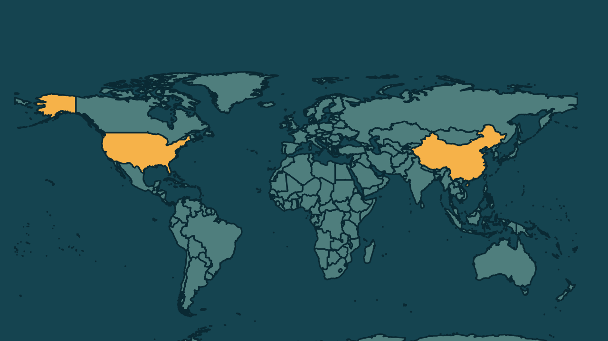

# Chefe da Nvidia renuncia após caso com suposta espiã chinesa

*Heimdall News, edição internacional. 12 de novembro de 2026*

## A notícia

A Nvidia, fabricante americana de chips, informou nesta quinta-feira que o presidente-executivo Jensen Huang renunciou, com efeito imediato. A diretora financeira, Colette Kress, assume o cargo interinamente. [1][2][3]

A saída vem depois de reportagens sobre um caso de Huang com Alice Huang, ex-executiva de uma empresa de Singapura que agências de inteligência dos Estados Unidos apontam como espiã da China. Autoridades americanas suspeitam que o caso facilitou o envio de cerca de 240 mil chips avançados à China. [4][5][6]

Entre o fim de outubro e o dia 10, a empresa perdeu mais de 1 trilhão de dólares em valor de mercado. Nesta quinta, Singapura proibiu a volta de Alice Huang ao país. [7][8][9]

## Quem se manifestou

- **Guo Jiakun, chinês, porta-voz das Relações Exteriores:** disse na segunda-feira que a acusação de espionagem chinesa é infundada e não passa de difamação contra a China. [10][11]
- **Donald Trump, americano, presidente:** disse na segunda-feira que acredita em Huang, que negou saber que a mulher era espiã. [12][13]
- **Kevin Cramer, americano, senador:** defendeu na terça-feira a saída de Huang, por considerar grande demais o risco de chantagem num setor tão sensível quanto o de chips. [14]

## Reação no Brasil

Nenhum posicionamento encontrado.

## Fontes

1. Folha de S.Paulo, [Leia a íntegra do comunicado da Nvidia com a renúncia de Jensen Huang](https://c-level.folha.uol.com.br/negocios/2026/11/leia-a-integra-do-comunicado-da-nvidia-com-a-renuncia-de-jensen-huang.shtml): "Jensen Huang renunciou aos cargos de presidente, diretor-executivo e membro do Conselho, com efeito imediato"
2. Folha de S.Paulo, [Leia a íntegra do comunicado da Nvidia com a renúncia de Jensen Huang](https://c-level.folha.uol.com.br/negocios/2026/11/leia-a-integra-do-comunicado-da-nvidia-com-a-renuncia-de-jensen-huang.shtml): "Colette Kress, atual vice-presidente executiva e diretora financeira da NVIDIA, concordou em assumir interinamente o cargo de diretora-executiva"
3. Gazeta do Povo, [CEO da Nvidia renuncia após relato de caso com espiã da China](https://www.gazetadopovo.com.br/mundo/ceo-da-nvidia-renuncia-apos-relato-de-caso-com-espia-da-china/): "O conselho de administração da gigante de tecnologia americana Nvidia informou nesta quinta-feira (12)"
4. Gazeta do Povo, [CEO da Nvidia renuncia após relato de caso com espiã da China](https://www.gazetadopovo.com.br/mundo/ceo-da-nvidia-renuncia-apos-relato-de-caso-com-espia-da-china/): "agências de inteligência dos Estados Unidos afirmaram que uma empresária com quem Huang teve um caso estaria coletando informações para o regime comunista da China"
5. G1, [Alice Huang, suposta espiã e amante de ex-CEO da Nvidia, é proibida de entrar em Singapura](https://g1.globo.com/mundo/noticia/2026/11/12/alice-huang-suposta-amante-de-ex-ceo-da-nvidia-e-proibida-de-entrar-na-singapura.ghtml): "Alice Huang, ex-executiva da Megaspeed — uma empresa de Singapura cliente da Nvidia"
6. Poder360, [“The Economist” pede saída de CEO da Nvidia após caso com possível espiã](https://www.poder360.com.br/poder-internacional/the-economist-pede-saida-de-ceo-da-nvidia-apos-caso-com-possivel-espia/): "Autoridades norte-americanas também suspeitam que o relacionamento pode ter facilitado o envio de cerca de 240 mil chips avançados para empresas da China"
7. G1, [Nvidia perde quase R$ 6 trilhões após caso envolvendo CEO, mais que toda a Bolsa brasileira](https://g1.globo.com/economia/noticia/2026/11/11/nvidia-bolsa-brasileira.ghtml): "perdeu US$ 1,081 trilhão (cerca de R$ 6,1 trilhões) em valor de mercado entre 29 de outubro e 10 de novembro de 2026"
8. G1, [Alice Huang, suposta espiã e amante de ex-CEO da Nvidia, é proibida de entrar em Singapura](https://g1.globo.com/mundo/noticia/2026/11/12/alice-huang-suposta-amante-de-ex-ceo-da-nvidia-e-proibida-de-entrar-na-singapura.ghtml): "foi impedida de entrar de volta em Singapura, país onde vivia, anunciou o Ministério do Interior do país nesta quinta-feira (12)"
9. G1, [Alice Huang, suposta espiã e amante de ex-CEO da Nvidia, é proibida de entrar em Singapura](https://g1.globo.com/mundo/noticia/2026/11/12/alice-huang-suposta-amante-de-ex-ceo-da-nvidia-e-proibida-de-entrar-na-singapura.ghtml): "Ela recebeu uma advertência severa e foi proibida de retornar ao país"
10. Revista Oeste, [China diz que suspeita de espionagem contra CEO da Nvidia é difamação](https://revistaoeste.com/mundo/china-diz-que-suspeita-de-espionagem-contra-ceo-da-nvidia-e-difamacao/): "“A chamada alegação de espionagem chinesa é infundada”, afirmou Guo a jornalistas"
11. Revista Oeste, [China diz que suspeita de espionagem contra CEO da Nvidia é difamação](https://revistaoeste.com/mundo/china-diz-que-suspeita-de-espionagem-contra-ceo-da-nvidia-e-difamacao/): "Não passa de difamação contra a China."
12. CNN Brasil, [Rubio teria alertado Trump sobre suposta espiã em caso Nvidia, diz fonte](https://www.cnnbrasil.com.br/economia/money/macroeconomia/rubio-teria-alertado-trump-sobre-suposta-espia-em-caso-nvidia-diz-fonte/): "“Eu realmente acredito nele”, disse Trump"
13. CNN Brasil, [Senador dos EUA pede renúncia de CEO da Nvidia após caso com empresária](https://www.cnnbrasil.com.br/economia/senador-dos-eua-pede-renuncia-de-ceo-da-nvidia-apos-caso-com-empresaria/): "Huang disse que não fazia ideia de que a empresária era uma espiã"
14. CNN Brasil, [Senador dos EUA pede renúncia de CEO da Nvidia após caso com empresária](https://www.cnnbrasil.com.br/economia/senador-dos-eua-pede-renuncia-de-ceo-da-nvidia-apos-caso-com-empresaria/): "“O potencial de chantagem é tão grande que, quando se trata de algo tão sensível quanto os chips da Nvidia, simplesmente acho que ele precisa sair”"
