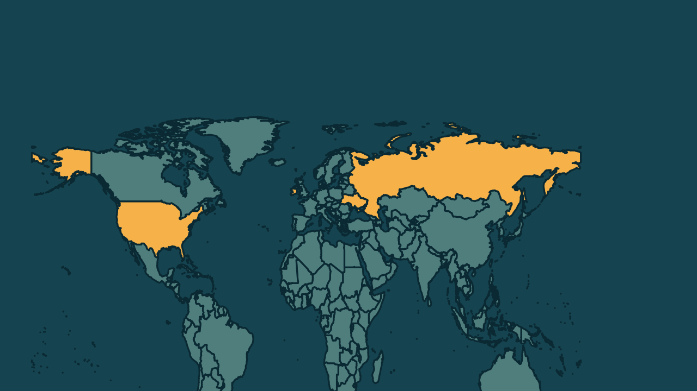

# Putin recebe enviados dos EUA e rejeita tropas estrangeiras na Ucrânia

*Heimdall News, edição internacional. 12 de novembro de 2026*

## A notícia

O presidente da Rússia, Vladimir Putin, recebeu nesta quinta-feira, no Kremlin, os enviados do presidente dos Estados Unidos, Donald Trump: Steve Witkoff e Jared Kushner. A conversa sobre um acordo de paz com a Ucrânia durou cerca de 2 horas. [1][2][3]

A visita veio depois de 2 dias de negociações em Abu Dhabi, que terminaram só com o compromisso de trocar prisioneiros. Não houve acordo sobre território. [4][5][6]

Putin propôs uma pausa nos combates em Kostiantynivka, na região de Donetsk, para retirar civis. Depois de Moscou, os enviados seguem para Dublin, na Irlanda, para encontrar o presidente ucraniano, Volodymyr Zelensky. [7][8][9]

## Quem se manifestou

- **Vladimir Putin, russo, presidente:** afirmou que tropas estrangeiras na Ucrânia são inaceitáveis e seriam alvo legítimo, e que a única linha de demarcação é a fronteira estatal. [10][11][12]
- **Steve Witkoff, americano, enviado especial:** disse que houve progresso e que os europeus vão participar da próxima rodada. [13][14]
- **Jared Kushner, americano:** afirmou que as delegações concordaram em muitos dos princípios. [15]
- **Dmytro Lytvyn, ucraniano, assessor de Zelensky:** disse que a Rússia usou a trégua em Oleshky para levar equipamentos militares. [16]

## Reação no Brasil

Nenhum posicionamento encontrado.

## Fontes

1. Poder360, [Putin recebe enviados de Trump e rejeita tropas europeias](https://www.poder360.com.br/poder-internacional/putin-recebe-enviados-de-trump-e-rejeita-tropas-europeias/): "recebeu nesta 5ª feira (12.nov.2026) no Kremlin, em Moscou, os enviados do presidente dos EUA"
2. Poder360, [Putin recebe enviados de Trump e rejeita tropas europeias](https://www.poder360.com.br/poder-internacional/putin-recebe-enviados-de-trump-e-rejeita-tropas-europeias/): "para discutir um acordo de paz com a Ucrânia"
3. Poder360, [Putin recebe enviados de Trump e rejeita tropas europeias](https://www.poder360.com.br/poder-internacional/putin-recebe-enviados-de-trump-e-rejeita-tropas-europeias/): "A conversa durou cerca de 2 horas."
4. Poder360, [Putin recebe enviados de Trump e rejeita tropas europeias](https://www.poder360.com.br/poder-internacional/putin-recebe-enviados-de-trump-e-rejeita-tropas-europeias/): "na 3ª feira (10.nov) e na 4ª feira (11.nov), eles mediaram negociações entre delegações da Rússia e da Ucrânia"
5. Poder360, [Putin recebe enviados de Trump e rejeita tropas europeias](https://www.poder360.com.br/poder-internacional/putin-recebe-enviados-de-trump-e-rejeita-tropas-europeias/): "O único resultado concreto foi o compromisso de trocar soldados capturados em combate."
6. Poder360, [Putin recebe enviados de Trump e rejeita tropas europeias](https://www.poder360.com.br/poder-internacional/putin-recebe-enviados-de-trump-e-rejeita-tropas-europeias/): "Não houve acordo sobre território, ponto que trava o fim da guerra"
7. Poder360, [Putin recebe enviados de Trump e rejeita tropas europeias](https://www.poder360.com.br/poder-internacional/putin-recebe-enviados-de-trump-e-rejeita-tropas-europeias/): "Putin propôs uma pausa nos combates em Kostiantynivka, cidade da região de Donetsk"
8. Brasil de Fato, [Em reunião com enviados de Trump, Putin propõe trégua humanitária em Donetsk e cobra posição da UE](https://www.brasildefato.com.br/2026/11/12/em-reuniao-com-enviados-de-trump-putin-propoe-tregua-humanitaria-em-donetsk-e-cobra-posicao-da-ue/): "propôs realizar uma missão humanitária para evacuar civis na região de Kostiantynivka"
9. Poder360, [Putin recebe enviados de Trump e rejeita tropas europeias](https://www.poder360.com.br/poder-internacional/putin-recebe-enviados-de-trump-e-rejeita-tropas-europeias/): "devem viajar ainda nesta 5ª feira a Dublin, na Irlanda, para se reunir com Zelensky"
10. Brasil de Fato, [Em reunião com enviados de Trump, Putin propõe trégua humanitária em Donetsk e cobra posição da UE](https://www.brasildefato.com.br/2026/11/12/em-reuniao-com-enviados-de-trump-putin-propoe-tregua-humanitaria-em-donetsk-e-cobra-posicao-da-ue/): "a presença de quaisquer tropas estrangeiras em território ucraniano é absolutamente inaceitável para nós"
11. Brasil de Fato, [Em reunião com enviados de Trump, Putin propõe trégua humanitária em Donetsk e cobra posição da UE](https://www.brasildefato.com.br/2026/11/12/em-reuniao-com-enviados-de-trump-putin-propoe-tregua-humanitaria-em-donetsk-e-cobra-posicao-da-ue/): "elas seriam um alvo legítimo para as Forças Armadas Russas"
12. Poder360, [Putin recebe enviados de Trump e rejeita tropas europeias](https://www.poder360.com.br/poder-internacional/putin-recebe-enviados-de-trump-e-rejeita-tropas-europeias/): "Para nós, há só uma linha de demarcação: a fronteira estatal"
13. CNN Brasil, [Representantes dos EUA viajam para Dublin para se reunir com Zelensky](https://www.cnnbrasil.com.br/internacional/witkoff-e-kushner-vao-a-dublin-apos-reuniao-com-putin-em-moscou/): "Acho que houve progresso"
14. CNN Brasil, [Representantes dos EUA viajam para Dublin para se reunir com Zelensky](https://www.cnnbrasil.com.br/internacional/witkoff-e-kushner-vao-a-dublin-apos-reuniao-com-putin-em-moscou/): "Witkoff também confirmou que representantes europeus participarão da próxima rodada de negociações"
15. Poder360, [Putin recebe enviados de Trump e rejeita tropas europeias](https://www.poder360.com.br/poder-internacional/putin-recebe-enviados-de-trump-e-rejeita-tropas-europeias/): "concordaram em muitos dos princípios"
16. Poder360, [Putin recebe enviados de Trump e rejeita tropas europeias](https://www.poder360.com.br/poder-internacional/putin-recebe-enviados-de-trump-e-rejeita-tropas-europeias/): "a Rússia aproveitou a trégua em Oleshky para levar equipamentos militares e substituir soldados na linha de frente"
