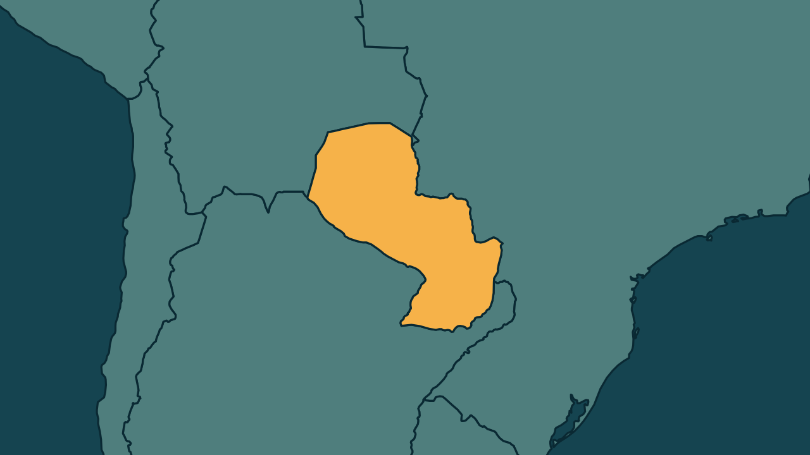

# Paraguai faz buscas na residência presidencial no caso Ueno Bank

*Heimdall News, edição internacional. 12 de novembro de 2026*

## A notícia

O Ministério Público do Paraguai fez nesta quinta-feira buscas na residência oficial da Presidência, em Assunção, como parte da investigação sobre o colapso do Ueno Bank. [1][2]

O ex-presidente Santiago Peña, destituído pelo Senado e em prisão preventiva, é acusado de usar sua influência para favorecer o banco, do qual foi acionista até 2025. Ele pode pegar até 15 anos de prisão. [3][4][5][6]

No mesmo dia, foi preso o superintendente de bancos do Banco Central, Holger Insfrán, suspeito de omissão na fiscalização. Dez dirigentes do banco e o ex-presidente do Banco Central Carlos Carvallo já estavam detidos. [7][8][9]

## Quem se manifestou

- **Ministério Público do Paraguai, Paraguai:** informou que os agentes fizeram trabalhos técnicos de extração de dados e de levantamento de informações para a investigação. [10]
- **Cristian Benítez, paraguaio, promotor:** afirmou que há elementos de suspeita sobre a conduta do superintendente de bancos. [11]
- **Presidência do Paraguai, Paraguai:** afirmou que o governo de Pedro Alliana garante plena colaboração com a Justiça e respeito à independência do Ministério Público e do Judiciário. [12][13]

## Reação no Brasil

Nenhum posicionamento encontrado.

## Fontes

1. Estadão, [Ministério Público faz buscas na residência presidencial do Paraguai em caso que derrubou Peña](https://www.estadao.com.br/internacional/ministerio-publico-faz-buscas-na-residencia-presidencial-do-paraguai-em-caso-que-derrubou-pena-npr/): "O Ministério Público do Paraguai realiza nesta quinta-feira, 12, uma operação de busca e apreensão na residência presidencial, em Assunção"
2. Estadão, [Ministério Público faz buscas na residência presidencial do Paraguai em caso que derrubou Peña](https://www.estadao.com.br/internacional/ministerio-publico-faz-buscas-na-residencia-presidencial-do-paraguai-em-caso-que-derrubou-pena-npr/): "como parte da investigação sobre o colapso do Ueno Bank"
3. Estadão, [Ministério Público faz buscas na residência presidencial do Paraguai em caso que derrubou Peña](https://www.estadao.com.br/internacional/ministerio-publico-faz-buscas-na-residencia-presidencial-do-paraguai-em-caso-que-derrubou-pena-npr/): "Peña permanece em prisão preventiva desde 6 de novembro, quando foi destituído pelo Senado paraguaio"
4. Estadão, [Ministério Público faz buscas na residência presidencial do Paraguai em caso que derrubou Peña](https://www.estadao.com.br/internacional/ministerio-publico-faz-buscas-na-residencia-presidencial-do-paraguai-em-caso-que-derrubou-pena-npr/): "acusado de utilizar sua influência política para favorecer a instituição financeira"
5. CNN Brasil, [Paraguai faz buscas na residência presidencial em investigação sobre Peña](https://www.cnnbrasil.com.br/internacional/paraguai-faz-buscas-na-residencia-presidencial-em-investigacao-sobre-pena/): "O ex-presidente foi acionista da controladora do Ueno até 2025."
6. CartaCapital, [Escândalo do Ueno Bank: MP do Paraguai faz buscas na residência presidencial](https://www.cartacapital.com.br/mundo/escandalo-do-ueno-bank-mp-do-paraguai-faz-buscas-na-residencia-presidencial/): "Peña, que pode pegar até 15 anos de prisão"
7. Metrópoles, [Paraguai: MP faz buscas na residência presidencial após prisão de Peña](https://www.metropoles.com/mundo/paraguai-mp-faz-buscas-na-residencia-presidencial-apos-prisao-de-pena): "os investigadores também prenderam o superintendente de bancos do Banco Central do Paraguai (BCP), Holger Insfrán"
8. Metrópoles, [Paraguai: MP faz buscas na residência presidencial após prisão de Peña](https://www.metropoles.com/mundo/paraguai-mp-faz-buscas-na-residencia-presidencial-apos-prisao-de-pena): "Ele é suspeito de omissão na fiscalização do setor financeiro."
9. Metrópoles, [Paraguai: MP faz buscas na residência presidencial após prisão de Peña](https://www.metropoles.com/mundo/paraguai-mp-faz-buscas-na-residencia-presidencial-apos-prisao-de-pena): "dez dirigentes da instituição financeira e o ex-presidente do BCP Carlos Carvallo já foram detidos"
10. CNN Brasil, [Paraguai faz buscas na residência presidencial em investigação sobre Peña](https://www.cnnbrasil.com.br/internacional/paraguai-faz-buscas-na-residencia-presidencial-em-investigacao-sobre-pena/): "trabalhos técnicos voltados à extração de dados e ao levantamento de informações de interesse para a investigação"
11. Estadão, [Ministério Público faz buscas na residência presidencial do Paraguai em caso que derrubou Peña](https://www.estadao.com.br/internacional/ministerio-publico-faz-buscas-na-residencia-presidencial-do-paraguai-em-caso-que-derrubou-pena-npr/): "elementos de suspeita em relação à conduta"
12. Folha de S.Paulo, [Residência presidencial do Paraguai é revistada por ordem da Justiça](https://www1.folha.uol.com.br/mundo/2026/11/residencia-presidencial-do-paraguai-e-revistada-por-ordem-da-justica.shtml): "O governo, liderado pelo presidente Pedro Alliana, garante plena colaboração com a Justiça"
13. Estadão, [Ministério Público faz buscas na residência presidencial do Paraguai em caso que derrubou Peña](https://www.estadao.com.br/internacional/ministerio-publico-faz-buscas-na-residencia-presidencial-do-paraguai-em-caso-que-derrubou-pena-npr/): "respeito à independência do Ministério Público e do Poder Judiciário"
