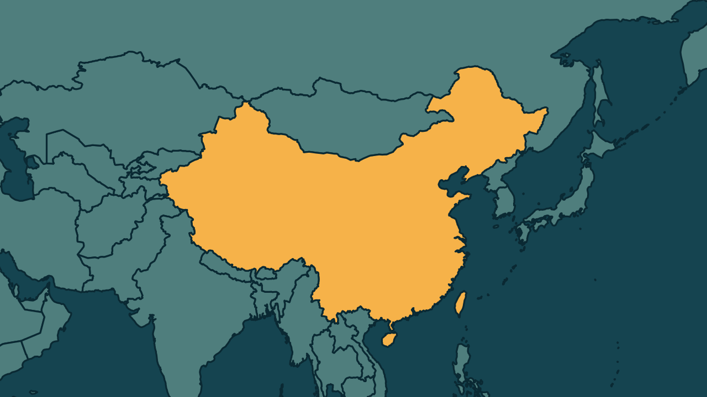

# Xi diz que reunificação com Taiwan será realizada; Taipé rejeita

*Heimdall News, edição internacional. 12 de novembro de 2026*

## A notícia

O presidente da China, Xi Jinping, afirmou nesta quinta-feira, em Pequim, que a reunificação de Taiwan é uma missão histórica do Partido Comunista e que certamente será realizada. O discurso marcou os 160 anos do nascimento de Sun Yat-sen. [1][2][3]

Xi defendeu a reunificação pacífica, no modelo um país, dois sistemas, e não mencionou o uso da força, que Pequim nunca descartou. [4][5][6]

O Ministério da Defesa de Taiwan informou ter detectado 29 aeronaves militares chinesas perto da ilha. Na véspera, os chanceleres do Grupo dos Sete criticaram a pressão militar e marítima de Pequim sobre Taiwan. [7][8]

## Quem se manifestou

- **Xi Jinping, chinês, presidente:** afirmou que a maré da história não pode ser detida e pediu que todos os chineses se unam contra as forças separatistas. [9][10]
- **Conselho para Assuntos do Continente, Taiwan:** afirmou que nem o governo nem a população da ilha aceitam a fórmula, que significaria submeter-se ao Partido Comunista. [11][12]
- **Chanceleres do Grupo dos Sete:** afirmaram que as ações cada vez mais assertivas da China a leste de Taiwan ameaçam a estabilidade regional e a liberdade de navegação. [13]

## Reação no Brasil

Nenhum posicionamento encontrado.

## Fontes

1. Brasil de Fato, [Xi Jinping afirma que reunificação de Taiwan é missão histórica do Partido Comunista da China](https://www.brasildefato.com.br/2026/11/12/xi-jinping-afirma-que-reunificacao-de-taiwan-e-missao-historica-do-partido-comunista-da-china/): "O presidente chinês, Xi Jinping, afirmou nesta quinta-feira (12) que a reunificação de Taiwan é uma missão histórica do Partido Comunista da China"
2. Estadão, [Xi Jinping afirma que Taiwan será reunificada à China e diz que processo é ‘inevitável’](https://www.estadao.com.br/internacional/xi-jinping-afirma-que-taiwan-sera-reunificada-a-china-e-diz-que-processo-e-inevitavel-npr/): "A reunificação completa da pátria deve ser realizada e certamente será realizada"
3. Estadão, [Xi Jinping afirma que Taiwan será reunificada à China e diz que processo é ‘inevitável’](https://www.estadao.com.br/internacional/xi-jinping-afirma-que-taiwan-sera-reunificada-a-china-e-diz-que-processo-e-inevitavel-npr/): "O discurso marcou os 160 anos do nascimento de Sun Yat-sen"
4. Estadão, [Xi Jinping afirma que Taiwan será reunificada à China e diz que processo é ‘inevitável’](https://www.estadao.com.br/internacional/xi-jinping-afirma-que-taiwan-sera-reunificada-a-china-e-diz-que-processo-e-inevitavel-npr/): "Xi declarou que Pequim mantém o compromisso com a reunificação pacífica e está disposta a dialogar com Taiwan"
5. Estadão, [Xi Jinping afirma que Taiwan será reunificada à China e diz que processo é ‘inevitável’](https://www.estadao.com.br/internacional/xi-jinping-afirma-que-taiwan-sera-reunificada-a-china-e-diz-que-processo-e-inevitavel-npr/): "O governo de Xi defende o modelo de autonomia conhecido como “um país, dois sistemas”"
6. Estadão, [Xi Jinping afirma que Taiwan será reunificada à China e diz que processo é ‘inevitável’](https://www.estadao.com.br/internacional/xi-jinping-afirma-que-taiwan-sera-reunificada-a-china-e-diz-que-processo-e-inevitavel-npr/): "Apesar de não ter mencionado o uso da força no discurso, a China nunca descartou uma ação militar"
7. Estadão, [Xi Jinping afirma que Taiwan será reunificada à China e diz que processo é ‘inevitável’](https://www.estadao.com.br/internacional/xi-jinping-afirma-que-taiwan-sera-reunificada-a-china-e-diz-que-processo-e-inevitavel-npr/): "Segundo o Ministério da Defesa de Taiwan, 29 aeronaves militares chinesas, entre caças J-16 e drones, foram detectadas nas proximidades do território"
8. Folha de S.Paulo, [Xi Jinping diz que reunificação de Taiwan à China é inevitável](https://www1.folha.uol.com.br/mundo/2026/11/xi-jinping-diz-que-reunificacao-de-taiwan-com-a-china-e-inevitavel.shtml): "um dia depois de os ministros das Relações Exteriores do G7 criticarem, em declaração conjunta, o aumento da pressão militar e marítima de Pequim sobre a ilha"
9. CNN Brasil, [Xi Jinping diz que reunificação de Taiwan com a China é “inevitável”](https://www.cnnbrasil.com.br/internacional/xi-jinping-diz-que-reunificacao-de-taiwan-com-a-china-e-inevitavel/): "“A maré da história não pode ser detida”, afirmou o presidente chinês, Xi Jinping"
10. CNN Brasil, [Xi Jinping diz que reunificação de Taiwan com a China é “inevitável”](https://www.cnnbrasil.com.br/internacional/xi-jinping-diz-que-reunificacao-de-taiwan-com-a-china-e-inevitavel/): "Todos os chineses, incluindo os que vivem em Taiwan, devem unir esforços para se opor às forças “separatistas”"
11. Folha de S.Paulo, [Xi Jinping diz que reunificação de Taiwan à China é inevitável](https://www1.folha.uol.com.br/mundo/2026/11/xi-jinping-diz-que-reunificacao-de-taiwan-com-a-china-e-inevitavel.shtml): "Um porta-voz do Conselho para Assuntos do Continente afirmou que nem o governo nem a população da ilha podem aceitar a fórmula"
12. Folha de S.Paulo, [Xi Jinping diz que reunificação de Taiwan à China é inevitável](https://www1.folha.uol.com.br/mundo/2026/11/xi-jinping-diz-que-reunificacao-de-taiwan-com-a-china-e-inevitavel.shtml): "que significaria submeter-se ao regime autoritário do Partido Comunista"
13. CNN Brasil, [G7 diz que ações da China perto de Taiwan ameaçam estabilidade regional](https://www.cnnbrasil.com.br/internacional/g7-diz-que-acoes-da-china-perto-de-taiwan-ameacam-estabilidade-regional/): "As ações cada vez mais assertivas da China nas águas a leste de Taiwan ameaçam a estabilidade regional e a liberdade de navegação"
