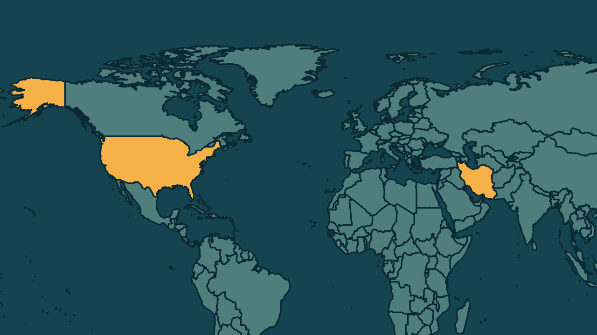

# Trump tira Vance das negociações e diz não precisar de acordo com o Irã

*Heimdall News, edição internacional. 13 de novembro de 2026*

## A notícia

O presidente dos Estados Unidos, Donald Trump, afirmou na quinta-feira que o país não precisa de um acordo com o Irã e tirou o vice-presidente, J. D. Vance, das negociações de paz. [1][2]

Trump pediu que Vance investigue suposta corrupção em cidades e estados governados por democratas. Na semana passada, Vance atribuiu à guerra a derrota dos republicanos nas eleições de meio de mandato. [3][4]

Nesta sexta-feira, a Guarda Revolucionária do Irã afirmou ter atacado um radar dos Estados Unidos no Bahrein, em resposta a um ataque aéreo no sul do Irã. A guerra começou em 28 de fevereiro. [5][6][7]

## Quem se manifestou

- **Donald Trump, americano, presidente:** escreveu que os Estados Unidos já têm o dinheiro e o estreito do Irã. [8]
- **J. D. Vance, americano, vice-presidente:** escreveu, depois das eleições, que os republicanos perderam por causa da guerra. [9]
- **Guarda Revolucionária Islâmica, Irã:** afirmou que o ataque é um aviso sério para que cessem as provocações aéreas em Ormuz. [10]
- **Abbas Araghchi, iraniano, ministro das Relações Exteriores:** escreveu que a proposta de reabrir Ormuz em dois dias segue de pé, se o Irã for atendido. [11][12]

## Reação no Brasil

- **Luiz Inácio Lula da Silva, brasileiro, presidente:** afirmou, depois de se reunir com o presidente do Irã, que encorajou uma solução pacífica e defendeu a livre navegação em Ormuz. [13][14]
- **Marco Fernandes, brasileiro, analista geopolítico:** avaliou que a disputa entre Rubio e Vance pela candidatura republicana vai refletir nas tentativas de acordo com o Irã. [15][16]

## Fontes

1. CNN Brasil, [Trump retira JD Vance de negociação com Irã para focar nos Democratas](https://www.cnnbrasil.com.br/internacional/trump-retira-jd-vance-de-negociacao-com-ira-para-focar-nos-democratas/): "O presidente Donald Trump afirmou nesta quinta-feira (12) que os Estados Unidos não precisam de um acordo com o Irã"
2. Folha de S.Paulo, [Trump tira seu vice de negociação com Irã e diz que EUA não precisam de acordo](https://www1.folha.uol.com.br/mundo/2026/11/trump-tira-seu-vice-de-negociacao-com-ira-e-diz-que-eua-nao-precisam-de-acordo.shtml): "havia retirado seu vice, J. D. Vance, das possíveis negociações de paz com o Irã"
3. Folha de S.Paulo, [Trump tira seu vice de negociação com Irã e diz que EUA não precisam de acordo](https://www1.folha.uol.com.br/mundo/2026/11/trump-tira-seu-vice-de-negociacao-com-ira-e-diz-que-eua-nao-precisam-de-acordo.shtml): "seu tempo seria mais bem gasto investigando suposta corrupção em cidades e estados governados por democratas"
4. CNN Brasil, [Trump retira JD Vance de negociação com Irã para focar nos Democratas](https://www.cnnbrasil.com.br/internacional/trump-retira-jd-vance-de-negociacao-com-ira-para-focar-nos-democratas/): "Vance se distanciou da guerra na semana passada, após a derrota expressiva dos republicanos para os democratas nas eleições de meio de mandato"
5. G1, [Irã diz ter atacado radar dos EUA no Bahrein](https://g1.globo.com/mundo/noticia/2026/11/13/ira-diz-ter-atacado-radar-dos-eua-no-bahrein.ghtml): "A Guarda Revolucionária do Irã afirmou nesta sexta-feira (13) ter atacado um radar de alerta antecipado dos Estados Unidos no Bahrein"
6. G1, [Irã diz ter atacado radar dos EUA no Bahrein](https://g1.globo.com/mundo/noticia/2026/11/13/ira-diz-ter-atacado-radar-dos-eua-no-bahrein.ghtml): "o ataque foi uma retaliação a uma ofensiva aérea contra uma torre de telecomunicações no condado de Sirik"
7. Estadão, com AFP, [‘Não precisamos de um acordo com o Irã’, diz Trump um dia após Teerã ameaçar bases dos EUA na Europa](https://www.estadao.com.br/internacional/nao-precisamos-de-um-acordo-com-o-ira-diz-trump-um-dia-apos-teera-ameacar-bases-dos-eua-na-europa-npr/): "A guerra no Oriente Médio começou em 28 de fevereiro"
8. CNN Brasil, [Trump retira JD Vance de negociação com Irã para focar nos Democratas](https://www.cnnbrasil.com.br/internacional/trump-retira-jd-vance-de-negociacao-com-ira-para-focar-nos-democratas/): "“Não precisamos de um acordo com o Irã. Esses dias ficaram para trás há muito tempo. Temos o dinheiro deles, centenas de bilhões de dólares, e temos o Estreito deles!”"
9. Folha de S.Paulo, [Trump tira seu vice de negociação com Irã e diz que EUA não precisam de acordo](https://www1.folha.uol.com.br/mundo/2026/11/trump-tira-seu-vice-de-negociacao-com-ira-e-diz-que-eua-nao-precisam-de-acordo.shtml): ""O motivo de termos perdido foi a guerra", escreveu ele"
10. Metrópoles, [Irã diz ter atacado radar dos EUA no Bahrein](https://www.metropoles.com/mundo/ira-diz-ter-atacado-radar-dos-eua-no-bahrein): "Isto constitui um sério aviso ao inimigo agressor para que cesse as suas provocações aéreas e o contrabando de petróleo no Estreito de Ormuz."
11. Folha de S.Paulo, [Trump tira seu vice de negociação com Irã e diz que EUA não precisam de acordo](https://www1.folha.uol.com.br/mundo/2026/11/trump-tira-seu-vice-de-negociacao-com-ira-e-diz-que-eua-nao-precisam-de-acordo.shtml): "Nossa proposta de dois dias continua de pé: atendam às exigências, incluindo o fim da guerra em todas as frentes"
12. Folha de S.Paulo, [Trump tira seu vice de negociação com Irã e diz que EUA não precisam de acordo](https://www1.folha.uol.com.br/mundo/2026/11/trump-tira-seu-vice-de-negociacao-com-ira-e-diz-que-eua-nao-precisam-de-acordo.shtml): "o Irã afirmou que estava preparado para reabrir totalmente o estreito em dois dias"
13. Gazeta do Povo, [Em encontro na COP 31, Lula fala em ampliar comércio com o Irã, transações na mira de Trump](https://www.gazetadopovo.com.br/mundo/encontro-cop-31-lula-fala-ampliar-comercio-ira-transacoes-mira-trump/): "encorajei a busca por uma solução pacífica para o conflito"
14. Gazeta do Povo, [Em encontro na COP 31, Lula fala em ampliar comércio com o Irã, transações na mira de Trump](https://www.gazetadopovo.com.br/mundo/encontro-cop-31-lula-fala-ampliar-comercio-ira-transacoes-mira-trump/): "defendeu “a livre navegação no Estreito de Ormuz”"
15. Brasil de Fato, [Reconhecer o direito do Irã manter seu programa nuclear foi ‘golaço de Lula’, diz analista geopolítico](https://www.brasildefato.com.br/2026/11/12/reconhecer-o-direito-do-ira-manter-seu-programa-nuclear-foi-golaco-de-lula-diz-analista-geopolitico/): "Há uma guerra interna no Partido Republicano entre Marco Rubio e JD Vance"
16. Brasil de Fato, [Reconhecer o direito do Irã manter seu programa nuclear foi ‘golaço de Lula’, diz analista geopolítico](https://www.brasildefato.com.br/2026/11/12/reconhecer-o-direito-do-ira-manter-seu-programa-nuclear-foi-golaco-de-lula-diz-analista-geopolitico/): "isso vai refletir nas tentativas de acordo, seja na Ucrânia, seja no Irã"
