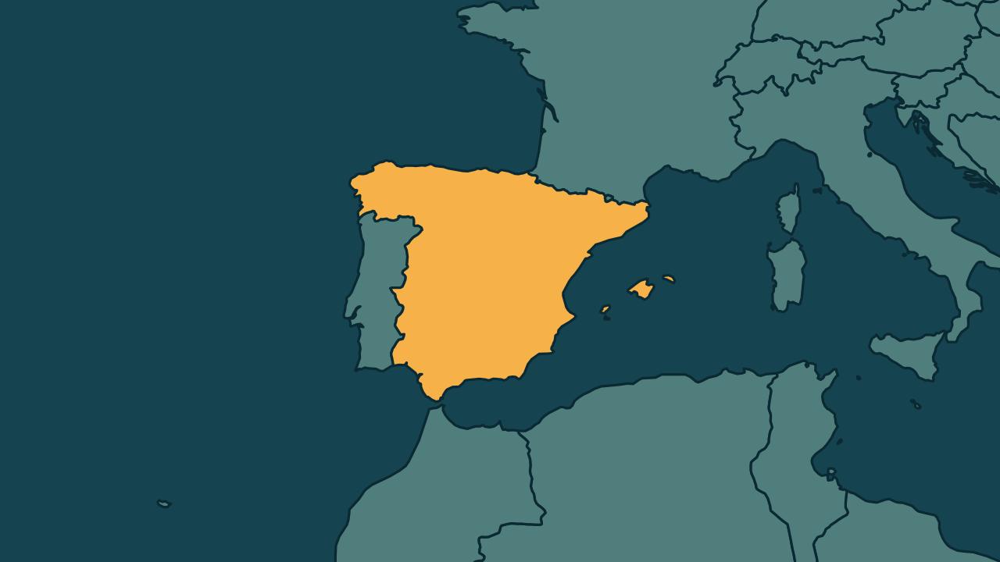

# Parlamento da Espanha aprova decreto que suspende despejos até 2030

*Heimdall News, edição internacional. 13 de novembro de 2026*

## A notícia

O Parlamento da Espanha aprovou nesta quinta-feira, por 35 votos a 34, um decreto que suspende até 2030 o despejo de inquilinos vulneráveis sem outra moradia. A votação foi na comissão de 69 deputados que substitui o Parlamento dissolvido antes das eleições de 29 de novembro. [1][2][3][4]

O texto permite prorrogar aluguéis por até dois anos e cria empréstimos sem juros de até 50 mil euros para a primeira casa. Um segundo decreto, que renovava contratos automaticamente, foi rejeitado. [5][6][7]

Os decretos foram criados depois do despejo de Maricarmen Abascal, aposentada de 87 anos que morreu duas semanas depois. A votação ocorreu um dia após a primeira greve geral desde 2012. [8][9][10]

## Quem se manifestou

- **Isabel Rodríguez, espanhola, ministra:** defendeu que o decreto protege os inquilinos e os pequenos proprietários durante a emergência habitacional. Disse que a moradia não é mercadoria, e sim um direito básico. [11][12][13]
- **Alberto Núñez Feijóo, espanhol:** anunciou que vai revogar a norma se formar governo depois das eleições. Afirmou que os decretos prejudicam inquilinos e proprietários. [14][15]

## Reação no Brasil

Nenhum posicionamento encontrado.

## Fontes

1. Estadão, com AFP, [Parlamento espanhol aprova medidas para proteger direito à moradia após greve geral](https://www.estadao.com.br/internacional/parlamento-espanhol-aprova-medidas-proteger-direito-moradia-apos-greve-geral-npr/): "suspende até 2030 os despejos de vulneráveis"
2. Estadão, com AFP, [Parlamento espanhol aprova medidas para proteger direito à moradia após greve geral](https://www.estadao.com.br/internacional/parlamento-espanhol-aprova-medidas-proteger-direito-moradia-apos-greve-geral-npr/): "35 deputados votaram a favor do primeiro texto, contra 34 votos contrários"
3. Estadão, com AFP, [Parlamento espanhol aprova medidas para proteger direito à moradia após greve geral](https://www.estadao.com.br/internacional/parlamento-espanhol-aprova-medidas-proteger-direito-moradia-apos-greve-geral-npr/): "dentro desse órgão especial composto por 69 membros"
4. Estadão, com AFP, [Parlamento espanhol aprova medidas para proteger direito à moradia após greve geral](https://www.estadao.com.br/internacional/parlamento-espanhol-aprova-medidas-proteger-direito-moradia-apos-greve-geral-npr/): "que assume as funções do Parlamento após a sua dissolução antes das eleições de 29 de novembro"
5. Poder360, [Parlamento da Espanha aprova medidas que dificultam despejo](https://www.poder360.com.br/poder-internacional/parlamento-da-espanha-aprova-medidas-que-dificultam-despejo/): "autoriza a prorrogação de contratos de aluguel por até 2 anos"
6. Poder360, [Parlamento da Espanha aprova medidas que dificultam despejo](https://www.poder360.com.br/poder-internacional/parlamento-da-espanha-aprova-medidas-que-dificultam-despejo/): "limitados a € 50 mil, com juros zero e sem cobrança de comissões"
7. Estadão, com AFP, [Parlamento espanhol aprova medidas para proteger direito à moradia após greve geral](https://www.estadao.com.br/internacional/parlamento-espanhol-aprova-medidas-proteger-direito-moradia-apos-greve-geral-npr/): "Outro texto, que incluía a renovação automática dos contratos de locação, foi rejeitado"
8. Folha de S.Paulo, [Parlamento da Espanha aprova 'decreto Maricarmen', que dificulta despejos, em meio à corrida eleitoral](https://www1.folha.uol.com.br/mundo/2026/11/parlamento-da-espanha-aprova-decreto-maricarmen-que-dificulta-despejos-em-meio-a-corrida-eleitoral.shtml): "Maricarmen Abascal, despejada em 23 de setembro do imóvel onde morara a vida toda"
9. Folha de S.Paulo, [Parlamento da Espanha aprova 'decreto Maricarmen', que dificulta despejos, em meio à corrida eleitoral](https://www1.folha.uol.com.br/mundo/2026/11/parlamento-da-espanha-aprova-decreto-maricarmen-que-dificulta-despejos-em-meio-a-corrida-eleitoral.shtml): "A aposentada de 87 anos morreu num hospital duas semanas depois do despejo"
10. Estadão, com AFP, [Parlamento espanhol aprova medidas para proteger direito à moradia após greve geral](https://www.estadao.com.br/internacional/parlamento-espanhol-aprova-medidas-proteger-direito-moradia-apos-greve-geral-npr/): "um dia após a primeira greve geral na Espanha desde 2012"
11. Infobae, [La Diputación Permanente del Congreso valida el decreto de vivienda y deroga el de los alquileres indefinidos](https://www.infobae.com/america/agencias/2026/11/12/la-diputacion-permanente-del-congreso-valida-el-decreto-de-vivienda-y-deroga-el-de-los-alquileres-indefinidos/): "Rodríguez ha defendido que este decreto permite proteger a los inquilinos y a los pequeños propietarios ante la emergencia habitacional"
12. Infobae, [La Diputación Permanente del Congreso valida el decreto de vivienda y deroga el de los alquileres indefinidos](https://www.infobae.com/america/agencias/2026/11/12/la-diputacion-permanente-del-congreso-valida-el-decreto-de-vivienda-y-deroga-el-de-los-alquileres-indefinidos/): "La ministra ha insistido en que la vivienda "no es mercancía""
13. Infobae, [La Diputación Permanente del Congreso valida el decreto de vivienda y deroga el de los alquileres indefinidos](https://www.infobae.com/america/agencias/2026/11/12/la-diputacion-permanente-del-congreso-valida-el-decreto-de-vivienda-y-deroga-el-de-los-alquileres-indefinidos/): "sino que constituye "un derecho básico""
14. elDiario.es, [La Diputación Permanente pone el colofón a la huelga con la aprobación del decreto Ley de vivienda](https://www.eldiario.es/politica/diputacion-permanente-pone-colofon-huelga-aprobacion-decreto-ley-vivienda_1_13655575.html): "si consigue formar Gobierno tras las elecciones generales del próximo 29 de noviembre derogará la norma"
15. elDiario.es, [La Diputación Permanente pone el colofón a la huelga con la aprobación del decreto Ley de vivienda](https://www.eldiario.es/politica/diputacion-permanente-pone-colofon-huelga-aprobacion-decreto-ley-vivienda_1_13655575.html): "Los decretos perjudican a los inquilinos y a los propietarios"
