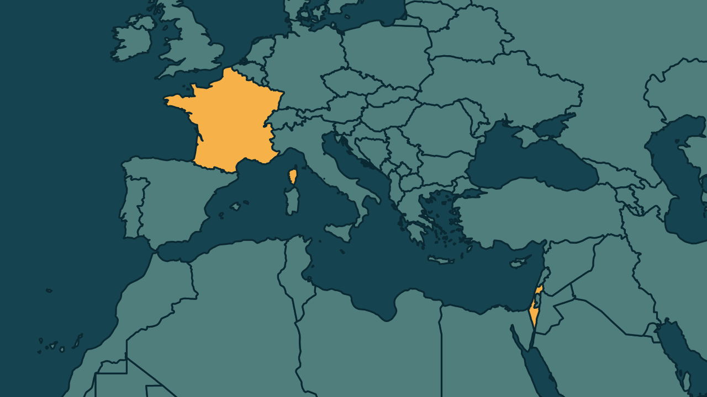

# Israel proíbe a entrada de Mélenchon e Mathilde Panot no país

*Heimdall News, edição internacional. 13 de novembro de 2026*

## A notícia

O governo de Israel proibiu nesta quinta-feira a entrada no país de Jean-Luc Mélenchon, fundador do partido França Insubmissa e candidato à Presidência da França em 2027, e de Mathilde Panot, que lidera a bancada do partido na Assembleia Nacional francesa. [1][2][3]

A decisão foi do ministro das Relações Exteriores, Gideon Sa'ar. O comunicado de Israel citou a proposta de Mélenchon de usar navios militares franceses para escoltar barcos de ativistas a caminho da Faixa de Gaza. [4][5]

No sábado, num comício perto de Paris, Mélenchon apresentou o programa do partido para a eleição presidencial. [6]

## Quem se manifestou

- **Gideon Sa'ar, israelense, ministro das Relações Exteriores:** afirmou que Israel não deixará entrar quem incita o ódio contra seus cidadãos. [7]
- **Jean-Luc Mélenchon, francês, candidato à Presidência:** disse que lamenta que o governo de Israel o persiga. [8]
- **Mathilde Panot, francesa, deputada:** escreveu que ainda procura a má notícia na proibição. [9]
- **Jean-Noël Barrot, francês, ministro das Relações Exteriores:** classificou a proibição como demagógica e criticou a França Insubmissa por explorar politicamente o conflito entre israelenses e palestinos. [10][11]

## Reação no Brasil

Nenhum posicionamento encontrado.

## Fontes

1. Gazeta do Povo, [Israel acusa líderes da esquerda radical da França de incitação ao ódio e proíbe entrada no país](https://www.gazetadopovo.com.br/mundo/israel-acusa-lideres-da-esquerda-radical-da-franca-de-incitacao-ao-odio-e-proibe-entrada-no-pais/): "anunciou nesta quinta-feira (12) que proibiu a entrada de dois líderes"
2. Gazeta do Povo, [Israel acusa líderes da esquerda radical da França de incitação ao ódio e proíbe entrada no país](https://www.gazetadopovo.com.br/mundo/israel-acusa-lideres-da-esquerda-radical-da-franca-de-incitacao-ao-odio-e-proibe-entrada-no-pais/): "Jean-Luc Mélenchon, fundador do partido França Insubmissa (LFI) e candidato à Presidência francesa em 2027"
3. Gazeta do Povo, [Israel acusa líderes da esquerda radical da França de incitação ao ódio e proíbe entrada no país](https://www.gazetadopovo.com.br/mundo/israel-acusa-lideres-da-esquerda-radical-da-franca-de-incitacao-ao-odio-e-proibe-entrada-no-pais/): "Mathilde Panot, que lidera a bancada da legenda na Assembleia Nacional"
4. Gazeta do Povo, [Israel acusa líderes da esquerda radical da França de incitação ao ódio e proíbe entrada no país](https://www.gazetadopovo.com.br/mundo/israel-acusa-lideres-da-esquerda-radical-da-franca-de-incitacao-ao-odio-e-proibe-entrada-no-pais/): "A proibição foi determinada pelo ministro das Relações Exteriores de Israel, Gideon Sa'ar"
5. Gazeta do Povo, [Israel acusa líderes da esquerda radical da França de incitação ao ódio e proíbe entrada no país](https://www.gazetadopovo.com.br/mundo/israel-acusa-lideres-da-esquerda-radical-da-franca-de-incitacao-ao-odio-e-proibe-entrada-no-pais/): "uma proposta apresentada por Mélenchon de utilizar navios militares franceses para escoltar embarcações de ativistas"
6. CartaCapital, [Israel proíbe entrada de líder da esquerda francesa de seu território](https://www.cartacapital.com.br/mundo/israel-proibe-entrada-de-lider-da-esquerda-francesa-em-seu-territorio/): "Durante um comício realizado no sábado 7, nos arredores de Paris, no qual apresentou o programa da LFI"
7. CartaCapital, [Israel proíbe entrada de líder da esquerda francesa de seu território](https://www.cartacapital.com.br/mundo/israel-proibe-entrada-de-lider-da-esquerda-francesa-em-seu-territorio/): "não permitirá que pessoas que atuam contra seus interesses e incitam o ódio contra seus cidadãos entrem em seu território"
8. CartaCapital, [Israel proíbe entrada de líder da esquerda francesa de seu território](https://www.cartacapital.com.br/mundo/israel-proibe-entrada-de-lider-da-esquerda-francesa-em-seu-territorio/): "Lamento que o governo de Israel me persiga dessa maneira"
9. Gazeta do Povo, [Israel acusa líderes da esquerda radical da França de incitação ao ódio e proíbe entrada no país](https://www.gazetadopovo.com.br/mundo/israel-acusa-lideres-da-esquerda-radical-da-franca-de-incitacao-ao-odio-e-proibe-entrada-no-pais/): "Ainda estou procurando a má notícia"
10. Gazeta do Povo, [Israel acusa líderes da esquerda radical da França de incitação ao ódio e proíbe entrada no país](https://www.gazetadopovo.com.br/mundo/israel-acusa-lideres-da-esquerda-radical-da-franca-de-incitacao-ao-odio-e-proibe-entrada-no-pais/): "classificou a proibição como "demagógica""
11. Gazeta do Povo, [Israel acusa líderes da esquerda radical da França de incitação ao ódio e proíbe entrada no país](https://www.gazetadopovo.com.br/mundo/israel-acusa-lideres-da-esquerda-radical-da-franca-de-incitacao-ao-odio-e-proibe-entrada-no-pais/): "criticou a própria França Insubmissa por, segundo ele, explorar politicamente o conflito entre israelenses e palestinos"
