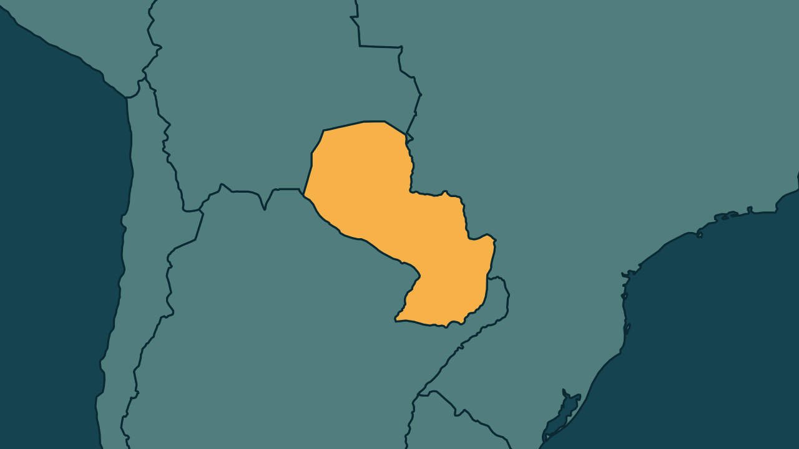

# Paraguai acusa Peña de liderar associação criminosa no caso Ueno Bank

*Heimdall News, edição internacional. 13 de novembro de 2026*

## A notícia

O Ministério Público do Paraguai ampliou nesta sexta-feira a acusação contra o ex-presidente Santiago Peña e incluiu o crime de associação criminosa, no caso do colapso do Ueno Bank. [1][2]

Segundo a promotoria, Peña teria chefiado da Presidência um grupo com cinco diretores do Banco Central para proteger o banco. Ele já responde por quebra de confiança e administração em proveito próprio, e está em prisão preventiva. [3][4][5][6]

Um juiz deve decidir se aceita a nova acusação. Se for condenado, Peña pode pegar até 15 anos de prisão. Mais de 800 milhões de dólares em recursos públicos seguem desaparecidos. [7][8][9]

## Quem se manifestou

- **Ministério Público do Paraguai, Paraguai:** afirmou no documento da acusação que Peña teria dado diretrizes para não intervir no banco, abafado os alertas de insolvência e recebido pessoalmente contraprestações ilícitas. [10][11]
- **Francisco Cabrera, paraguaio, promotor:** disse que vários países já confirmaram a presença de ativos ligados ao banco e que estão sendo tomadas as medidas para pedir o congelamento. [12][13]

## Reação no Brasil

Nenhum posicionamento encontrado.

## Fontes

1. Metrópoles, [Paraguai: MP acusa ex-presidente de liderar associação criminosa](https://www.metropoles.com/mundo/paraguai-mp-acusa-ex-presidente-de-liderar-associacao-criminosa): "O Ministério Público do Paraguai ampliou, nesta sexta-feira (13/11), a acusação contra o ex-presidente Santiago Peña"
2. Metrópoles, [Paraguai: MP acusa ex-presidente de liderar associação criminosa](https://www.metropoles.com/mundo/paraguai-mp-acusa-ex-presidente-de-liderar-associacao-criminosa): "incluiu o crime de associação criminosa entre os delitos investigados no caso Ueno Bank"
3. Estadão, com AFP, [MP do Paraguai acusa ex-presidente Santiago Peña de liderar uma associação criminosa](https://www.estadao.com.br/internacional/mp-paraguai-acusa-ex-presidente-santiago-pena-liderar-associacao-criminosa-npr/): "juntamente com cinco diretores do Banco Central do país, por terem protegido o Ueno Bank"
4. CartaCapital, com AFP, [MP do Paraguai acusa Santiago Peña de liderar uma associação criminosa](https://www.cartacapital.com.br/mundo/mp-do-paraguai-acusa-santiago-pena-de-liderar-uma-associacao-criminosa/): "Os promotores sustentam que o grupo teria trabalhado para proteger o Ueno Bank"
5. Estadão, com AFP, [MP do Paraguai acusa ex-presidente Santiago Peña de liderar uma associação criminosa](https://www.estadao.com.br/internacional/mp-paraguai-acusa-ex-presidente-santiago-pena-liderar-associacao-criminosa-npr/): "Peña já responde, no mesmo processo, por quebra de confiança e administração em proveito próprio."
6. Metrópoles, [Paraguai: MP acusa ex-presidente de liderar associação criminosa](https://www.metropoles.com/mundo/paraguai-mp-acusa-ex-presidente-de-liderar-associacao-criminosa): "O ex-presidente permanece em prisão preventiva em uma instalação militar."
7. Estadão, com AFP, [MP do Paraguai acusa ex-presidente Santiago Peña de liderar uma associação criminosa](https://www.estadao.com.br/internacional/mp-paraguai-acusa-ex-presidente-santiago-pena-liderar-associacao-criminosa-npr/): "Um juiz deverá decidir se ele também será formalmente acusado pelo crime de associação criminosa."
8. Estadão, com AFP, [MP do Paraguai acusa ex-presidente Santiago Peña de liderar uma associação criminosa](https://www.estadao.com.br/internacional/mp-paraguai-acusa-ex-presidente-santiago-pena-liderar-associacao-criminosa-npr/): "Caso seja considerado culpado, Peña pode enfrentar uma pena de até 15 anos de prisão."
9. Estadão, com AFP, [MP do Paraguai acusa ex-presidente Santiago Peña de liderar uma associação criminosa](https://www.estadao.com.br/internacional/mp-paraguai-acusa-ex-presidente-santiago-pena-liderar-associacao-criminosa-npr/): "a maior parte do dinheiro depositado continua desaparecida, incluindo mais de US$ 800 milhões em recursos públicos"
10. CNN Brasil, [Procuradoria do Paraguai acrescenta associação criminosa a caso contra Peña](https://www.cnnbrasil.com.br/internacional/procuradoria-do-paraguai-acrescenta-associacao-criminosa-a-caso-contra-pena/): "Ele teria emitido diretrizes públicas e institucionais para não intervir na entidade"
11. CNN Brasil, [Procuradoria do Paraguai acrescenta associação criminosa a caso contra Peña](https://www.cnnbrasil.com.br/internacional/procuradoria-do-paraguai-acrescenta-associacao-criminosa-a-caso-contra-pena/): "teria abafado na mídia os alertas de insolvência e teria recebido pessoalmente contraprestações ilícitas"
12. Folha de S.Paulo, [Ministério Público do Paraguai acusa presidente destituído de liderar quadrilha](https://www1.folha.uol.com.br/mundo/2026/11/ministerio-publico-do-paraguai-acusa-presidente-destituido-de-liderar-quadrilha.shtml): "vários países "já confirmaram a presença de ativos""
13. Folha de S.Paulo, [Ministério Público do Paraguai acusa presidente destituído de liderar quadrilha](https://www1.folha.uol.com.br/mundo/2026/11/ministerio-publico-do-paraguai-acusa-presidente-destituido-de-liderar-quadrilha.shtml): ""estão sendo tomadas as medidas necessárias para solicitar o congelamento""
