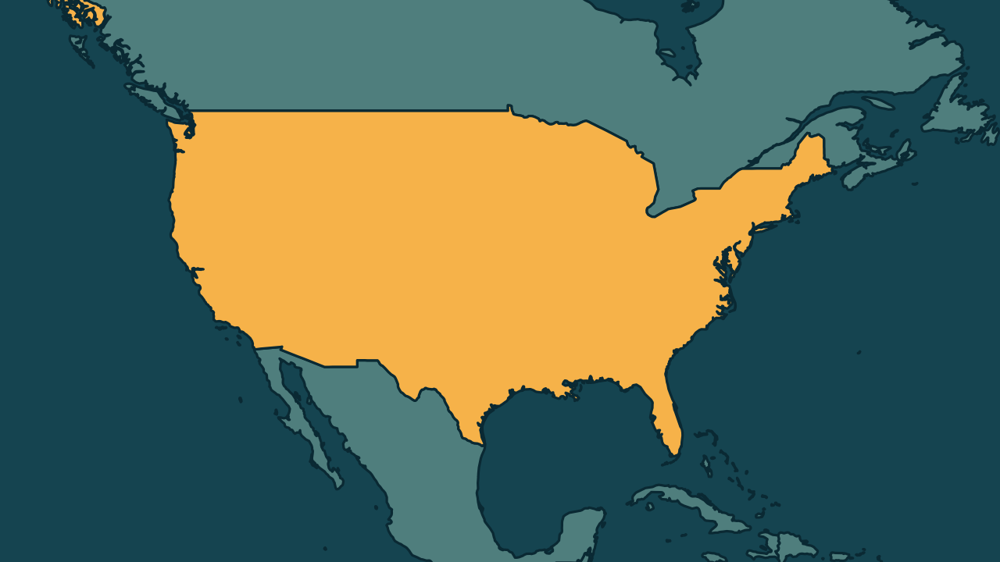

# Estados Unidos param todas as decolagens após falha no controle aéreo

*Heimdall News, edição internacional. 13 de novembro de 2026*

## A notícia

A Administração Federal de Aviação dos Estados Unidos suspendeu nesta sexta-feira as decolagens em todos os aeroportos do país, depois de uma falha de comunicação nos 22 centros regionais de controle do tráfego aéreo. Os aviões que já estavam no ar puderam pousar. [1][2][3]

Segundo o site FlightAware, mais de 12 mil voos atrasaram e cerca de 2.500 foram cancelados. A Eurocontrol, que coordena o tráfego aéreo de 42 países europeus, e o México também seguraram os voos para os Estados Unidos. [4][5][6]

É a segunda suspensão nacional desde os atentados de 11 de setembro de 2001. A anterior, em janeiro de 2023, durou menos de duas horas. [7][8]

## Quem se manifestou

- **Administração Federal de Aviação, Estados Unidos:** informou que parou os voos por precaução e que os voos internacionais serão tratados caso a caso. [9][10]
- **Sean Duffy, americano, secretário de Transportes:** afirmou que a falha afeta todos os centros de controle de tráfego aéreo e que técnicos investigam o problema. [11][12]
- **Markwayne Mullin, americano, secretário de Segurança Interna:** disse que não há indícios de ameaça e que não é outro 11 de setembro, mas uma interrupção nas telecomunicações. Afirmou que nada foi descartado. [13][14][15]

## Reação no Brasil

- **Agência Nacional de Aviação Civil, Brasil:** informou que monitora os voos entre o Brasil e os Estados Unidos e orientou os passageiros a procurar as companhias aéreas. [16][17]
- **GRU Airport, concessionária do Aeroporto de Guarulhos, Brasil:** informou que recebeu alerta americano para manter em solo os voos de ida e volta aos Estados Unidos até novo aviso. [18][19]

## Fontes

1. Gazeta do Povo, [EUA suspendem decolagens em todos os aeroportos do país por razões de segurança](https://www.gazetadopovo.com.br/mundo/eua-suspendem-decolagens-em-todos-os-aeroportos-do-pais-por-razoes-de-seguranca/): "determinou nesta sexta-feira (13) a suspensão das decolagens em todos os aeroportos do país"
2. Gazeta do Povo, [Secretário de Trump diz não haver sinais de ataque terrorista em falha que paralisou voos nos EUA](https://www.gazetadopovo.com.br/mundo/secretario-de-trump-diz-nao-haver-sinais-de-ataque-terrorista-em-falha-que-paralisou-voos/): "problemas de comunicação afetaram os 22 centros regionais responsáveis por coordenar o tráfego de aeronaves em rota"
3. CNN Brasil, [Ações de aéreas dos EUA caem após suspensão de voos em todo o país](https://www.cnnbrasil.com.br/economia/money/mercado/acoes-de-aereas-dos-eua-caem-apos-suspensao-de-voos-em-todo-o-pais/): "Aeronaves que já estavam em voo puderam pousar"
4. Poder360, [Anac monitora voos entre Brasil e EUA após suspensão de decolagens](https://www.poder360.com.br/poder-internacional/anac-monitora-voos-entre-brasil-e-eua-apos-suspensao-de-decolagens/): "mais de 12.000 voos atrasados e cerca de 2.500 cancelamentos"
5. Folha de S.Paulo, [Europa suspende voos para os EUA após interrupção de decolagens](https://www1.folha.uol.com.br/mundo/2026/11/europa-suspende-voos-para-os-eua-apos-interrupcao-de-decolagens.shtml): "responsável pela coordenação e gestão do tráfego aéreo em 42 países europeus e vizinhos, suspendeu voos para os Estados Unidos"
6. Folha de S.Paulo, [Europa suspende voos para os EUA após interrupção de decolagens](https://www1.folha.uol.com.br/mundo/2026/11/europa-suspende-voos-para-os-eua-apos-interrupcao-de-decolagens.shtml): "O México também anunciou que manterá todos os aviões com destino aos EUA no solo"
7. Poder360, [Secretário dos EUA diz que técnicos investigam falha que afetou voos](https://www.poder360.com.br/poder-internacional/secretario-dos-eua-diz-que-tecnicos-investigam-falha-que-afetou-voos/): "Esta é a 2ª suspensão nacional de decolagens desde os atentados de 11 de setembro de 2001."
8. Poder360, [Secretário dos EUA diz que técnicos investigam falha que afetou voos](https://www.poder360.com.br/poder-internacional/secretario-dos-eua-diz-que-tecnicos-investigam-falha-que-afetou-voos/): "A anterior ocorreu em janeiro de 2023, quando uma falha no sistema de informações aeronáuticas interrompeu as decolagens por menos de duas horas."
9. Poder360, [Secretário dos EUA diz que técnicos investigam falha que afetou voos](https://www.poder360.com.br/poder-internacional/secretario-dos-eua-diz-que-tecnicos-investigam-falha-que-afetou-voos/): "A FAA informou que a paralisação foi determinada por precaução"
10. CNN Brasil, [Suspensão de voos nos EUA: O que causou a pausa nas operações aéreas?](https://www.cnnbrasil.com.br/internacional/suspensao-de-voos-nos-eua-o-que-causou-a-pausa-nas-operacoes-aereas/): "A FAA informou que a situação de todas as aeronaves foi verificada e que os voos internacionais “serão tratados caso a caso”."
11. CNN Brasil, [Ações de aéreas dos EUA caem após suspensão de voos em todo o país](https://www.cnnbrasil.com.br/economia/money/mercado/acoes-de-aereas-dos-eua-caem-apos-suspensao-de-voos-em-todo-o-pais/): "a ordem foi emitida devido a uma falha de comunicação que afeta todos os Centros de Controle de Tráfego Aéreo"
12. CNN Brasil, [Ações de aéreas dos EUA caem após suspensão de voos em todo o país](https://www.cnnbrasil.com.br/economia/money/mercado/acoes-de-aereas-dos-eua-caem-apos-suspensao-de-voos-em-todo-o-pais/): "Técnicos da FAA estão investigando o problema."
13. Gazeta do Povo, [Secretário de Trump diz não haver sinais de ataque terrorista em falha que paralisou voos nos EUA](https://www.gazetadopovo.com.br/mundo/secretario-de-trump-diz-nao-haver-sinais-de-ataque-terrorista-em-falha-que-paralisou-voos/): "Não há indícios, nem motivos para acreditar, neste momento, que isso tenha sido uma ameaça aos Estados Unidos"
14. Folha de S.Paulo, [Europa suspende voos para os EUA após interrupção de decolagens](https://www1.folha.uol.com.br/mundo/2026/11/europa-suspende-voos-para-os-eua-apos-interrupcao-de-decolagens.shtml): "Isto não é outro 11 de Setembro. Trata-se de uma interrupção nas telecomunicações"
15. Gazeta do Povo, [Secretário de Trump diz não haver sinais de ataque terrorista em falha que paralisou voos nos EUA](https://www.gazetadopovo.com.br/mundo/secretario-de-trump-diz-nao-haver-sinais-de-ataque-terrorista-em-falha-que-paralisou-voos/): "Não estamos descartando nada neste momento"
16. Poder360, [Anac monitora voos entre Brasil e EUA após suspensão de decolagens](https://www.poder360.com.br/poder-internacional/anac-monitora-voos-entre-brasil-e-eua-apos-suspensao-de-decolagens/): "A Anac esclarece que está monitorando os voos entre o Brasil e os Estados Unidos"
17. Poder360, [Anac monitora voos entre Brasil e EUA após suspensão de decolagens](https://www.poder360.com.br/poder-internacional/anac-monitora-voos-entre-brasil-e-eua-apos-suspensao-de-decolagens/): "a Agência recomenda aos passageiros que busquem as companhias aéreas para verificar a situação do voo"
18. Estadão, [EUA suspendem voos em todos os aeroportos do país por motivos de segurança; acompanhe](https://www.estadao.com.br/internacional/ao-vivo-suspensao-de-voos-nos-estados-unidos/): "recebeu um alerta de segurança do Centro de Comando Federal de Aviação dos Estados Unidos"
19. Estadão, [EUA suspendem voos em todos os aeroportos do país por motivos de segurança; acompanhe](https://www.estadao.com.br/internacional/ao-vivo-suspensao-de-voos-nos-estados-unidos/): "todo o tráfego aéreo com origem ou destino ao país norte-americano permaneça em solo até novo aviso"
