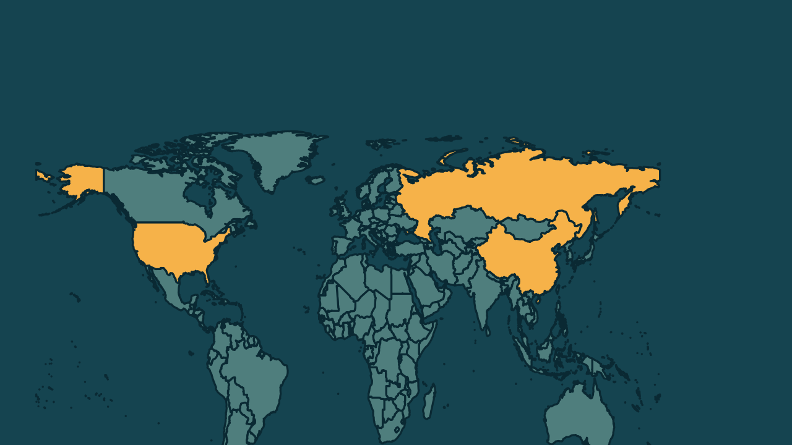

# Trump, Putin e Xi Jinping terão reunião a três na China

*Heimdall News, edição internacional. 14 de novembro de 2026*

## A notícia

A Casa Branca anunciou na sexta-feira que o presidente dos Estados Unidos, Donald Trump, vai se reunir com Vladimir Putin, da Rússia, e Xi Jinping, da China, na quinta-feira, dia 19, em Shenzhen, na China. [1][2]

Será a primeira reunião a três entre os líderes dos três países, à margem da cúpula do Fórum de Cooperação Econômica Ásia-Pacífico, que reúne 21 economias. [3][4]

Segundo um funcionário americano, Trump vai tratar da redução das armas nucleares e da guerra com o Irã, mas não da guerra na Ucrânia, e não se espera um acordo. O último tratado nuclear entre Estados Unidos e Rússia expirou em fevereiro. [5][6][7][8]

## Quem se manifestou

- **Olivia Wales, americana, porta-voz da Casa Branca:** disse que Trump vai discutir a redução das armas nucleares no mundo, cuja proliferação ele considera muito perigosa. [9]
- **Dmitry Peskov, russo, porta-voz do Kremlin:** tinha dito que a presença dos três na cúpula abriu espaço para um encontro paralelo, ainda sem proposta nem pauta definidas. [10][11]
- **Volodimir Zelenski, ucraniano, presidente:** manifestou preocupação de que a reunião sirva para discutir um acordo sobre a guerra no seu país sem a participação da Ucrânia. [12]

## Reação no Brasil

Nenhum posicionamento encontrado.

## Fontes

1. Folha de S.Paulo, [Trump, Xi e Putin vão se reunir na China na próxima quinta (19), diz Casa Branca](https://www1.folha.uol.com.br/mundo/2026/11/trump-xi-e-putin-vao-se-reunir-na-china-na-proxima-quinta-19-diz-casa-branca.shtml): "A Casa Branca anunciou nesta sexta-feira (13) que o presidente dos Estados Unidos, Donald Trump, o presidente da Rússia, Vladimir Putin, e o líder da China, Xi Jinping"
2. G1, [Trump, Xi Jinping e Putin terão reunirão histórica na China na próxima semana](https://g1.globo.com/mundo/noticia/2026/11/13/trump-xi-jinping-e-putin-se-reunirao-na-proxima-semana.ghtml): "sobre as conversas previstas para quinta-feira (19) em Shenzhen, China"
3. Estadão, com AFP, [Trump falará sobre o Irã com Xi e Putin na cúpula da Apec](https://www.estadao.com.br/internacional/trump-falara-sobre-o-ira-com-xi-e-putin-na-cupula-da-apec/): "realizarão a primeira reunião trilateral entre os líderes dos Estados Unidos, da Rússia e da China"
4. CNN Brasil, [Cinco pontos para entender a Apec antes de cúpula com Trump, Putin e Xi](https://www.cnnbrasil.com.br/internacional/cinco-pontos-para-entender-a-apec-antes-de-cupula-com-trump-putin-e-xi/): "encontro de 21 membros do Fórum de Cooperação Econômica Ásia-Pacífico (Apec)"
5. Estadão, com AFP, [Trump falará sobre o Irã com Xi e Putin na cúpula da Apec](https://www.estadao.com.br/internacional/trump-falara-sobre-o-ira-com-xi-e-putin-na-cupula-da-apec/): "Trump quer tratar da redução dos arsenais nucleares no encontro"
6. Estadão, com AFP, [Trump falará sobre o Irã com Xi e Putin na cúpula da Apec](https://www.estadao.com.br/internacional/trump-falara-sobre-o-ira-com-xi-e-putin-na-cupula-da-apec/): "levantará o tema da guerra com o Irã, mas não deve discutir o conflito na Ucrânia, disse um funcionário americano"
7. Metrópoles, [Casa Branca confirma reunião de Trump com Putin e Xi Jinping na China](https://www.metropoles.com/mundo/casa-branca-confirma-reuniao-de-trump-com-putin-e-xi-jinping-na-china): "Não esperamos chegar a nenhum tipo de acordo"
8. Folha de S.Paulo, [Trump, Xi e Putin vão se reunir na China na próxima quinta (19), diz Casa Branca](https://www1.folha.uol.com.br/mundo/2026/11/trump-xi-e-putin-vao-se-reunir-na-china-na-proxima-quinta-19-diz-casa-branca.shtml): "O último pacto entre russos e americanos sobre o controle de armas nucleares expirou em fevereiro"
9. G1, [Trump, Xi Jinping e Putin terão reunirão histórica na China na próxima semana](https://g1.globo.com/mundo/noticia/2026/11/13/trump-xi-jinping-e-putin-se-reunirao-na-proxima-semana.ghtml): "O presidente deixou claro que, entre outros temas, tratará da redução das armas nucleares no mundo. Essa proliferação, na visão do presidente Trump, é muito perigosa"
10. Metrópoles, [Casa Branca confirma reunião de Trump com Putin e Xi Jinping na China](https://www.metropoles.com/mundo/casa-branca-confirma-reuniao-de-trump-com-putin-e-xi-jinping-na-china): "a presença dos três presidentes na cúpula da Apec abriu espaço para discutir a realização de um encontro paralelo"
11. Metrópoles, [Casa Branca confirma reunião de Trump com Putin e Xi Jinping na China](https://www.metropoles.com/mundo/casa-branca-confirma-reuniao-de-trump-com-putin-e-xi-jinping-na-china): "ainda não havia uma proposta específica nem um entendimento definitivo sobre a realização da reunião e a pauta a ser discutida"
12. Folha de S.Paulo, [Trump, Xi e Putin vão se reunir na China na próxima quinta (19), diz Casa Branca](https://www1.folha.uol.com.br/mundo/2026/11/trump-xi-e-putin-vao-se-reunir-na-china-na-proxima-quinta-19-diz-casa-branca.shtml): "manifestou preocupações de que a reunião trilateral de quinta-feira sirva de plataforma para discutir um acordo sobre o conflito em seu país, mas sem a participação de Kiev"
