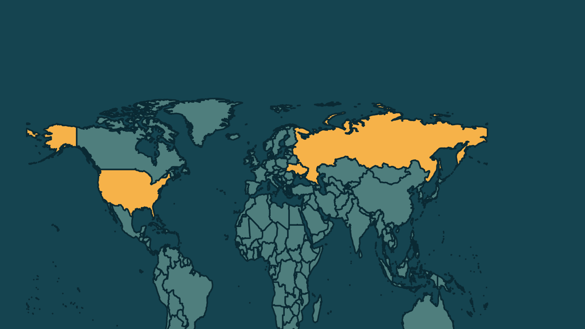

# EUA sugerem saída do Donbass em troca de entrada na Otan, diz Zelensky

*Heimdall News, edição internacional. 14 de novembro de 2026*

## A notícia

O presidente da Ucrânia, Volodymyr Zelensky, afirmou que os Estados Unidos levantaram, pela primeira vez, a possibilidade de a Ucrânia deixar o Donbass, no leste do país, em troca da entrada na Organização do Tratado do Atlântico Norte. [1][2]

A ideia veio dos enviados americanos Steve Witkoff e Jared Kushner, na rodada desta semana, depois de dois dias de conversas com russos e ucranianos em Abu Dhabi, que terminaram sem avanços significativos. [3][4][5][6]

Na sexta-feira, a União Europeia definiu que 5 países vão representar a Europa nas próximas negociações: Alemanha, França, Itália, Polônia e Reino Unido. [7][8]

## Quem se manifestou

- **Volodymyr Zelensky, ucraniano, presidente:** afirmou que a Ucrânia não vai ceder território, mas que submeteria a questão a um referendo nacional se recebesse um pacote amplo de garantias de segurança. [9][10][11]
- **Dmitry Peskov, russo, porta-voz do Kremlin:** disse que a Rússia pode aceitar os europeus nas negociações quando entender que eles querem contribuir com o processo de paz. [12]
- **Friedrich Merz, alemão, chanceler:** afirmou que não haverá discussões sobre a Ucrânia sem a Ucrânia, nem sobre a Europa sem a Europa. [13]

## Reação no Brasil

Nenhum posicionamento encontrado.

## Fontes

1. G1, [EUA propõem que Ucrânia ceda território à Rússia em troca de entrada na Otan, diz Zelensky](https://g1.globo.com/mundo/noticia/2026/11/14/eua-propoem-que-ucrania-ceda-territorio-a-russia-em-troca-de-entrada-na-otan-diz-zelensky.ghtml): "afirmou que os Estados Unidos levantaram, pela primeira vez, a possibilidade de o país retirar suas tropas das áreas de Donbas, no leste ucraniano"
2. Folha de S.Paulo, [EUA propõem que Ucrânia perca território para Rússia em troca de entrada na Otan, diz Zelenski](https://www1.folha.uol.com.br/mundo/2026/11/eua-propoem-que-ucrania-perca-territorio-para-russia-em-troca-de-entrada-na-otan-diz-zelenski.shtml): "Negociadores dos Estados Unidos levantaram a possibilidade de a Ucrânia se retirar da região de Donbass em troca de uma eventual adesão à Otan"
3. Brasil de Fato, [Enfraquecido, Trump propõe que Ucrânia ceda território à Rússia por vaga na Otan](https://www.brasildefato.com.br/2026/11/14/enfraquecido-trump-propoe-que-ucrania-ceda-territorio-a-russia-por-vaga-na-otan/): "foi colocada de forma inédita pelos enviados especiais da Casa Branca durante a mais recente rodada de negociações"
4. Folha de S.Paulo, [EUA propõem que Ucrânia perca território para Rússia em troca de entrada na Otan, diz Zelenski](https://www1.folha.uol.com.br/mundo/2026/11/eua-propoem-que-ucrania-perca-territorio-para-russia-em-troca-de-entrada-na-otan-diz-zelenski.shtml): "Os enviados americanos para as negociações de paz, Steve Witkoff e Jared Kushner"
5. Brasil de Fato, [Enfraquecido, Trump propõe que Ucrânia ceda território à Rússia por vaga na Otan](https://www.brasildefato.com.br/2026/11/14/enfraquecido-trump-propoe-que-ucrania-ceda-territorio-a-russia-por-vaga-na-otan/): "A dupla conduziu dois dias de conversas a portas fechadas em Abu Dhabi, nos Emirados Árabes Unidos, com negociadores de Kiev e de Moscou"
6. Folha de S.Paulo, [EUA propõem que Ucrânia perca território para Rússia em troca de entrada na Otan, diz Zelenski](https://www1.folha.uol.com.br/mundo/2026/11/eua-propoem-que-ucrania-perca-territorio-para-russia-em-troca-de-entrada-na-otan-diz-zelenski.shtml): "na capital dos Emirados Árabes Unidos, sem avanços significativos"
7. CNN Brasil, [UE define grupo com cinco países para negociações de paz na Ucrânia](https://www.cnnbrasil.com.br/internacional/ue-define-grupo-com-cinco-paises-para-negociacoes-de-paz-na-ucrania/): "será composta por cinco grandes potências militares — o Reino Unido, que não é membro da UE, além de França, Alemanha, Itália e Polônia"
8. CNN Brasil, [UE define grupo com cinco países para negociações de paz na Ucrânia](https://www.cnnbrasil.com.br/internacional/ue-define-grupo-com-cinco-paises-para-negociacoes-de-paz-na-ucrania/): "afirmou o presidente do Conselho Europeu, António Costa, na sexta-feira (13)"
9. Folha de S.Paulo, [EUA propõem que Ucrânia perca território para Rússia em troca de entrada na Otan, diz Zelenski](https://www1.folha.uol.com.br/mundo/2026/11/eua-propoem-que-ucrania-perca-territorio-para-russia-em-troca-de-entrada-na-otan-diz-zelenski.shtml): "Zelenski reiterou que Kiev não está disposta a ceder territórios"
10. Folha de S.Paulo, [EUA propõem que Ucrânia perca território para Rússia em troca de entrada na Otan, diz Zelenski](https://www1.folha.uol.com.br/mundo/2026/11/eua-propoem-que-ucrania-perca-territorio-para-russia-em-troca-de-entrada-na-otan-diz-zelenski.shtml): "se recebesse um pacote abrangente de garantias de segurança"
11. Folha de S.Paulo, [EUA propõem que Ucrânia perca território para Rússia em troca de entrada na Otan, diz Zelenski](https://www1.folha.uol.com.br/mundo/2026/11/eua-propoem-que-ucrania-perca-territorio-para-russia-em-troca-de-entrada-na-otan-diz-zelenski.shtml): "submeteria a questão a um referendo nacional"
12. CNN Brasil, [Rússia aceitará europeus em negociações se considerar que estão prontos](https://www.cnnbrasil.com.br/internacional/russia-aceitara-europeus-em-negociacoes-se-considerar-que-estao-prontos/): "Assim que compreendermos sua intenção genuína e disposição para contribuir com o processo de paz"
13. CNN Brasil, [UE define grupo com cinco países para negociações de paz na Ucrânia](https://www.cnnbrasil.com.br/internacional/ue-define-grupo-com-cinco-paises-para-negociacoes-de-paz-na-ucrania/): "Não haverá discussões sobre a Ucrânia sem a Ucrânia, nem discussões sobre a Europa sem a Europa"
