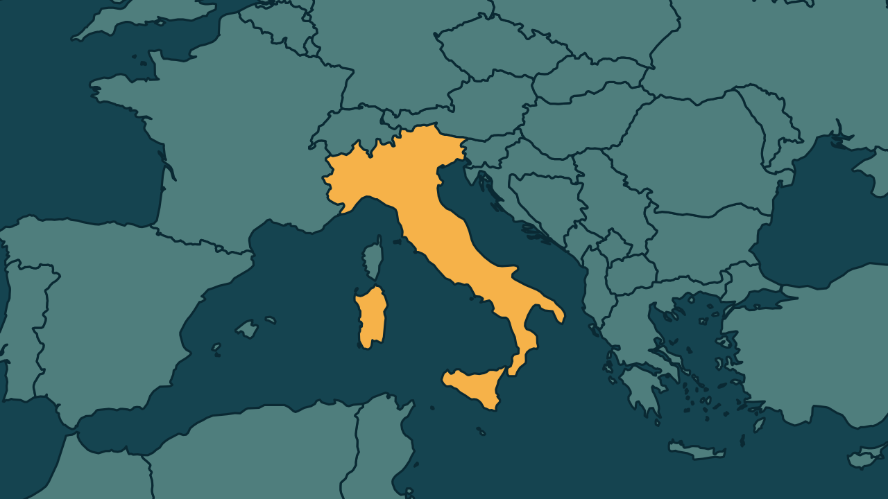

# Itália multa a Meta em 805 milhões de euros por acesso a fotos

*Heimdall News, edição internacional. 14 de novembro de 2026*

## A notícia

A autoridade de proteção de dados da Itália multou a Meta, dona do Facebook, do Instagram e do WhatsApp, em 805 milhões de euros neste sábado, por acessar fotos e vídeos de cerca de 20 milhões de usuários de Android sem informá-los nem pedir consentimento. [1][2][3]

O acesso vinha de um recurso do aplicativo do Facebook, ativado por padrão, que sugeria imagens da galeria do celular para publicar na rede social. [4][5]

A Meta tem 60 dias para desligar a função por padrão e pedir o consentimento dos usuários em separado. A multa equivale a cerca de 0,47% da receita global do grupo. [6][7]

## Quem se manifestou

- **Autoridade de Proteção de Dados da Itália, Itália:** afirmou que nem os usuários nem o próprio órgão conseguiam verificar quais imagens eram usadas, considerou tardias as mudanças feitas pela Meta depois da denúncia e rejeitou o argumento de que o caso caberia ao regulador da Irlanda. [8][9][10]
- **Meta, Estados Unidos:** negou ter usado as fotos e os vídeos para treinar modelos de inteligência artificial e defendeu que o caso fosse analisado pelo regulador da Irlanda. [11][12]

## Reação no Brasil

Nenhum posicionamento encontrado.

## Fontes

1. G1, [Itália multa Meta em R$ 5 bilhões por acessar fotos e vídeos de usuários sem consentimento](https://g1.globo.com/tecnologia/noticia/2026/11/14/italia-multa-meta.ghtml): "A autoridade de proteção de dados da Itália multou a Meta em € 805 milhões (R$ 5 bilhões) neste sábado (14)"
2. G1, [Itália multa Meta em R$ 5 bilhões por acessar fotos e vídeos de usuários sem consentimento](https://g1.globo.com/tecnologia/noticia/2026/11/14/italia-multa-meta.ghtml): "acessou fotos e vídeos de 20 milhões de usuários do sistema Android sem obter consentimento ou informá-los sobre a prática"
3. Folha de S.Paulo, [Itália multa Meta em US$ 887 milhões por acessar fotos de usuários sem consentimento](https://www1.folha.uol.com.br/tec/2026/11/italia-multa-meta-em-us-887-milhoes-por-acessar-fotos-de-usuarios-sem-consentimento.shtml): "A dona do Facebook, WhatsApp e Instagram não estava disponível para comentar imediatamente"
4. Folha de S.Paulo, [Itália multa Meta em US$ 887 milhões por acessar fotos de usuários sem consentimento](https://www1.folha.uol.com.br/tec/2026/11/italia-multa-meta-em-us-887-milhoes-por-acessar-fotos-de-usuarios-sem-consentimento.shtml): "por meio de um recurso do aplicativo do Facebook que sugeria conteúdos das galerias pessoais dos usuários para que eles pudessem postar"
5. G1, [Itália multa Meta em R$ 5 bilhões por acessar fotos e vídeos de usuários sem consentimento](https://g1.globo.com/tecnologia/noticia/2026/11/14/italia-multa-meta.ghtml): "Além disso, a função vinha ativada por padrão."
6. Folha de S.Paulo, [Itália multa Meta em US$ 887 milhões por acessar fotos de usuários sem consentimento](https://www1.folha.uol.com.br/tec/2026/11/italia-multa-meta-em-us-887-milhoes-por-acessar-fotos-de-usuarios-sem-consentimento.shtml): "A Meta tem 60 dias para desativar o recurso por padrão e solicitar o consentimento dos usuários separadamente"
7. Folha de S.Paulo, [Itália multa Meta em US$ 887 milhões por acessar fotos de usuários sem consentimento](https://www1.folha.uol.com.br/tec/2026/11/italia-multa-meta-em-us-887-milhoes-por-acessar-fotos-de-usuarios-sem-consentimento.shtml): "A multa equivale a cerca de 0,47% da receita global do grupo"
8. G1, [Itália multa Meta em R$ 5 bilhões por acessar fotos e vídeos de usuários sem consentimento](https://g1.globo.com/tecnologia/noticia/2026/11/14/italia-multa-meta.ghtml): "nem o usuário nem a própria autoridade conseguiam verificar quais informações eram efetivamente utilizadas"
9. G1, [Itália multa Meta em R$ 5 bilhões por acessar fotos e vídeos de usuários sem consentimento](https://g1.globo.com/tecnologia/noticia/2026/11/14/italia-multa-meta.ghtml): "avaliou que elas foram tardias e limitadas aos usuários que atualizaram o aplicativo"
10. G1, [Itália multa Meta em R$ 5 bilhões por acessar fotos e vídeos de usuários sem consentimento](https://g1.globo.com/tecnologia/noticia/2026/11/14/italia-multa-meta.ghtml): "A autoridade também rejeitou o argumento da Meta de que o caso deveria ser analisado pelo regulador irlandês"
11. CNN Brasil, [Itália multa Meta em 805 milhões de euros por acesso a dados de usuários](https://www.cnnbrasil.com.br/economia/money/macroeconomia/italia-multa-meta-em-805-milhoes-de-euros-por-acesso-a-dados-de-usuarios/): "a autoridade afirmou que a Meta negou ter utilizado o conteúdo para essa finalidade"
12. G1, [Itália multa Meta em R$ 5 bilhões por acessar fotos e vídeos de usuários sem consentimento](https://g1.globo.com/tecnologia/noticia/2026/11/14/italia-multa-meta.ghtml): "rejeitou o argumento da Meta de que o caso deveria ser analisado pelo regulador irlandês"
