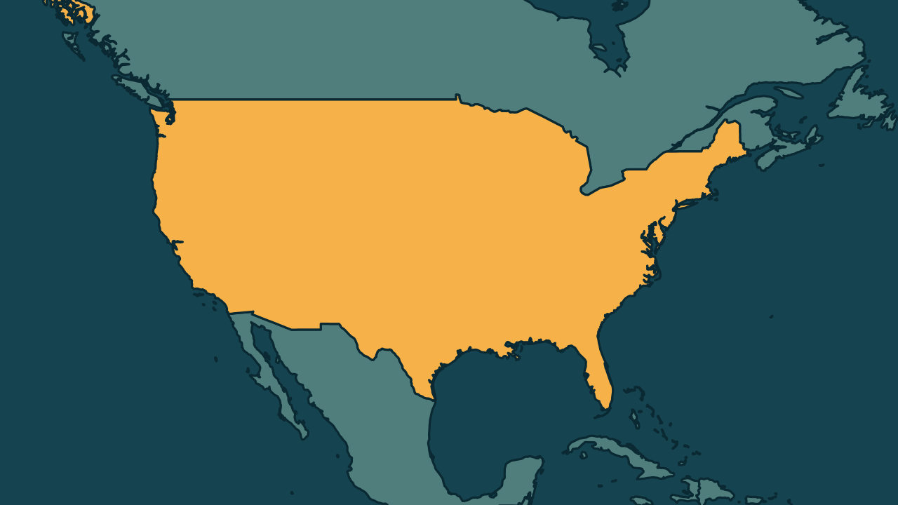

# EUA atribuem pane aérea a troca de cabos e descartam ataque hacker

*Heimdall News, edição internacional. 14 de novembro de 2026*

## A notícia

O governo dos Estados Unidos afirmou neste sábado que a pane de sexta-feira no controle do tráfego aéreo não foi um ataque hacker. A principal hipótese é uma falha na troca de cabos de cobre por fibra óptica, feita por uma empresa contratada numa instalação da Administração Federal de Aviação. [1][2][3]

As decolagens ficaram suspensas em todo o país por mais de 4 horas. Neste sábado, mais de 4 mil voos foram cancelados, segundo o site FlightAware. [4][5][6]

Alguns dos roteadores envolvidos foram fabricados em 2001. O governo ainda investiga se houve erro humano na instalação ou equipamento com defeito. [7][8]

## Quem se manifestou

- **Sean Duffy, americano, secretário de Transportes:** disse que o roteador em troca inundou os outros e que não acredita em ataque cibernético. Falta saber se foi erro humano. [9][10][11]
- **Bryan Bedford, americano, chefe da Aviação Federal:** pediu desculpas, disse não ver nada malicioso e previu a normalização até domingo. [12][13][14]
- **Donald Trump, americano, presidente:** disse que não parece ter sido ataque cibernético e culpou a infraestrutura antiga. [15][16]
- **Tammy Duckworth, americana, senadora:** pediu na sexta-feira uma investigação minuciosa e vai exigir explicações. [17][18]

## Reação no Brasil

- **GRU Airport, concessionária do Aeroporto de Guarulhos, Brasil:** informou que contou 9 cancelamentos ligados à paralisação nos Estados Unidos e que suas operações estavam normalizadas neste sábado. [19][20]
- **BH Airport, concessionária do Aeroporto de Confins, Brasil:** informou que não houve impacto significativo nas operações. [21]

## Fontes

1. Poder360, [Governo Trump atribui apagão aéreo a troca de cabos, não a hacker](https://www.poder360.com.br/poder-internacional/governo-trump-atribui-apagao-aereo-a-troca-de-cabos-nao-a-hacker/): "declarou neste sábado (14.nov.2026) não acreditar que o apagão aéreo de 6ª feira (13.nov) tenha sido provocado por ataque hacker"
2. Poder360, [Governo Trump atribui apagão aéreo a troca de cabos, não a hacker](https://www.poder360.com.br/poder-internacional/governo-trump-atribui-apagao-aereo-a-troca-de-cabos-nao-a-hacker/): "A principal hipótese é uma falha na substituição de cabos de cobre por fibra óptica em instalações da FAA"
3. Poder360, [Governo Trump atribui apagão aéreo a troca de cabos, não a hacker](https://www.poder360.com.br/poder-internacional/governo-trump-atribui-apagao-aereo-a-troca-de-cabos-nao-a-hacker/): "a manutenção feita por uma empresa contratada sobrecarregou equipamentos antigos do controle de tráfego aéreo"
4. Poder360, [Governo Trump atribui apagão aéreo a troca de cabos, não a hacker](https://www.poder360.com.br/poder-internacional/governo-trump-atribui-apagao-aereo-a-troca-de-cabos-nao-a-hacker/): "A FAA suspendeu as decolagens em todo o país por mais de 4 horas."
5. Poder360, [EUA têm mais de 4.000 voos cancelados neste sábado após suspensão aérea](https://www.poder360.com.br/poder-internacional/eua-tem-voos-cancelados-neste-sabado-apos-suspensao-aerea/): "Os Estados Unidos têm mais de 4.000 voos cancelados e 3.000 atrasados neste sábado"
6. Poder360, [EUA têm mais de 4.000 voos cancelados neste sábado após suspensão aérea](https://www.poder360.com.br/poder-internacional/eua-tem-voos-cancelados-neste-sabado-apos-suspensao-aerea/): "Os dados são da plataforma FlightAware"
7. Poder360, [Governo Trump atribui apagão aéreo a troca de cabos, não a hacker](https://www.poder360.com.br/poder-internacional/governo-trump-atribui-apagao-aereo-a-troca-de-cabos-nao-a-hacker/): "Alguns dos roteadores envolvidos foram fabricados em 2001"
8. Poder360, [Governo Trump atribui apagão aéreo a troca de cabos, não a hacker](https://www.poder360.com.br/poder-internacional/governo-trump-atribui-apagao-aereo-a-troca-de-cabos-nao-a-hacker/): "ainda investigam se a falha decorreu de erro humano na instalação ou de equipamento defeituoso"
9. Metrópoles, [EUA: governo Trump diz que troca de fios causou apagão e descarta ataque](https://www.metropoles.com/mundo/eua-governo-trump-diz-que-troca-de-fios-causou-apagao-e-descarta-ataque): "Esse roteador que estava sendo substituído começou a inundar os outros roteadores do sistema de tráfego aéreo"
10. Gazeta do Povo, [Governo dos EUA nega ataque hacker e atribui apagão aéreo a troca de cabos](https://www.gazetadopovo.com.br/mundo/eua-nega-ataque-hacker-apagao-aereo/): "Não acreditamos, de forma alguma, que tenha se tratado de um ataque cibernético"
11. Metrópoles, [EUA: governo Trump diz que troca de fios causou apagão e descarta ataque](https://www.metropoles.com/mundo/eua-governo-trump-diz-que-troca-de-fios-causou-apagao-e-descarta-ataque): "temos de determinar se foi um caso de incompetência, se foi um erro de usuário"
12. Metrópoles, [EUA: governo Trump diz que troca de fios causou apagão e descarta ataque](https://www.metropoles.com/mundo/eua-governo-trump-diz-que-troca-de-fios-causou-apagao-e-descarta-ataque): "Bryan Bedford, pediu desculpas pelo transtorno"
13. CNN Brasil, [Análise: Falha de comunicação do governo dos EUA amplia caos no setor aéreo](https://www.cnnbrasil.com.br/internacional/analise-falha-de-comunicacao-do-governo-dos-eua-amplia-caos-no-setor-aereo/): "Não vemos nenhuma evidência de algo malicioso"
14. Metrópoles, [EUA: governo Trump diz que troca de fios causou apagão e descarta ataque](https://www.metropoles.com/mundo/eua-governo-trump-diz-que-troca-de-fios-causou-apagao-e-descarta-ataque): "A previsão é que o serviço seja totalmente normalizado até este domingo (15/11)."
15. Revista Oeste, [Trump nega ataque hacker em apagão aéreo nos EUA](https://revistaoeste.com/mundo/trump-nega-ataque-hacker-em-apagao-aereo-nos-eua/): "não parece ter sido causada por ataque cibernético ou uso de inteligência artificial"
16. Poder360, [Governo Trump atribui apagão aéreo a troca de cabos, não a hacker](https://www.poder360.com.br/poder-internacional/governo-trump-atribui-apagao-aereo-a-troca-de-cabos-nao-a-hacker/): "o presidente atribuiu o problema à infraestrutura antiga da FAA"
17. CNN Brasil, com Reuters, [Senadora dos EUA pede “investigação minuciosa” sobre voos suspensos](https://www.cnnbrasil.com.br/internacional/senadora-dos-eua-pede-investigacao-minuciosa-sobre-voos-suspensos/): "ela exigirá uma investigação minuciosa e completa"
18. CNN Brasil, com Reuters, [Senadora dos EUA pede “investigação minuciosa” sobre voos suspensos](https://www.cnnbrasil.com.br/internacional/senadora-dos-eua-pede-investigacao-minuciosa-sobre-voos-suspensos/): "Vou exigir explicações da FAA"
19. Poder360, [EUA têm mais de 4.000 voos cancelados neste sábado após suspensão aérea](https://www.poder360.com.br/poder-internacional/eua-tem-voos-cancelados-neste-sabado-apos-suspensao-aerea/): "contabilizou 9 cancelamentos relacionados à paralisação nos Estados Unidos"
20. Poder360, [EUA têm mais de 4.000 voos cancelados neste sábado após suspensão aérea](https://www.poder360.com.br/poder-internacional/eua-tem-voos-cancelados-neste-sabado-apos-suspensao-aerea/): "O aeroporto afirmou que suas operações estavam normalizadas neste sábado"
21. Poder360, [EUA têm mais de 4.000 voos cancelados neste sábado após suspensão aérea](https://www.poder360.com.br/poder-internacional/eua-tem-voos-cancelados-neste-sabado-apos-suspensao-aerea/): "o BH Airport informou que não houve impacto significativo nas operações"
