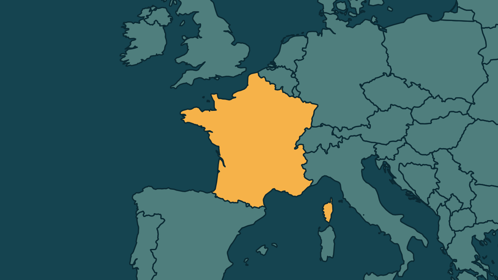

# França tem quinto sábado de protestos contra o custo de vida

*Heimdall News, edição internacional. 14 de novembro de 2026*

## A notícia

O Ministério do Interior da França contou 106 mil manifestantes neste sábado, no quinto sábado seguido de protestos contra o aumento do custo de vida. Os organizadores estimaram 200 mil pessoas. [1][2][3][4]

Os atos também se opõem a um projeto de lei que amplia a proteção jurídica de policiais que usam armas em serviço. O texto foi aprovado por parlamentares em julho e ainda precisa ser votado pelo Senado. [5][6]

Até as 18 horas, 219 pessoas tinham sido detidas. Em Lyon, uma equipe da emissora BFMTV foi agredida por manifestantes. Uma greve geral está marcada para terça-feira, dia 17, convocada pela Confederação Geral do Trabalho. [7][8][9][10]

## Quem se manifestou

- **Laurent Nuñez, francês, ministro do Interior:** afirmou que o uso da força deve respeitar a proporcionalidade e a lei. [11]
- **Ministério do Interior, França:** afirmou que a situação permaneceu globalmente sob controle. [12]
- **Sindicatos franceses, França:** rejeitaram como migalhas o reajuste de 0,6 por cento no salário mínimo. [13]
- **Partido de Marine Le Pen, França:** defende o projeto, para que policiais não sejam automaticamente suspeitos de força desproporcional. [14][15]
- **Especialistas das Nações Unidas:** afirmaram que as detenções de quase 7 mil menores foram desproporcionais. [16][17]

## Reação no Brasil

Nenhum posicionamento encontrado.

## Fontes

1. Brasil de Fato, [França tem novos protestos contra violência policial e custo de vida](https://www.brasildefato.com.br/2026/11/14/franca-tem-novos-protestos-contra-violencia-policial-e-custo-de-vida/): "106 mil manifestantes participaram dos atos em todo o território nacional"
2. Metrópoles, [Protestos na França reúnem 100 mil pessoas e equipe de TV é agredida](https://www.metropoles.com/mundo/protestos-na-franca-reunem-100-mil-pessoas-e-equipe-de-tv-e-agredida): "As mobilizações, realizadas pelo quinto sábado consecutivo"
3. Metrópoles, [Protestos na França reúnem 100 mil pessoas e equipe de TV é agredida](https://www.metropoles.com/mundo/protestos-na-franca-reunem-100-mil-pessoas-e-equipe-de-tv-e-agredida): "Mais de 100 mil pessoas foram às ruas da França neste sábado (14/11) em protestos contra o aumento do custo de vida"
4. G1, [Protestos levam mais de 100 mil pessoas às ruas na França; equipe de TV é agredida em Lyon](https://g1.globo.com/mundo/noticia/2026/11/14/protestos-levam-mais-de-100-mil-pessoas-as-ruas-na-franca-equipe-de-tv-e-agredida-em-lyon.ghtml): "Os organizadores estimam que a mobilização reuniu 200 mil manifestantes."
5. Brasil de Fato, [França tem novos protestos contra violência policial e custo de vida](https://www.brasildefato.com.br/2026/11/14/franca-tem-novos-protestos-contra-violencia-policial-e-custo-de-vida/): "a tramitação de um projeto de lei que amplia a proteção jurídica a policiais que utilizam armas em serviço"
6. CNN Brasil, [Igualdade, educação e salários altos: Manifestantes voltam às ruas de Paris](https://www.cnnbrasil.com.br/internacional/igualdade-educacao-e-salarios-altos-manifestantes-voltam-as-ruas-de-paris/): "A medida, aprovada por parlamentares em julho, ainda precisa ser votada pelo Senado francês."
7. Metrópoles, [Protestos na França reúnem 100 mil pessoas e equipe de TV é agredida](https://www.metropoles.com/mundo/protestos-na-franca-reunem-100-mil-pessoas-e-equipe-de-tv-e-agredida): "Até as 18h, no horário local, as autoridades haviam registrado 219 detenções"
8. G1, [Protestos levam mais de 100 mil pessoas às ruas na França; equipe de TV é agredida em Lyon](https://g1.globo.com/mundo/noticia/2026/11/14/protestos-levam-mais-de-100-mil-pessoas-as-ruas-na-franca-equipe-de-tv-e-agredida-em-lyon.ghtml): "Uma equipe da emissora de notícias BFMTV, formada por dois jornalistas e dois agentes de segurança, foi atacada por manifestantes"
9. Estadão, com AFP, [França tem dia de protestos contra crise econômica e lei policial; novos atos ocorrem nesta semana](https://www.estadao.com.br/internacional/franca-enfrenta-novo-dia-de-protestos-contra-crise-economica-e-lei-policial-npr/): "Para a próxima terça-feira, 17, já está prevista uma greve geral acompanhada de novos protestos"
10. Estadão, com AFP, [França tem dia de protestos contra crise econômica e lei policial; novos atos ocorrem nesta semana](https://www.estadao.com.br/internacional/franca-enfrenta-novo-dia-de-protestos-contra-crise-economica-e-lei-policial-npr/): "liderados pela Confederação Geral do Trabalho (CGT)"
11. Metrópoles, [França mobiliza 70 mil policiais para novo dia de protestos em meio à crise](https://www.metropoles.com/mundo/franca-mobiliza-70-mil-policiais-para-novo-dia-de-protestos-em-meio-a-crise): "o uso da força pelas autoridades deve respeitar os critérios de proporcionalidade e a legislação vigente"
12. Metrópoles, [Protestos na França reúnem 100 mil pessoas e equipe de TV é agredida](https://www.metropoles.com/mundo/protestos-na-franca-reunem-100-mil-pessoas-e-equipe-de-tv-e-agredida): "O órgão afirmou, em nota, que a situação permaneceu “globalmente sob controle”, apesar dos episódios de violência."
13. Estadão, com AFP, [França tem dia de protestos contra crise econômica e lei policial; novos atos ocorrem nesta semana](https://www.estadao.com.br/internacional/franca-enfrenta-novo-dia-de-protestos-contra-crise-economica-e-lei-policial-npr/): "Os sindicatos convocaram uma nova greve geral para a próxima terça-feira, após rejeitarem como “migalhas” a proposta do governo de reajustar o salário mínimo em apenas 0,6%."
14. Estadão, com AFP, [França tem dia de protestos contra crise econômica e lei policial; novos atos ocorrem nesta semana](https://www.estadao.com.br/internacional/franca-enfrenta-novo-dia-de-protestos-contra-crise-economica-e-lei-policial-npr/): "Os defensores do novo projeto de lei policial — incluindo o partido de extrema direita da principal candidata à presidência, Marine Le Pen"
15. Estadão, com AFP, [França tem dia de protestos contra crise econômica e lei policial; novos atos ocorrem nesta semana](https://www.estadao.com.br/internacional/franca-enfrenta-novo-dia-de-protestos-contra-crise-economica-e-lei-policial-npr/): "afirmam que uma nova lei é necessária para evitar que os policiais sejam automaticamente suspeitos de usar força desproporcional"
16. CNN Brasil, [Mais de 100 mil pessoas participam de protestos em toda a França](https://www.cnnbrasil.com.br/internacional/mais-de-100-mil-pessoas-participam-de-protestos-em-toda-a-franca/): "manifestaram preocupação com a detenção de quase 7 mil menores de idade durante bloqueios de escolas"
17. CNN Brasil, [Mais de 100 mil pessoas participam de protestos em toda a França](https://www.cnnbrasil.com.br/internacional/mais-de-100-mil-pessoas-participam-de-protestos-em-toda-a-franca/): "Segundo esses especialistas, as detenções foram desproporcionais."
