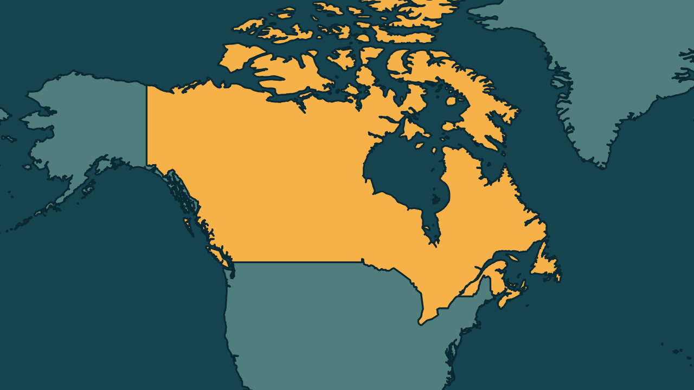

# Canadá anuncia US$ 400 milhões para fundo de florestas tropicais

*Heimdall News, edição internacional. 15 de novembro de 2026*

## A notícia

O primeiro-ministro do Canadá, Mark Carney, anunciou neste domingo um aporte de 400 milhões de dólares ao Fundo Florestas Tropicais para Sempre, durante reunião com o presidente Luiz Inácio Lula da Silva em Manila, nas Filipinas, à margem da cúpula da Associação das Nações do Sudeste Asiático. [1][2][3]

O fundo, proposto pelo Brasil, quer remunerar países que conservam suas florestas tropicais. Com o Canadá, passa de 8 bilhões de dólares em compromissos. A meta final é de 125 bilhões. [4][5][6]

Os dois também concordaram em tentar concluir nos próximos meses o acordo de livre comércio entre o Mercosul e o Canadá, e Carney aceitou visitar o Brasil no primeiro trimestre de 2027. [7][8]

## Quem se manifestou

- **Mark Carney, canadense, primeiro-ministro:** manifestou disposição de ajudar a ampliar o apoio internacional ao fundo, segundo o Itamaraty, e felicitou Lula pela vitória eleitoral e pela liderança do Brasil nas áreas social e ambiental. [9][10]

## Reação no Brasil

- **Luiz Inácio Lula da Silva, brasileiro, presidente:** escreveu que Carney anunciou o aporte ao reconhecer o caráter inovador do mecanismo e, no discurso da cúpula, disse que o fundo vai remunerar a preservação dos biomas. [11][12]

## Fontes

1. Estadão, [Canadá anuncia aporte de US$ 400 milhões a fundo de proteção de florestas após reunião com Lula](https://www.estadao.com.br/internacional/canada-anuncia-aporte-de-us-400-milhoes-a-fundo-de-protecao-de-florestas-apos-reuniao-com-lula-npr/): "O compromisso foi anunciado pelo primeiro-ministro canadense, Mark Carney, durante reunião com o presidente Luiz Inácio Lula da Silva (PT), neste domingo, 15, em Manila, nas Filipinas."
2. Estadão, [Canadá anuncia aporte de US$ 400 milhões a fundo de proteção de florestas após reunião com Lula](https://www.estadao.com.br/internacional/canada-anuncia-aporte-de-us-400-milhoes-a-fundo-de-protecao-de-florestas-apos-reuniao-com-lula-npr/): "O Canadá anunciou um aporte de US$ 400 milhões ao Fundo Florestas Tropicais para Sempre"
3. CNN Brasil, [Em encontro com Lula, Carney promete US$ 400 mi para proteção de florestas](https://www.cnnbrasil.com.br/internacional/em-encontro-com-lula-carney-promete-us-400-mi-para-protecao-de-florestas/): "durante a 49ª Cúpula da ASEAN, em Manila, nas Filipinas"
4. ND Mais, [Após reunião com Lula, Canadá confirma investimento de US$ 400 milhões para proteger florestas tropicais](https://ndmais.com.br/meio-ambiente/canada-anuncia-400-milhoes-fundo-florestas-reuniao-lula/): "O TFFF é um mecanismo financeiro proposto pelo Brasil para remunerar países que mantêm suas florestas tropicais preservadas."
5. Estadão, [Canadá anuncia aporte de US$ 400 milhões a fundo de proteção de florestas após reunião com Lula](https://www.estadao.com.br/internacional/canada-anuncia-aporte-de-us-400-milhoes-a-fundo-de-protecao-de-florestas-apos-reuniao-com-lula-npr/): "Com a contribuição do Canadá, o TFFF reúne mais de US$ 8 bilhões em compromissos financeiros."
6. Estadão, [Canadá anuncia aporte de US$ 400 milhões a fundo de proteção de florestas após reunião com Lula](https://www.estadao.com.br/internacional/canada-anuncia-aporte-de-us-400-milhoes-a-fundo-de-protecao-de-florestas-apos-reuniao-com-lula-npr/): "A meta de longo prazo é mobilizar US$ 125 bilhões."
7. Estadão, [Canadá anuncia aporte de US$ 400 milhões a fundo de proteção de florestas após reunião com Lula](https://www.estadao.com.br/internacional/canada-anuncia-aporte-de-us-400-milhoes-a-fundo-de-protecao-de-florestas-apos-reuniao-com-lula-npr/): "Os líderes concordaram em trabalhar para concluir as tratativas nos próximos meses"
8. Estadão, [Canadá anuncia aporte de US$ 400 milhões a fundo de proteção de florestas após reunião com Lula](https://www.estadao.com.br/internacional/canada-anuncia-aporte-de-us-400-milhoes-a-fundo-de-protecao-de-florestas-apos-reuniao-com-lula-npr/): "Carney aceitou o convite de Lula para visitar o Brasil no primeiro trimestre do próximo ano."
9. ND Mais, [Após reunião com Lula, Canadá confirma investimento de US$ 400 milhões para proteger florestas tropicais](https://ndmais.com.br/meio-ambiente/canada-anuncia-400-milhoes-fundo-florestas-reuniao-lula/): "o premiê manifestou disposição para ajudar a ampliar o apoio internacional ao mecanismo"
10. CNN Brasil, [Em encontro com Lula, Carney promete US$ 400 mi para proteção de florestas](https://www.cnnbrasil.com.br/internacional/em-encontro-com-lula-carney-promete-us-400-mi-para-protecao-de-florestas/): "o premiê canadense parabenizou Lula pela vitória eleitoral e pela liderança do Brasil nas áreas social e ambiental"
11. Estadão, [Canadá anuncia aporte de US$ 400 milhões a fundo de proteção de florestas após reunião com Lula](https://www.estadao.com.br/internacional/canada-anuncia-aporte-de-us-400-milhoes-a-fundo-de-protecao-de-florestas-apos-reuniao-com-lula-npr/): "Foi ao reconhecer o caráter inovador do mecanismo que o premiê Carney anunciou o aporte de 400 milhões de dólares"
12. CNN Brasil, [Nas Filipinas, Lula ataca big techs e “tarifas injustas” contra sul global](https://www.cnnbrasil.com.br/internacional/nas-filipinas-lula-ataca-big-techs-e-tarifas-injustas-contra-sul-global/): "O Fundo Florestas Tropicais para Sempre (o TFFF) vai remunerar a preservação dos nossos biomas."
