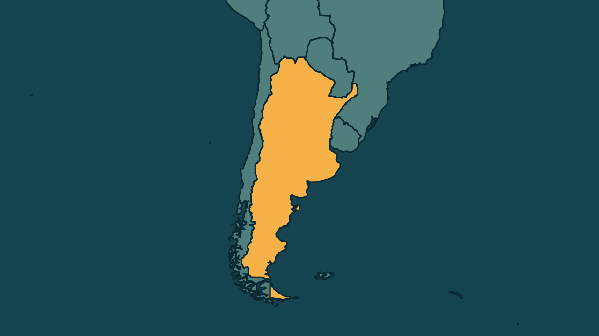

# Milei confirma que disputará a reeleição na Argentina em 2027

*Heimdall News, edição internacional. 15 de novembro de 2026*

## A notícia

O presidente da Argentina, Javier Milei, confirmou no sábado que vai disputar a reeleição. O anúncio foi feito na abertura de uma exposição no Museu da Casa Rosada, em Buenos Aires. A eleição está marcada para 24 de outubro de 2027. [1][2][3]

Milei prometeu cortar impostos em 500 bilhões de dólares até 2031, se reeleito. O valor é a redução acumulada projetada pelo governo, e não um pagamento aos contribuintes. [4][5]

A inflação anual caiu de 211,4% em 2023 para 31,5% em 2025, mas voltou a subir e chegou a 33,1% em 12 meses em outubro. O desemprego chegou a 7,9% no segundo trimestre, e a pobreza, a 32,3% no primeiro semestre. [6][7][8][9]

## Quem se manifestou

- **Javier Milei, argentino, presidente:** afirmou que o objetivo é chegar a 2031 comerciando com 90% do planeta e disse que vai continuar baixando impostos. Segundo ele, se o cenário-base se confirmar, o governo vai devolver aos argentinos 500 bilhões de dólares, valor que comparou à dívida do país. [10][11][12]

## Reação no Brasil

Nenhum posicionamento encontrado.

## Fontes

1. Folha de S.Paulo, [Milei confirma candidatura à reeleição em 2027 e promete reduzir impostos em US$ 500 bilhões](https://www1.folha.uol.com.br/mundo/2026/11/milei-confirma-candidatura-a-reeleicao-em-2027-e-promete-reduzir-impostos-em-us-500-bilhoes.shtml): "O presidente da Argentina, Javier Milei, confirmou neste sábado (14) que disputará a reeleição em 2027"
2. Metrópoles, [Milei confirma que disputará reeleição à presidência da Argentina em 2027](https://www.metropoles.com/mundo/milei-confirma-que-disputara-reeleicao-a-presidencia-da-argentina-em-2027): "A declaração foi feita durante a inauguração de uma exposição sobre Manuel Belgrano, no Museu da Casa Rosada, sede do governo argentino, em Buenos Aires."
3. Folha de S.Paulo, [Milei confirma candidatura à reeleição em 2027 e promete reduzir impostos em US$ 500 bilhões](https://www1.folha.uol.com.br/mundo/2026/11/milei-confirma-candidatura-a-reeleicao-em-2027-e-promete-reduzir-impostos-em-us-500-bilhoes.shtml): "As eleições presidenciais argentinas estão marcadas para o dia 24 de outubro de 2027."
4. Folha de S.Paulo, [Milei confirma candidatura à reeleição em 2027 e promete reduzir impostos em US$ 500 bilhões](https://www1.folha.uol.com.br/mundo/2026/11/milei-confirma-candidatura-a-reeleicao-em-2027-e-promete-reduzir-impostos-em-us-500-bilhoes.shtml): "reduzir os impostos em US$ 500 bilhões (cerca de R$ 2,82 trilhões) até 2031, caso seja eleito para um segundo mandato"
5. Folha de S.Paulo, [Milei confirma candidatura à reeleição em 2027 e promete reduzir impostos em US$ 500 bilhões](https://www1.folha.uol.com.br/mundo/2026/11/milei-confirma-candidatura-a-reeleicao-em-2027-e-promete-reduzir-impostos-em-us-500-bilhoes.shtml): "O valor se refere à redução acumulada da carga tributária projetada pelo governo, e não a um pagamento direto aos contribuintes."
6. G1, [Milei afirma que disputará reeleição na Argentina em 2027: 'Sim, estou buscando a reeleição'](https://g1.globo.com/mundo/noticia/2026/11/15/milei-reeleicao-presidencia-argentina-eleicoes-2027.ghtml): "a inflação anual argentina caiu de 211,4% em 2023 para 31,5% em 2025"
7. Folha de S.Paulo, [Milei confirma candidatura à reeleição em 2027 e promete reduzir impostos em US$ 500 bilhões](https://www1.folha.uol.com.br/mundo/2026/11/milei-confirma-candidatura-a-reeleicao-em-2027-e-promete-reduzir-impostos-em-us-500-bilhoes.shtml): "os preços voltaram a acelerar e a inflação acumulada em 12 meses chegou a 33,1% em outubro"
8. Folha de S.Paulo, [Milei confirma candidatura à reeleição em 2027 e promete reduzir impostos em US$ 500 bilhões](https://www1.folha.uol.com.br/mundo/2026/11/milei-confirma-candidatura-a-reeleicao-em-2027-e-promete-reduzir-impostos-em-us-500-bilhoes.shtml): "O desemprego chegou a 7,9% no segundo trimestre de 2026"
9. Folha de S.Paulo, [Milei confirma candidatura à reeleição em 2027 e promete reduzir impostos em US$ 500 bilhões](https://www1.folha.uol.com.br/mundo/2026/11/milei-confirma-candidatura-a-reeleicao-em-2027-e-promete-reduzir-impostos-em-us-500-bilhoes.shtml): "voltou a subir e atingiu 32,3% na primeira metade deste ano"
10. Gazeta do Povo, [Milei confirma que tentará a reeleição à presidência da Argentina em 2027](https://www.gazetadopovo.com.br/mundo/milei-reeleicao-argentina-2027/): "O objetivo é chegar a 2031 comercializando com 90% do planeta"
11. Folha de S.Paulo, [Milei confirma candidatura à reeleição em 2027 e promete reduzir impostos em US$ 500 bilhões](https://www1.folha.uol.com.br/mundo/2026/11/milei-confirma-candidatura-a-reeleicao-em-2027-e-promete-reduzir-impostos-em-us-500-bilhoes.shtml): "Vamos continuar baixando impostos e, durante todo o período, se o cenário-base se confirmar, vamos devolver aos argentinos US$ 500 bilhões"
12. Folha de S.Paulo, [Milei confirma candidatura à reeleição em 2027 e promete reduzir impostos em US$ 500 bilhões](https://www1.folha.uol.com.br/mundo/2026/11/milei-confirma-candidatura-a-reeleicao-em-2027-e-promete-reduzir-impostos-em-us-500-bilhoes.shtml): "ou seja, o equivalente ao que temos de dívida"
