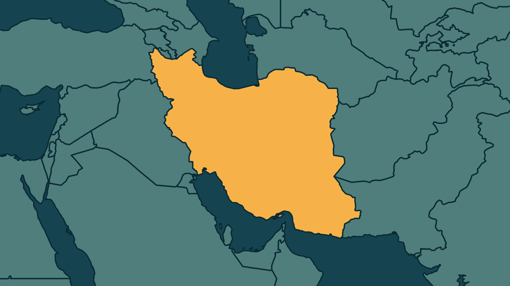

# Irã ataca o Bahrein com drones pela segunda vez em três dias

*Heimdall News, edição internacional. 15 de novembro de 2026*

## A notícia

O Bahrein afirmou neste domingo que seus sistemas de defesa aérea interceptaram e destruíram vários ataques do Irã. Foi o segundo ataque iraniano com drones contra o país em três dias. [1][2]

A Guarda Revolucionária do Irã disse ter usado 6 drones contra um radar americano na base de Riffa. O Bahrein, que abriga a Quinta Frota da Marinha dos Estados Unidos, emitiu o primeiro alerta à população desde setembro. [3][4][5][6]

Os ataques ocorrem em meio ao impasse entre Estados Unidos e Irã sobre o Estreito de Ormuz. A guerra começou em 28 de fevereiro, e um cessar-fogo vigora desde abril. [7][8][9]

## Quem se manifestou

- **Força de Defesa do Bahrein, Bahrein:** afirmou que o Irã continua com uma postura sistematicamente hostil. [10]
- **Ministério das Relações Exteriores do Bahrein, Bahrein:** afirmou que rejeita que o país vire cenário para acertos de contas e considera o Irã totalmente responsável. [11]
- **Guarda Revolucionária Islâmica, Irã:** afirmou que o Estreito de Ormuz está fechado e que qualquer agressão americana terá resposta ainda mais dura. [12]
- **Esmaeil Baghaei, iraniano, porta-voz:** afirmou que o Irã não deixará sem resposta nenhuma agressão militar americana. [13]

## Reação no Brasil

Nenhum posicionamento encontrado.

## Fontes

1. Folha de S.Paulo, [Irã ataca Bahrein e amplia escalada militar no Golfo](https://www1.folha.uol.com.br/mundo/2026/11/ira-ataca-bahrein-e-amplia-escalada-militar-no-golfo.shtml): "O Bahrein afirmou neste domingo (15) que seus sistemas de defesa aérea interceptaram e destruíram vários ataques iranianos"
2. G1, [Irã ataca o Bahrein com drones pela segunda vez em três dias](https://g1.globo.com/mundo/noticia/2026/11/15/ira-ataca-bahrein.ghtml): "O Bahrein sofreu neste domingo (15) o segundo ataque iraniano com drones em três dias"
3. Folha de S.Paulo, [Irã ataca Bahrein e amplia escalada militar no Golfo](https://www1.folha.uol.com.br/mundo/2026/11/ira-ataca-bahrein-e-amplia-escalada-militar-no-golfo.shtml): "Segundo o órgão, seis drones foram utilizados"
4. Folha de S.Paulo, [Irã ataca Bahrein e amplia escalada militar no Golfo](https://www1.folha.uol.com.br/mundo/2026/11/ira-ataca-bahrein-e-amplia-escalada-militar-no-golfo.shtml): "atacou a instalação de radares de defesa aérea dos EUA na base aérea de Riffa, no Bahrein"
5. Folha de S.Paulo, [Irã ataca Bahrein e amplia escalada militar no Golfo](https://www1.folha.uol.com.br/mundo/2026/11/ira-ataca-bahrein-e-amplia-escalada-militar-no-golfo.shtml): "abriga a Quinta Frota da Marinha dos Estados Unidos"
6. Folha de S.Paulo, [Irã ataca Bahrein e amplia escalada militar no Golfo](https://www1.folha.uol.com.br/mundo/2026/11/ira-ataca-bahrein-e-amplia-escalada-militar-no-golfo.shtml): "O país emitiu o primeiro alerta de ameaça à população desde setembro"
7. Folha de S.Paulo, [Irã ataca Bahrein e amplia escalada militar no Golfo](https://www1.folha.uol.com.br/mundo/2026/11/ira-ataca-bahrein-e-amplia-escalada-militar-no-golfo.shtml): "Os ataques mais recentes ocorrem em meio ao impasse entre Estados Unidos e Irã em torno do estreito de Hormuz"
8. G1, [Irã ataca o Bahrein com drones pela segunda vez em três dias](https://g1.globo.com/mundo/noticia/2026/11/15/ira-ataca-bahrein.ghtml): "Os países do Golfo sofreram milhares de ataques com drones e mísseis iranianos desde o início da guerra, em 28 de fevereiro."
9. Folha de S.Paulo, [Irã ataca Bahrein e amplia escalada militar no Golfo](https://www1.folha.uol.com.br/mundo/2026/11/ira-ataca-bahrein-e-amplia-escalada-militar-no-golfo.shtml): "apesar do cessar-fogo firmado em abril"
10. Folha de S.Paulo, [Irã ataca Bahrein e amplia escalada militar no Golfo](https://www1.folha.uol.com.br/mundo/2026/11/ira-ataca-bahrein-e-amplia-escalada-militar-no-golfo.shtml): "O Irã continua com sua postura sistematicamente hostil"
11. G1, [Irã ataca o Bahrein com drones pela segunda vez em três dias](https://g1.globo.com/mundo/noticia/2026/11/15/ira-ataca-bahrein.ghtml): "rejeita que seu território se transforme em um cenário para acertos de contas e considera o Irã totalmente responsável por estes ataques"
12. G1, [Irã ataca o Bahrein com drones pela segunda vez em três dias](https://g1.globo.com/mundo/noticia/2026/11/15/ira-ataca-bahrein.ghtml): "O Estreito de Ormuz está fechado e qualquer agressão do inimigo americano receberá uma resposta ainda mais dura e contundente"
13. Folha de S.Paulo, [Irã ataca Bahrein e amplia escalada militar no Golfo](https://www1.folha.uol.com.br/mundo/2026/11/ira-ataca-bahrein-e-amplia-escalada-militar-no-golfo.shtml): "afirmou que o país não deixará sem resposta nenhuma agressão militar americana ou de outras partes"
