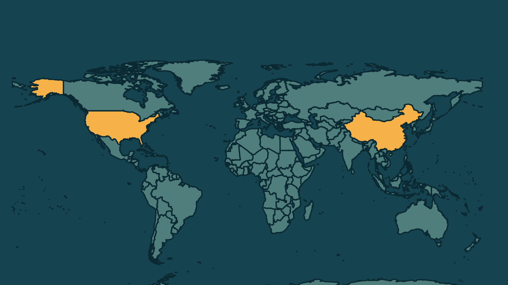

# Congresso dos EUA quer barrar chips para a China após caso Nvidia

*Heimdall News, edição internacional. 15 de novembro de 2026*

## A notícia

O Congresso dos Estados Unidos acelerou projetos para restringir o acesso da China a chips avançados de inteligência artificial. O impulso veio depois que Jensen Huang deixou o comando da Nvidia, na quinta-feira, após a revelação de um caso com Alice Huang, ex-executiva da Megaspeed, de Singapura, suspeita de atuar para a inteligência chinesa. A China nega. [1][2][3][4]

Um dos projetos barra o uso à distância, pela nuvem, de chips que empresas chinesas não podem comprar. Deputados pediram a votação imediata de 4 projetos, que devem entrar na lei anual de gastos de defesa, raramente vetada. [5][6][7][8]

Neste domingo, a Megaspeed afirmou que Alice Huang deixou a empresa em agosto de 2025. [9]

## Quem se manifestou

- **John Moolenaar, americano, deputado:** escreveu, com os deputados Brian Mast e Rick Crawford, que é preciso saber em que medida a segurança nacional foi colocada em risco. [10][11]
- **Scott Bessent, americano, secretário do Tesouro:** afirmou neste domingo que a Nvidia deveria procurar o próximo presidente-executivo fora da empresa, porque precisa de uma reformulação drástica. [12][13]
- **Megaspeed, Singapura:** afirmou que as reportagens trazem alegações sem evidências verificáveis e que atua dentro da lei. [14][15]

## Reação no Brasil

Nenhum posicionamento encontrado.

## Fontes

1. Poder360, [Congresso dos EUA quer restringir chips para a China após caso Nvidia](https://www.poder360.com.br/poder-tech/congresso-dos-eua-quer-restringir-chips-para-a-china-apos-caso-nvidia/): "O Congresso dos Estados Unidos acelerou a tramitação de projetos de lei para restringir o acesso de empresas da China a processadores avançados de IA"
2. Revista Oeste, [Ex-CEO da Nvidia teve terceiro caso com funcionária da empresa](https://revistaoeste.com/mundo/ex-ceo-da-nvidia-teve-terceiro-caso-com-funcionaria-da-empresa/): "renunciou ao cargo em 12 de novembro de 2026 depois da revelação de múltiplos relacionamentos extraconjugais"
3. Folha de S.Paulo, [Após caso Nvidia, aliados de Trump correm para aprovar restrição a chips para China](https://c-level.folha.uol.com.br/ia/2026/11/apos-caso-nvidia-aliados-de-trump-correm-para-aprovar-restricao-a-chips-para-china.shtml): "enquanto a mulher, Alice Huang, é suspeita de trabalhar para a inteligência chinesa"
4. G1, [Megaspeed afirma que Alice Huang deixou a empresa em agosto de 2025](https://g1.globo.com/mundo/noticia/2026/11/15/nvidia-megaspeed-alice-huang-espionagem-china-estados-unidos.ghtml): "Pequim nega categoricamente as acusações de espionagem."
5. Folha de S.Paulo, [Após caso Nvidia, aliados de Trump correm para aprovar restrição a chips para China](https://c-level.folha.uol.com.br/ia/2026/11/apos-caso-nvidia-aliados-de-trump-correm-para-aprovar-restricao-a-chips-para-china.shtml): "impediria empresas chinesas de acessar remotamente chips no exterior por meio de serviços de nuvem"
6. Poder360, [Congresso dos EUA quer restringir chips para a China após caso Nvidia](https://www.poder360.com.br/poder-tech/congresso-dos-eua-quer-restringir-chips-para-a-china-apos-caso-nvidia/): "cobraram a votação imediata de 4 projetos de fiscalização"
7. Poder360, [Congresso dos EUA quer restringir chips para a China após caso Nvidia](https://www.poder360.com.br/poder-tech/congresso-dos-eua-quer-restringir-chips-para-a-china-apos-caso-nvidia/): "A estratégia dos congressistas é incorporar as restrições ao texto final da NDAA"
8. Poder360, [Congresso dos EUA quer restringir chips para a China após caso Nvidia](https://www.poder360.com.br/poder-tech/congresso-dos-eua-quer-restringir-chips-para-a-china-apos-caso-nvidia/): "raramente sofre veto presidencial"
9. CNN Brasil, com Reuters, [Caso Nvidia: Megaspeed diz que Alice Huang deixou empresa em agosto de 2025](https://www.cnnbrasil.com.br/economia/money/negocios/caso-nvidia-megaspeed-diz-que-alice-huang-deixou-empresa-em-agosto-de-2025/): "afirmou neste domingo (15) que a empresária chinesa Alice Huang deixou oficialmente a companhia em agosto de 2025"
10. Folha de S.Paulo, [Após caso Nvidia, aliados de Trump correm para aprovar restrição a chips para China](https://c-level.folha.uol.com.br/ia/2026/11/apos-caso-nvidia-aliados-de-trump-correm-para-aprovar-restricao-a-chips-para-china.shtml): "Os republicanos John Moolenaar, Brian Mast e Rick Crawford"
11. Folha de S.Paulo, [Após caso Nvidia, aliados de Trump correm para aprovar restrição a chips para China](https://c-level.folha.uol.com.br/ia/2026/11/apos-caso-nvidia-aliados-de-trump-correm-para-aprovar-restricao-a-chips-para-china.shtml): ""Precisamos saber em que medida nossa segurança nacional foi colocada em risco", escreveram"
12. G1, [Secretário do Tesouro dos EUA defende que Nvidia busque novo CEO fora da empresa após saída de Jensen Huang](https://g1.globo.com/tecnologia/noticia/2026/11/15/eua-bessent-nvidia-novo-ceo-jensen-huang.ghtml): "afirmou neste domingo (15) que a Nvidia deveria procurar fora da empresa seu próximo presidente-executivo"
13. G1, [Secretário do Tesouro dos EUA defende que Nvidia busque novo CEO fora da empresa após saída de Jensen Huang](https://g1.globo.com/tecnologia/noticia/2026/11/15/eua-bessent-nvidia-novo-ceo-jensen-huang.ghtml): "eles precisam de uma reformulação drástica"
14. CNN Brasil, com Reuters, [Caso Nvidia: Megaspeed diz que Alice Huang deixou empresa em agosto de 2025](https://www.cnnbrasil.com.br/economia/money/negocios/caso-nvidia-megaspeed-diz-que-alice-huang-deixou-empresa-em-agosto-de-2025/): "alegações sobre nossos negócios, cadeia de suprimentos e operações globais que não são respaldadas por evidências verificáveis"
15. CNN Brasil, com Reuters, [Caso Nvidia: Megaspeed diz que Alice Huang deixou empresa em agosto de 2025](https://www.cnnbrasil.com.br/economia/money/negocios/caso-nvidia-megaspeed-diz-que-alice-huang-deixou-empresa-em-agosto-de-2025/): "conduz atividades legítimas e dentro da lei e que contratou assessoria jurídica externa"
