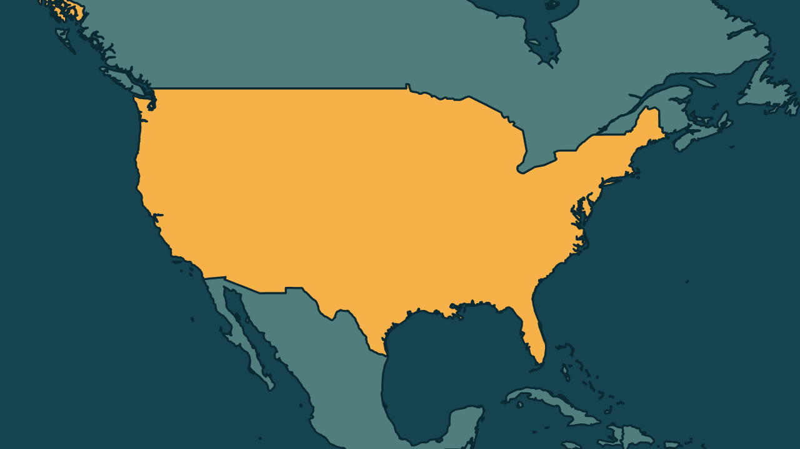

# Governo Trump pede 50 bilhões de dólares ao Congresso após pane aérea

*Heimdall News, edição internacional. 15 de novembro de 2026*

## A notícia

O presidente dos Estados Unidos, Donald Trump, cobrou neste domingo que o Congresso libere recursos para modernizar o controle do tráfego aéreo, dois dias depois da pane que suspendeu os voos em todo o país por mais de 4 horas. [1][2]

O secretário de Transportes, Sean Duffy, elevou o pedido de cerca de 30 bilhões para 50 bilhões de dólares. Os democratas, que assumem a maioria em janeiro, lembram que uma lei do ano passado já destinou 12,5 bilhões à agência de aviação. [3][4]

O governo disse que os transtornos devem seguir até segunda-feira. Desde sexta, mais de 30 mil voos foram afetados. [5][6]

## Quem se manifestou

- **Donald Trump, americano, presidente:** culpou o governo de Joe Biden e pediu que o Congresso libere o dinheiro rapidamente. [7][8]
- **Sean Duffy, americano, secretário de Transportes:** disse que não pode usar os 12,5 bilhões numa nova rede e rejeitou os pedidos de renúncia. [9][10]
- **Mike Johnson, americano, presidente da Câmara:** disse no sábado que vai incluir o dinheiro num próximo pacote de leis. [11]
- **Chris Van Hollen, americano, senador:** disse que apoia o valor necessário, mas que o governo precisa justificar o pedido. [12][13]

## Reação no Brasil

Nenhum posicionamento encontrado.

## Fontes

1. Metrópoles, [Trump cobra recursos do Congresso após governo atribuir caos aéreo a Biden](https://www.metropoles.com/mundo/trump-cobra-recursos-do-congresso-apos-governo-atribuir-caos-aereo-a-biden): "cobrou neste domingo (15/11) que o Congresso libere recursos para modernizar o sistema de controle de tráfego aéreo do país"
2. Metrópoles, [Trump cobra recursos do Congresso após governo atribuir caos aéreo a Biden](https://www.metropoles.com/mundo/trump-cobra-recursos-do-congresso-apos-governo-atribuir-caos-aereo-a-biden): "provocar a suspensão nacional de voos por mais de quatro horas"
3. CNN Brasil, [Trump cobra Congresso por investimentos no setor aéreo e democratas rebatem](https://www.cnnbrasil.com.br/internacional/trump-cobra-congresso-por-investimentos-no-setor-aereo-e-democratas-rebatem/): "Duffy havia pedido ao Congresso cerca de US$ 30 bilhões, mas após o incidente de sexta-feira, ele elevou o pedido para US$ 50 bilhões"
4. CNN Brasil, [Trump cobra Congresso por investimentos no setor aéreo e democratas rebatem](https://www.cnnbrasil.com.br/internacional/trump-cobra-congresso-por-investimentos-no-setor-aereo-e-democratas-rebatem/): "os democratas, que assumirão a maioria em janeiro, apontam para uma legislação aprovada pelos republicanos no ano passado que já destinou US$ 12,5 bilhões à agência"
5. Poder360, [Transtornos em voos nos EUA devem seguir até 2ª feira, diz governo](https://www.poder360.com.br/poder-internacional/transtornos-em-voos-nos-eua-devem-seguir-ate-2a-feira-diz-governo/): "os transtornos no transporte aéreo norte-americano devem continuar até 2ª feira"
6. Folha de S.Paulo, [Trump culpa Biden por caos aéreo; problemas devem persistir até segunda](https://www1.folha.uol.com.br/mundo/2026/11/trump-culpa-biden-por-caos-aereo-problemas-devem-persistir-ate-segunda.shtml): "Desde a sexta-feira, a quantidade de voos afetados supera 30 mil."
7. Gazeta do Povo, [Trump culpa Biden por caos aéreo e cobra verba do Congresso para modernizar sistema](https://www.gazetadopovo.com.br/mundo/trump-biden-caos-aereo/): "A administração Biden foi um desastre para a FAA"
8. Metrópoles, [Trump cobra recursos do Congresso após governo atribuir caos aéreo a Biden](https://www.metropoles.com/mundo/trump-cobra-recursos-do-congresso-apos-governo-atribuir-caos-aereo-a-biden): "Precisamos que o Congresso libere o dinheiro, rapidamente"
9. CNN Brasil, [Trump cobra Congresso por investimentos no setor aéreo e democratas rebatem](https://www.cnnbrasil.com.br/internacional/trump-cobra-congresso-por-investimentos-no-setor-aereo-e-democratas-rebatem/): "Não tenho nenhum dinheiro desses US$ 12,5 bilhões que eu possa usar para uma nova arquitetura de telecomunicações"
10. Folha de S.Paulo, [Trump culpa Biden por caos aéreo; problemas devem persistir até segunda](https://www1.folha.uol.com.br/mundo/2026/11/trump-culpa-biden-por-caos-aereo-problemas-devem-persistir-ate-segunda.shtml): "Duffy rejeitou categoricamente os pedidos para que renunciasse"
11. CNN Brasil, [Trump cobra Congresso por investimentos no setor aéreo e democratas rebatem](https://www.cnnbrasil.com.br/internacional/trump-cobra-congresso-por-investimentos-no-setor-aereo-e-democratas-rebatem/): "disse no sábado que acrescentaria o financiamento da FAA a um próximo"
12. CNN Brasil, [Trump cobra Congresso por investimentos no setor aéreo e democratas rebatem](https://www.cnnbrasil.com.br/internacional/trump-cobra-congresso-por-investimentos-no-setor-aereo-e-democratas-rebatem/): "Vou apoiar qualquer nível de recursos que seja necessário para resolver esse problema"
13. CNN Brasil, [Trump cobra Congresso por investimentos no setor aéreo e democratas rebatem](https://www.cnnbrasil.com.br/internacional/trump-cobra-congresso-por-investimentos-no-setor-aereo-e-democratas-rebatem/): "Se precisam de mais, devem vir aqui e justificar."
