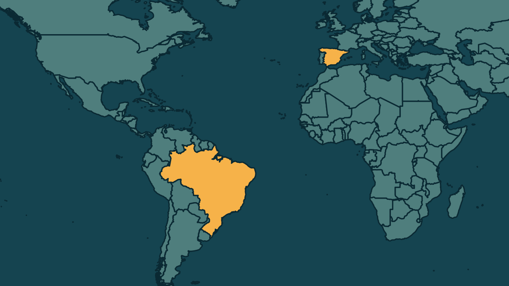

# Lula se reúne com Sánchez em Madri a 13 dias da eleição na Espanha

*Heimdall News, edição internacional. 16 de novembro de 2026*

## A notícia

O presidente Lula se reuniu nesta segunda-feira com o primeiro-ministro da Espanha, Pedro Sánchez, no Palácio da Moncloa, em Madri. A parada encerra a primeira viagem de Lula ao exterior depois da reeleição, que passou pela Turquia e pelas Filipinas. [1][2][3][4]

A Espanha vota em 29 de novembro. O Partido Popular lidera as pesquisas, e o Partido Socialista Operário Espanhol, de Sánchez, oscila entre 26% e 29%. A visita foi articulada pelos socialistas. [5][6][7][8]

Um ato público de campanha com os dois foi cancelado por causa da rouquidão de Lula. Eles posaram para fotos, mas não falaram à imprensa. [9][10]

## Quem se manifestou

- **Pedro Sánchez, espanhol, primeiro-ministro:** afirmou, num ato de campanha depois do segundo turno no Brasil, que “se o Brasil pode, a Espanha também pode”. [11]
- **Isabel Díaz Ayuso, espanhola, presidente da Comunidade de Madri:** disse que Lula estaria na Espanha só para dar conselhos sobre como se vive na prisão. [12]
- **Hermann Tertsch, espanhol, eurodeputado:** escreveu na rede X que Lula vem dar a Sánchez “as últimas lições para o estelionato eleitoral”, sem apresentar provas. [13][14]

## Reação no Brasil

- **Luiz Inácio Lula da Silva, brasileiro, presidente:** disse, em Manila, que sua eleição criou uma expectativa global por salvar o multilateralismo e a democracia. [15]
- **André Janones, brasileiro, deputado:** veio na comitiva de Lula, gravou vídeo com apoiadores na porta do hotel e disse que deve voltar à Espanha em breve. [16][17]

## Fontes

1. Folha de S.Paulo, [Lula se reúne com Sánchez em Madri a dias da eleição na Espanha](https://www1.folha.uol.com.br/mundo/2026/11/lula-se-reune-com-sanchez-em-madri-a-dias-da-eleicao-na-espanha.shtml): "o presidente Luiz Inácio Lula da Silva (PT) se reuniu nesta segunda-feira (16) com o primeiro-ministro espanhol, o socialista Pedro Sánchez"
2. Folha de S.Paulo, [Lula se reúne com Sánchez em Madri a dias da eleição na Espanha](https://www1.folha.uol.com.br/mundo/2026/11/lula-se-reune-com-sanchez-em-madri-a-dias-da-eleicao-na-espanha.shtml): "no Palácio da Moncloa, sede do governo em Madri"
3. G1, [Lula se reúne nesta segunda com Sánchez na Espanha e encerra primeiro giro pelo exterior após reeleição](https://g1.globo.com/politica/noticia/2026/11/16/lula-se-reune-nesta-segunda-com-sanchez-na-espanha-e-encerra-primeiro-giro-pelo-exterior-apos-reeleicao.ghtml): "Lula realiza sua primeira viagem internacional após ser reeleito para o quarto mandato presidencial"
4. Folha de S.Paulo, [Lula se reúne com Sánchez em Madri a dias da eleição na Espanha](https://www1.folha.uol.com.br/mundo/2026/11/lula-se-reune-com-sanchez-em-madri-a-dias-da-eleicao-na-espanha.shtml): "que desembarcou na Espanha depois de participar da COP31, na Turquia, e da cúpula da Asean"
5. Poder360, [Lula chega a Madri para se reunir com Pedro Sánchez](https://www.poder360.com.br/poder-governo/lula-chega-a-madri-para-se-reunir-com-pedro-sanchez/): "A eleição no país será realizada em 29 de novembro."
6. Folha de S.Paulo, [Lula se reúne com Sánchez em Madri a dias da eleição na Espanha](https://www1.folha.uol.com.br/mundo/2026/11/lula-se-reune-com-sanchez-em-madri-a-dias-da-eleicao-na-espanha.shtml): "o PP (Partido Popular), que lidera nas intenções de voto"
7. CNN Brasil, [Sánchez enfrenta dificuldades para mobilizar esquerda desiludida na Espanha](https://www.cnnbrasil.com.br/internacional/sanchez-enfrenta-dificuldades-para-mobilizar-esquerda-desiludida-na-espanha/): "o apoio ao seu partido ainda oscila em torno dos 26% a 29%"
8. Folha de S.Paulo, [Lula se reúne com Sánchez em Madri a dias da eleição na Espanha](https://www1.folha.uol.com.br/mundo/2026/11/lula-se-reune-com-sanchez-em-madri-a-dias-da-eleicao-na-espanha.shtml): "A visita à capital espanhola foi articulada pelo PSOE (Partido Socialista Operário Espanhol)"
9. Folha de S.Paulo, [Lula se reúne com Sánchez em Madri a dias da eleição na Espanha](https://www1.folha.uol.com.br/mundo/2026/11/lula-se-reune-com-sanchez-em-madri-a-dias-da-eleicao-na-espanha.shtml): "A rouquidão do petista, contudo, impediu a concretização do plano de haver um ato público de Sánchez com a participação de Lula."
10. Folha de S.Paulo, [Lula se reúne com Sánchez em Madri a dias da eleição na Espanha](https://www1.folha.uol.com.br/mundo/2026/11/lula-se-reune-com-sanchez-em-madri-a-dias-da-eleicao-na-espanha.shtml): "posaram juntos no começo do encontro, mas não fizeram declarações à imprensa"
11. Poder360, [Lula muda rota de viagem e vai à Espanha para encontrar Sánchez](https://www.poder360.com.br/poder-governo/lula-muda-rota-de-viagem-e-vai-a-espanha-para-encontrar-sanchez/): "Em ato de campanha 1 dia após o 2º turno das eleições presidenciais, o primeiro-ministro afirmou que “se o Brasil pode, a Espanha também pode”"
12. Gazeta do Povo, [Governadora de Madri ironiza Lula por prisão durante ato de campanha na Espanha](https://www.gazetadopovo.com.br/mundo/governadora-madri-ironiza-lula-prisao-campanha-espanha/): "Mas acredito que ele só esteja aqui para dar conselhos sobre como se vive na prisão"
13. Gazeta do Povo, [Direita da Espanha critica Lula por viagem para apoiar premiê socialista: “Mestre da fraude eleitoral”](https://www.gazetadopovo.com.br/mundo/direita-espanha-critica-lula-viagem-apoiar-premie-socialista/): "vem à Espanha para dar a Sánchez as últimas lições para o estelionato eleitoral"
14. Folha de S.Paulo, [Lula se reúne com Sánchez em Madri a dias da eleição na Espanha](https://www1.folha.uol.com.br/mundo/2026/11/lula-se-reune-com-sanchez-em-madri-a-dias-da-eleicao-na-espanha.shtml): "fez acusações sem comprovação ao presidente brasileiro"
15. Poder360, [Lula chega a Madri para se reunir com Pedro Sánchez](https://www.poder360.com.br/poder-governo/lula-chega-a-madri-para-se-reunir-com-pedro-sanchez/): "sua eleição criou uma expectativa global por “salvar o multilateralismo, a democracia e a participação da sociedade nas decisões”"
16. Folha de S.Paulo, [Lula se reúne com Sánchez em Madri a dias da eleição na Espanha](https://www1.folha.uol.com.br/mundo/2026/11/lula-se-reune-com-sanchez-em-madri-a-dias-da-eleicao-na-espanha.shtml): "A presença do deputado-federal na comitiva que acompanhou o presidente brasileiro a Madri"
17. Folha de S.Paulo, [Lula se reúne com Sánchez em Madri a dias da eleição na Espanha](https://www1.folha.uol.com.br/mundo/2026/11/lula-se-reune-com-sanchez-em-madri-a-dias-da-eleicao-na-espanha.shtml): "Janones gravou vídeo com apoiadores na porta do hotel e disse que deve voltar à Espanha em breve"
