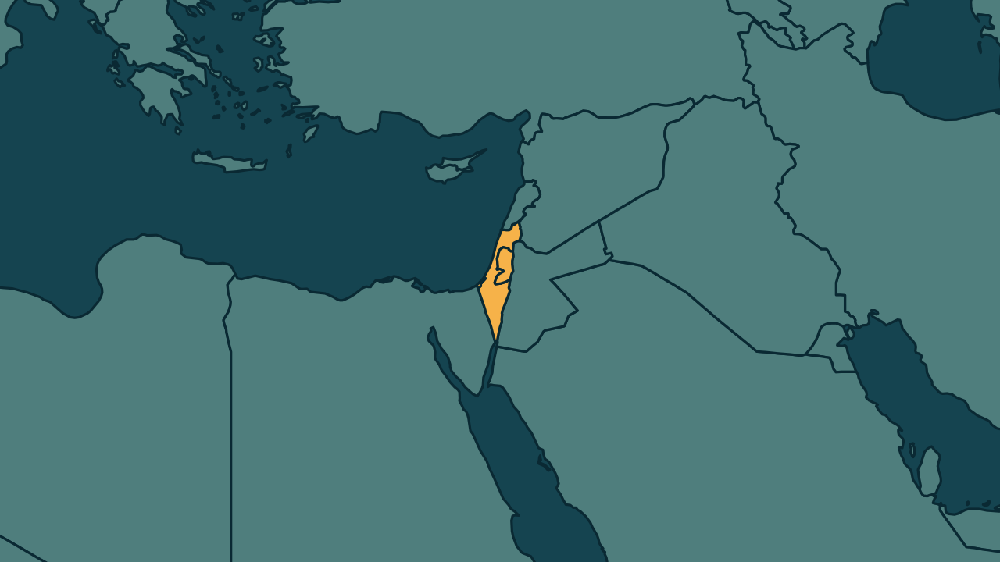

# Israel mata comandante do Hamas em Gaza durante o cessar-fogo

*Heimdall News, edição internacional. 16 de novembro de 2026*

## A notícia

O Exército de Israel e o Shin Bet, serviço de inteligência interna, anunciaram no domingo a morte de Samir Abu Younis, comandante da Brigada de Rafah, do Hamas. Ele foi atingido num ataque aéreo na noite de sábado em Al-Mawasi, no sul da Faixa de Gaza. [1][2][3]

Ele tinha assumido a brigada cerca de dois meses antes, depois que o antecessor, Nael Abu Obeid, foi morto por Israel em setembro. [4]

Segundo o Ministério da Saúde de Gaza, pelo menos 1.643 palestinos foram mortos desde o cessar-fogo de outubro de 2025. As negociações travaram no desarmamento do Hamas e na retirada das tropas de Israel. [5][6][7]

## Quem se manifestou

- **Forças de Defesa de Israel, Israel:** afirmaram, em comunicado com o Shin Bet, que Abu Younis orientava ataques contra civis e militares israelenses e trabalhava para reconstruir a capacidade militar do Hamas. [8][9]
- **Brigadas Al-Qassam, braço armado do Hamas, Palestina:** confirmaram a morte, chamaram a operação de assassinato covarde e disseram que Abu Younis foi um dos principais comandantes no planejamento do ataque de 7 de outubro de 2023 contra Israel. [10][11]

## Reação no Brasil

Nenhum posicionamento encontrado.

## Fontes

1. Brasil de Fato, [Israel mata comandante do Hamas em ataque aéreo no sul de Gaza](https://www.brasildefato.com.br/2026/11/15/israel-mata-comandante-do-hamas-em-ataque-aereo-no-sul-de-gaza/): "anunciaram, neste domingo (15), a morte de Samir Mahmoud Hassan Abu Younis, comandante da Brigada de Rafah"
2. Brasil de Fato, [Israel mata comandante do Hamas em ataque aéreo no sul de Gaza](https://www.brasildefato.com.br/2026/11/15/israel-mata-comandante-do-hamas-em-ataque-aereo-no-sul-de-gaza/): "A operação foi conduzida conjuntamente pelo Exército israelense e pelo serviço de inteligência interna Shin Bet"
3. Brasil de Fato, [Israel mata comandante do Hamas em ataque aéreo no sul de Gaza](https://www.brasildefato.com.br/2026/11/15/israel-mata-comandante-do-hamas-em-ataque-aereo-no-sul-de-gaza/): "em um ataque aéreo realizado na noite de sábado (14), na região de Al-Mawasi, a oeste de Khan Yunis, no sul da Faixa de Gaza"
4. Gazeta do Povo, [Israel anuncia morte de comandante do Hamas em ataque aéreo a Gaza](https://www.gazetadopovo.com.br/mundo/israel-morte-comandante-hamas-abu-younis/): "ocupava o comando da Brigada de Rafah havia aproximadamente dois meses, após a morte de seu antecessor, Nael Abu Obeid, em 15 de setembro"
5. Brasil de Fato, [Israel mata comandante do Hamas em ataque aéreo no sul de Gaza](https://www.brasildefato.com.br/2026/11/15/israel-mata-comandante-do-hamas-em-ataque-aereo-no-sul-de-gaza/): "Segundo o Ministério da Saúde de Gaza, os ataques israelenses desde o início do cessar-fogo provocaram pelo menos 1.643 mortes"
6. Brasil de Fato, [Israel mata comandante do Hamas em ataque aéreo no sul de Gaza](https://www.brasildefato.com.br/2026/11/15/israel-mata-comandante-do-hamas-em-ataque-aereo-no-sul-de-gaza/): "cessar-fogo anunciado em outubro de 2025"
7. Folha de S.Paulo, [Israel mata comandante do Hamas em ataque no sul de Gaza](https://www1.folha.uol.com.br/mundo/2026/11/israel-mata-comandante-do-hamas-em-ataque-no-sul-de-gaza.shtml): "os negociadores não conseguiram chegar a um acordo sobre os termos para que o Hamas se desarme e Israel retire suas tropas"
8. Gazeta do Povo, [Israel anuncia morte de comandante do Hamas em ataque aéreo a Gaza](https://www.gazetadopovo.com.br/mundo/israel-morte-comandante-hamas-abu-younis/): "ele orientava integrantes da brigada na promoção e execução de ataques contra civis israelenses e forças militares de Israel"
9. Gazeta do Povo, [Israel anuncia morte de comandante do Hamas em ataque aéreo a Gaza](https://www.gazetadopovo.com.br/mundo/israel-morte-comandante-hamas-abu-younis/): "o comandante trabalhava para reconstruir a capacidade militar da Brigada de Rafah e do próprio Hamas"
10. Folha de S.Paulo, [Israel mata comandante do Hamas em ataque no sul de Gaza](https://www1.folha.uol.com.br/mundo/2026/11/israel-mata-comandante-do-hamas-em-ataque-no-sul-de-gaza.shtml): "descreveram a ação como um assassinato covarde"
11. Folha de S.Paulo, [Israel mata comandante do Hamas em ataque no sul de Gaza](https://www1.folha.uol.com.br/mundo/2026/11/israel-mata-comandante-do-hamas-em-ataque-no-sul-de-gaza.shtml): "um dos comandantes mais importantes envolvidos no planejamento e na supervisão do ataque de 7 de outubro"
