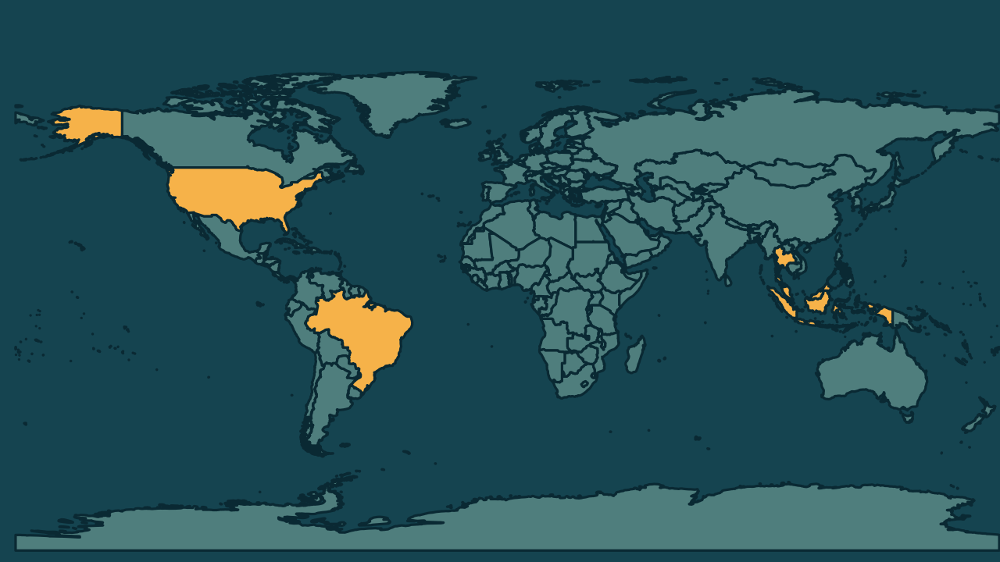

# EUA exigem licença para vender chips avançados a data centers no Brasil

*Heimdall News, edição internacional. 16 de novembro de 2026*

## A notícia

O Departamento de Comércio dos Estados Unidos publicou nesta segunda-feira uma norma que exige licença do governo americano para exportar chips avançados de inteligência artificial a data centers no Brasil, na Indonésia, na Malásia, em Singapura e na Tailândia. [1][2][3]

A norma não proíbe as compras, mas cada pedido será analisado caso a caso. O objetivo declarado é impedir que empresas chinesas usem data centers em outros países para treinar modelos com chips vetados à China. [4][5][6][7]

Envios a empresas com sede nos Estados Unidos ficam de fora. A medida sai dias antes do encontro de Donald Trump com Xi Jinping, na China. [8][9]

## Quem se manifestou

- **Departamento de Comércio, Estados Unidos:** afirmou que a regra foi feita para que as restrições ao acesso à tecnologia americana sensível não sejam contornadas por data centers em outros países, que os cinco apresentam risco de desvio acima do normal e que vai monitorar países que tolerem o descumprimento. [10][11][12]

## Reação no Brasil

Nenhum posicionamento encontrado.

## Fontes

1. Poder360, [EUA restringem venda de chips de IA para data centers no Brasil](https://www.poder360.com.br/poder-tech/eua-restringem-venda-de-chips-de-ia-para-data-centers-no-brasil/): "publicou nesta 2ª feira (16.nov.2026) uma norma que exige licença governamental para a exportação"
2. Metrópoles, [EUA restringe exportação de chips de IA e inclui Brasil na lista](https://www.metropoles.com/mundo/eua-restringe-exportacao-de-chips-de-ia-e-inclue-brasil-na-lista): "Brasil, Indonésia, Malásia, Singapura e Tailândia estão entre os países que passarão a exigir licença"
3. Brasil 247, [EUA restringem acesso do Brasil a chips da Nvidia](https://www.brasil247.com/economia/eua-restringem-acesso-do-brasil-a-chips-da-nvidia/): "precisarão obter uma licença do governo norte-americano para adquirir chips e servidores avançados de inteligência artificial"
4. Poder360, [EUA restringem venda de chips de IA para data centers no Brasil](https://www.poder360.com.br/poder-tech/eua-restringem-venda-de-chips-de-ia-para-data-centers-no-brasil/): "A norma não impede o Brasil de adquirir chips norte-americanos."
5. Folha de S.Paulo, [EUA incluem Brasil em lista de países com restrições para comprar chips para data centers](https://c-level.folha.uol.com.br/ia/2026/11/eua-incluem-brasil-em-lista-de-paises-com-restricoes-para-comprar-chips-para-data-centers.shtml): "com pedidos analisados caso a caso"
6. Folha de S.Paulo, [EUA incluem Brasil em lista de países com restrições para comprar chips para data centers](https://c-level.folha.uol.com.br/ia/2026/11/eua-incluem-brasil-em-lista-de-paises-com-restricoes-para-comprar-chips-para-data-centers.shtml): "evitar que empresas chinesas usem sedes no exterior para treinar modelos de inteligência artificial"
7. Brasil 247, [EUA restringem acesso do Brasil a chips da Nvidia](https://www.brasil247.com/economia/eua-restringem-acesso-do-brasil-a-chips-da-nvidia/): "serão avaliadas individualmente, caso a caso"
8. Poder360, [EUA restringem venda de chips de IA para data centers no Brasil](https://www.poder360.com.br/poder-tech/eua-restringem-venda-de-chips-de-ia-para-data-centers-no-brasil/): "A exigência de licença não se aplica a chips destinados a empresas com sede ou cuja controladora final tenha sede nos Estados Unidos"
9. Folha de S.Paulo, [EUA incluem Brasil em lista de países com restrições para comprar chips para data centers](https://c-level.folha.uol.com.br/ia/2026/11/eua-incluem-brasil-em-lista-de-paises-com-restricoes-para-comprar-chips-para-data-centers.shtml): "O anúncio da medida ocorre dias antes do encontro de Trump com o líder da China, Xi Jinping"
10. Folha de S.Paulo, [EUA incluem Brasil em lista de países com restrições para comprar chips para data centers](https://c-level.folha.uol.com.br/ia/2026/11/eua-incluem-brasil-em-lista-de-paises-com-restricoes-para-comprar-chips-para-data-centers.shtml): "A regra foi elaborada para garantir que as restrições existentes ao acesso a tecnologia norte-americana sensível não possam ser contornadas"
11. Metrópoles, [EUA restringe exportação de chips de IA e inclui Brasil na lista](https://www.metropoles.com/mundo/eua-restringe-exportacao-de-chips-de-ia-e-inclue-brasil-na-lista): "países que apresentam risco de desvio acima do normal"
12. Poder360, [EUA restringem venda de chips de IA para data centers no Brasil](https://www.poder360.com.br/poder-tech/eua-restringem-venda-de-chips-de-ia-para-data-centers-no-brasil/): "O Departamento de Comércio afirmou que vai monitorar ativamente países que tolerem o descumprimento da norma."
