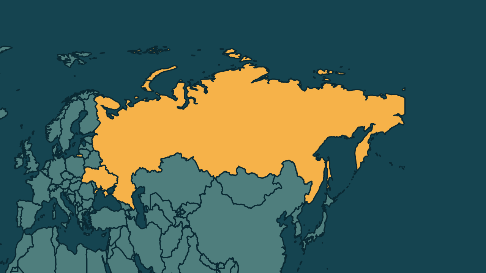

# Ucrânia faz o maior ataque com drones contra a Rússia desde 2022

*Heimdall News, edição internacional. 16 de novembro de 2026*

## A notícia

Na noite de domingo para segunda-feira, a Ucrânia fez o maior ataque com drones contra a Rússia desde 2022. A Defesa russa afirmou ter derrubado 1.336 drones em 16 regiões, acima do recorde de 1.254, de 29 de outubro. [1][2][3]

A ponte que liga a Crimeia à Rússia foi atingida, e o tráfego de carros foi suspenso para reparos. Houve incêndios em instalações industriais e numa refinaria no sul do país. Seis pessoas ficaram feridas em Krasnodar e três em Rostov. [4][5][6][7][8][9]

Os ataques continuam apesar das negociações de paz mediadas pelos Estados Unidos em Abu Dhabi na semana passada. A Rússia controla cerca de um quinto do território da Ucrânia. [10][11]

## Quem se manifestou

- **Dmitry Peskov, russo, porta-voz do Kremlin:** descreveu o ataque como massivo e disse que os danos foram insignificantes. [12][13]
- **Estado-Maior da Ucrânia, Ucrânia:** afirmou ter atingido a refinaria de Ilsky, uma das maiores do sul da Rússia, de onde o combustível chega mais rápido às tropas russas. [14][15]
- **Volodymyr Zelensky, ucraniano, presidente:** afirmou no domingo que os ataques já desativaram mais da metade do refino de petróleo da Rússia, o que não pôde ser verificado de forma independente. [16][17]

## Reação no Brasil

Nenhum posicionamento encontrado.

## Fontes

1. Revista Oeste, [Ucrânia lança mais de mil drones contra a Rússia e atinge ponte da Crimeia](https://revistaoeste.com/mundo/ucrania-lanca-mais-de-mil-drones-contra-a-russia-e-atinge-ponte-da-crimeia/): "durante a noite do domingo para esta segunda-feira, 16"
2. CNN Brasil, [Ucrânia lança maior ataque com drone contra Rússia desde o início da guerra](https://www.cnnbrasil.com.br/internacional/ucrania-lanca-maior-ataque-com-drone-contra-russia-desde-o-inicio-da-guerra/): "o maior ataque com drones contra a Rússia durante a noite desde o início da guerra em grande escala em 2022"
3. CNN Brasil, [Ucrânia lança maior ataque com drone contra Rússia desde o início da guerra](https://www.cnnbrasil.com.br/internacional/ucrania-lanca-maior-ataque-com-drone-contra-russia-desde-o-inicio-da-guerra/): "A Rússia afirmou que suas forças de defesa aérea abateram 1.336 drones ucranianos em 16 regiões, superando os 1.254 drones que haviam sido registrados como abatidos em 29 de outubro"
4. Revista Oeste, [Ucrânia lança mais de mil drones contra a Rússia e atinge ponte da Crimeia](https://revistaoeste.com/mundo/ucrania-lanca-mais-de-mil-drones-contra-a-russia-e-atinge-ponte-da-crimeia/): "outra atingiu a ponte que liga a península da Crimeia ao território russo"
5. CNN Brasil, [Ucrânia lança maior ataque com drone contra Rússia desde o início da guerra](https://www.cnnbrasil.com.br/internacional/ucrania-lanca-maior-ataque-com-drone-contra-russia-desde-o-inicio-da-guerra/): "O tráfego rodoviário foi temporariamente suspenso enquanto os reparos eram realizados"
6. CNN Brasil, [Ucrânia lança maior ataque com drone contra Rússia desde o início da guerra](https://www.cnnbrasil.com.br/internacional/ucrania-lanca-maior-ataque-com-drone-contra-russia-desde-o-inicio-da-guerra/): "incêndios deflagraram em quatro instalações industriais em Azov"
7. Metrópoles, [Maior ataque de drones ucranianos da guerra é lançado contra a Rússia](https://www.metropoles.com/mundo/maior-ataque-de-drones-ucranianos-da-guerra-e-lancado-contra-a-russia): "um incêndio também foi relatado na vila de Ilsky, onde fica uma grande refinaria de petróleo"
8. G1, [Ucrânia faz maior ataque com drones contra Rússia desde início da guerra, diz Moscou](https://g1.globo.com/mundo/noticia/2026/11/16/ucrania-faz-maior-ataque-com-drones-contra-russia-desde-inicio-da-guerra-diz-moscou.ghtml): "Seis pessoas ficaram feridas em um ataque na região de Krasnodar"
9. G1, [Ucrânia faz maior ataque com drones contra Rússia desde início da guerra, diz Moscou](https://g1.globo.com/mundo/noticia/2026/11/16/ucrania-faz-maior-ataque-com-drones-contra-russia-desde-inicio-da-guerra-diz-moscou.ghtml): "outras três pessoas ficaram feridas em ataques com drones na cidade de Azov"
10. CNN Brasil, [Ucrânia lança maior ataque com drone contra Rússia desde o início da guerra](https://www.cnnbrasil.com.br/internacional/ucrania-lanca-maior-ataque-com-drone-contra-russia-desde-o-inicio-da-guerra/): "Os ataques continuaram apesar das negociações de paz mediadas pelos EUA em Abu Dhabi na semana passada"
11. CNN Brasil, [Ucrânia lança maior ataque com drone contra Rússia desde o início da guerra](https://www.cnnbrasil.com.br/internacional/ucrania-lanca-maior-ataque-com-drone-contra-russia-desde-o-inicio-da-guerra/): "A Rússia controla cerca de um quinto do território ucraniano"
12. Metrópoles, [Maior ataque de drones ucranianos da guerra é lançado contra a Rússia](https://www.metropoles.com/mundo/maior-ataque-de-drones-ucranianos-da-guerra-e-lancado-contra-a-russia): "descreveu o ataque como “massivo”"
13. G1, [Ucrânia faz maior ataque com drones contra Rússia desde início da guerra, diz Moscou](https://g1.globo.com/mundo/noticia/2026/11/16/ucrania-faz-maior-ataque-com-drones-contra-russia-desde-inicio-da-guerra-diz-moscou.ghtml): "afirmou que o ataque provocou apenas danos "insignificantes""
14. Metrópoles, [Maior ataque de drones ucranianos da guerra é lançado contra a Rússia](https://www.metropoles.com/mundo/maior-ataque-de-drones-ucranianos-da-guerra-e-lancado-contra-a-russia): "confirmando que seus drones atingiram a refinaria de Ilsky, uma das maiores do sul da Rússia"
15. Metrópoles, [Maior ataque de drones ucranianos da guerra é lançado contra a Rússia](https://www.metropoles.com/mundo/maior-ataque-de-drones-ucranianos-da-guerra-e-lancado-contra-a-russia): "daqui, o combustível tem o caminho mais curto para as forças russas nas linhas de frente e na Crimeia ocupada"
16. G1, [Ucrânia faz maior ataque com drones contra Rússia desde início da guerra, diz Moscou](https://g1.globo.com/mundo/noticia/2026/11/16/ucrania-faz-maior-ataque-com-drones-contra-russia-desde-inicio-da-guerra-diz-moscou.ghtml): "afirmou que os ataques de seu país já desativaram mais de 55% da capacidade de refino de petróleo da Rússia"
17. G1, [Ucrânia faz maior ataque com drones contra Rússia desde início da guerra, diz Moscou](https://g1.globo.com/mundo/noticia/2026/11/16/ucrania-faz-maior-ataque-com-drones-contra-russia-desde-inicio-da-guerra-diz-moscou.ghtml): "A informação também não pôde ser verificada de forma independente"
